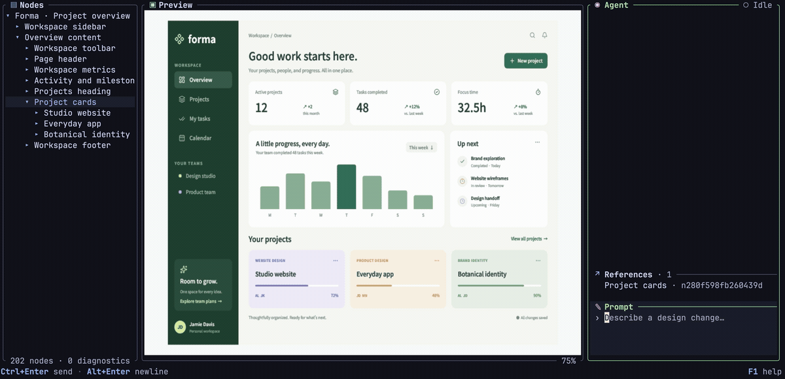
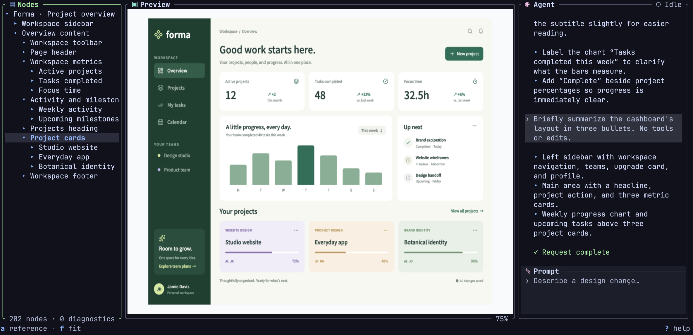
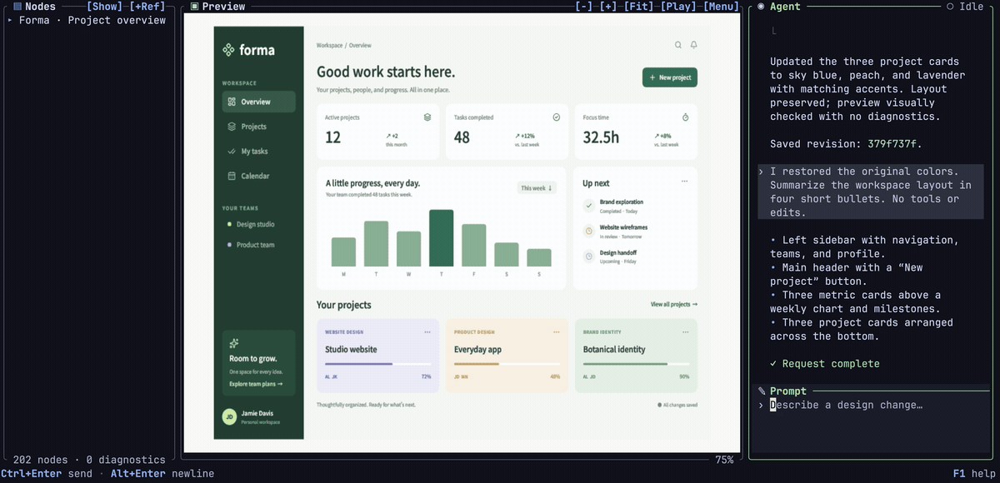
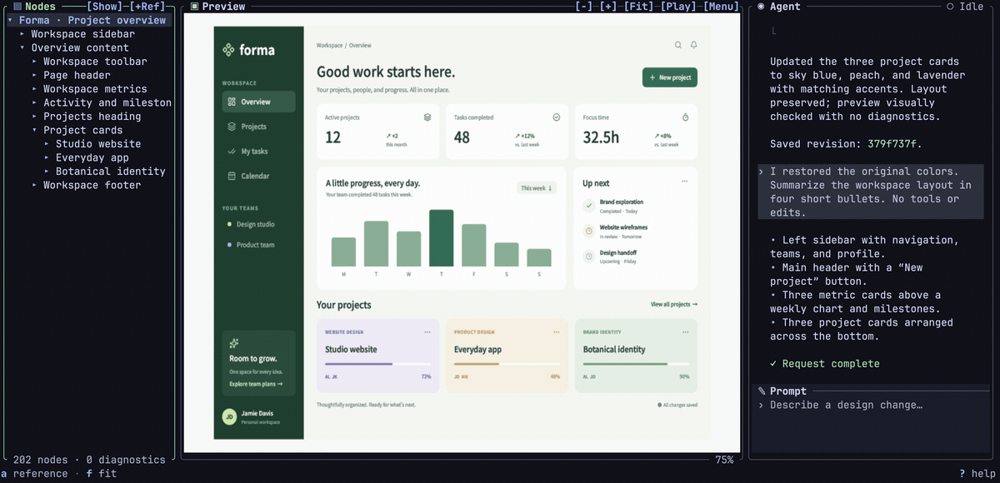

# lazypencil

**Design interfaces with AI, from your terminal.**

Create and compare UI ideas before implementation. Describe a screen or a change
to Codex or Claude, review the preview, and keep the editable `.pen` design beside
your code. lazypencil is open source and works with your existing AI client or its
own terminal workspace.

[Install](#install) · [Quick start](#quick-start) ·
[Example gallery](examples/README.md) · [日本語ではじめる](docs/getting-started.ja.md)

## Demo

[](docs/media/lazypencil-demo.mp4)

[Watch or download the video](docs/media/lazypencil-demo.mp4).
Select an element, pan and zoom, then ask Codex to recolor the project cards.
AI waiting time is shortened in this recording.

<details>
<summary>Screenshot and editable example</summary>



Open the editable [project dashboard](examples/project-dashboard.pen), or choose
another design from the [gallery](examples/README.md).

</details>

## Supported environment

macOS Tahoe 26 or later on Apple Silicon.
For the terminal workspace's image preview, use Kitty or WezTerm. Other preview
options are described in [terminal graphics](docs/tui.md#terminal-image-previews).

## Install

Install from the [Homebrew tap](https://github.com/EkeMinusYou/homebrew-lazypencil):

```sh
brew install --cask ekeminusyou/lazypencil/lazypencil
```

To update an existing installation, run `brew upgrade --cask lazypencil`.

For manual installation, download `lazypencil-0.2.6-aarch64-apple-darwin.tar.gz`
from [GitHub Releases](https://github.com/EkeMinusYou/lazypencil/releases), then:

```sh
tar -xzf lazypencil-0.2.6-aarch64-apple-darwin.tar.gz
export PATH="$PWD/lazypencil-0.2.6-aarch64-apple-darwin/bin:$PATH"
lazypencil --version
```

Add that `bin` directory to your shell startup file to keep it on `PATH`. Keep the
complete extracted directory, including its sources and notices. See
[download verification](docs/development.md#verify-a-downloaded-release) or
[build from source](docs/development.md#build-from-source) for those workflows.

## Quick start

| What you want to do | Start here | Preparation |
| --- | --- | --- |
| View a finished design and export a PNG | [Try the sample](#try-without-ai) | Install lazypencil |
| Design from an AI client you already use | [Connect MCP](#use-lazypencil-from-your-ai-client) | Register the server in your client |
| Chat beside the design in one terminal | [Use the workspace](#use-the-terminal-workspace) | Configure an ACP adapter |

### Try without AI

In a new working directory:

```sh
lazypencil demo
lazypencil render demo.pen --output demo.png
open demo.png
```

`demo` creates an editable dashboard as `demo.pen`; `render` exports its image.
If the file already exists, choose another name with
`lazypencil demo my-dashboard.pen`. To explore it in the workspace, run
`lazypencil tui demo.pen`.

The [gallery](examples/README.md) includes screenshots, editable files and prompts
for a dashboard, Japanese settings screen and content page.

### Use the terminal workspace

Install the adapter for the AI runtime you use:

```sh
# Codex
npm install -g @agentclientprotocol/codex-acp@latest

# Or Claude
npm install -g @agentclientprotocol/claude-agent-acp@latest
```

Sign in using the [adapter's instructions](docs/agents.md#install-and-authenticate-an-adapter),
then open the dashboard:

```sh
lazypencil tui demo.pen --agent codex
```

Use `--agent claude` for Claude. Tab moves to the prompt. Ask for a change such as
“Make the sidebar narrower and increase the spacing.” The footer shows available
keys; F1 opens help and Alt+P opens the command palette.

To create a design instead, choose a new filename:

```sh
lazypencil tui my-screen.pen --create --agent codex
```

Try: “Design a settings screen for a note-taking app, with a sidebar and light theme.”
Reopen it with the same command without `--create`.

## MCP and AI prompts

### Use lazypencil from your AI client

Register lazypencil as an MCP server in Codex or Claude Code:

```sh
# Codex
codex mcp add lazypencil -- lazypencil mcp

# Claude Code
claude mcp add --scope user --transport stdio lazypencil -- lazypencil mcp
```

Register once, then restart or reload the client if needed. Ask it to open an
absolute file path, for example: “Open /absolute/path/demo.pen, improve the spacing,
and render the result.” Use an absolute executable path in the registration if
your client cannot resolve `lazypencil` on `PATH`.

This route uses the AI client's connection. For tools, editing operations and input
examples, see the [MCP reference](docs/mcp.md).

### Send a prompt from the command line

With an ACP adapter configured:

```sh
lazypencil prompt demo.pen --agent codex "Improve the spacing and hierarchy"
lazypencil prompt demo.pen --agent claude --image reference.png "Use this visual style"
```

See [agent options](docs/agents.md) for models, permissions and saved conversations,
and [reference images](docs/image-attachments.md) for clipboard input and resizing.
AI authentication and usage follow your selected provider/client.

## Features

### Nodes

Browse the tree, search by name with `/`, and press `f` to fit an element in Preview.
Press `a` to attach a node reference to your next request.

[](docs/media/lazypencil-nodes.mp4)

### Preview

Use arrows to pan, `+` / `-` to zoom, and `0` to fit the whole document.
Mouse and trackpad controls, themes and panel layout are described in the
[workspace guide](docs/tui.md).

[](docs/media/lazypencil-preview.mp4)

## CLI

Inspect, validate, measure or export an existing document:

```sh
lazypencil inspect demo.pen
lazypencil validate demo.pen --scope layout
lazypencil layout demo.pen
lazypencil render demo.pen --output demo.png
```

Add `--json` for structured output. PNG export includes bundled Noto Sans JP for
Japanese text. For reusable fonts, agent defaults and UI controls, see
[configuration](docs/configuration.md).

## Format support

lazypencil edits Pencil's `.pen` versions **2.19, 2.21 and 2.22**, preserving comments
and unrelated content. New empty documents use **2.22**; existing documents,
copied examples and user libraries keep their versions.

See [document semantics](docs/pen-semantics.md) and [graphics](docs/graphics.md) for
supported properties and rendering behavior. Some Pencil features, including named
device presets and object sampling in shader fills, are unavailable; see
[dynamic-content limits](docs/dynamic-content.md#compatibility-limits).

For browser nodes and GLSL fills/effects, install Chromium:

```sh
lazypencil runtime setup chromium
```

See [runtime setup](docs/runtimes.md) for browser profiles and capture settings.

## Check your setup

If a connection, font or preview fails, run:

```sh
lazypencil doctor
```

Follow its suggested fixes. `--agent codex` or `--agent claude` checks only the
selected agent. See [diagnostics](docs/doctor.md) for report meanings and scripted use.

## Documentation and development

| What you want to do | Reference |
| --- | --- |
| Start in Japanese | [日本語の導入ガイド](docs/getting-started.ja.md) |
| Reuse finished screens | [Example gallery](examples/README.md) |
| Use the terminal workspace | [TUI](docs/tui.md), [reference images](docs/image-attachments.md) |
| Configure AI and preferences | [Agents](docs/agents.md), [settings](docs/configuration.md), [shell completion](docs/completions.md) |
| Automate document editing | [MCP reference](docs/mcp.md) |
| Restore or prune design history | [Checkpoints](docs/checkpoints.md) |
| Understand rendering | [Format/layout](docs/pen-semantics.md), [graphics](docs/graphics.md), [fonts](docs/fonts.md), [icons](docs/icons.md) |
| Use scripts, pages or shaders | [Dynamic content](docs/dynamic-content.md), [Chromium](docs/runtimes.md) |
| Contribute | [Development](docs/development.md), [architecture](docs/design.md) |
| Investigate performance | [Measurements](docs/performance.md), [timing fields](docs/performance-logging.md) |

For bugs, setup help or environment requests, [choose an issue form](https://github.com/EkeMinusYou/lazypencil/issues/new/choose).
Include the version, relevant environment, reproduction steps and a minimal public
example when possible. See the development guide before opening a pull request.

## License

[MIT](LICENSE). Bundled dependencies, fonts, icons and separately installed runtimes
retain their own terms; see [redistribution](docs/development.md#licenses-and-third-party-inputs).
