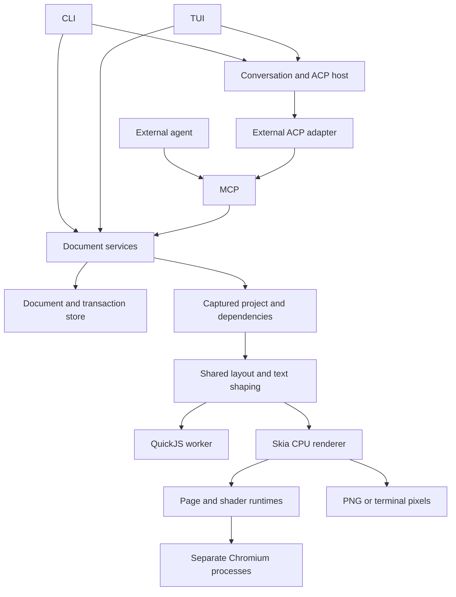

# Architecture

lazypencil exposes one document engine through a CLI, a terminal viewer, and an
MCP server. ACP connects its own conversations to external Codex/Claude adapters;
the application does not implement an LLM loop or store provider credentials.
The supported platform and user-facing limits are listed in the [README](../README.md).

## System boundaries

Each MCP process embeds the same service implementation. There is no mandatory
application daemon. A standalone MCP connection can open several documents;
host-owned attachment, usage, and preview grants remain bound to the conversation's
selected document. Multi-document atomic saves are not provided.

## Source map

| Area | Responsibility |
| --- | --- |
| `document` | JSONC source, schema adapters, addresses, and source-preserving edits |
| `store`, `operations`, `service` | Locks, atomic batches, revision checks, request replay, history, and recovery |
| `project` | Captured documents/configuration/assets, dependency verification, component/variable resolution, imports, and copied contexts |
| `layout`, `text` | Geometry, shaped paragraphs, font selection, measured diagnostics, and calculation identity |
| `render`, `geometry`, `mesh` | Native paints, masks, filter context, bounded raster planning, and compositing |
| `script` | Header/input validation, bounded QuickJS workers, and generated layout passes |
| `dynamic`, `cdp`, `runtime`, `shader` | Captured page/GLSL acquisitions, Chromium installation/ownership, and bounded caches |
| `agent`, `conversation`, `attachments` | ACP sessions, permissions, local records, explicit image input, and continuity |
| `mcp`, `preview_control`, `tui` | Tool dispatch, connection-local document/snapshot state, live preview control, and terminal input/presentation |
| `guidance`, `resources/guidance`, `resources/styles` | Shared English agent guides and original editable styles |
| `xtask` | Independent build/test/CI, fixture, distribution, and provenance tools |

The tools workspace does not depend on the application or Skia. Browser/ABI inputs
and the separately built shader-preprocessor component are explicit source inputs,
not replacement Python/Shell build orchestrators.

## Document and save invariants

The `.pen` file is authoritative. Read adapters accept 2.19, 2.21, and 2.22, and new files
use 2.22. Edits preserve the existing version, comments, unknown fields, and unrelated
source text. An unknown version fails explicitly; it is not silently upgraded.

A batch resolves references against captured inputs, validates the resulting document,
and checks expected document/dependency revisions before publication. Immutable assets
are staged before the document is replaced. A dry run publishes neither files nor
history. Request IDs bind identical payloads to committed results for safe retries.

Cooperating readers and writers use stable per-user path locks, independent of the
selected history directory. Save journals and before/after snapshots support recovery
and checked restoration as a new edit. These rules do not promise atomic changes
across arbitrary external writers or several documents.

Missing declared inputs remain inspectable with absence revisions and diagnostics
where structural repair is supported. Layout and rendering require their applicable
inputs. Discovering or restoring a dependency invalidates a previously captured result.
See [semantics](pen-semantics.md), [repair and assets](mcp.md#repairing-missing-assets),
and [configuration dependencies](configuration.md#revisions-and-concurrent-changes).

## Calculation and rendering

Component expansion and variable/theme resolution precede shared layout. Text uses
the same shaped Paragraph for measurement and painting. Script-generated nodes return
to that pipeline as derived, read-only results; edits target their owning source.

A retained calculation fixes document, dependency, font, and runtime-discovered inputs.
MCP snapshot IDs are connection/document-local, bounded, and expiring. TUI displayed
preview IDs are descriptive and cannot substitute for MCP calculation handles.

Skia CPU/SkParagraph provide native geometry, multilingual text, and compositing in
one path. Browser pages and software WebGL run separately and return images to that
path. No second native renderer or document-wide HTML conversion is maintained.
Node/region output crops the composited scene and retains required backdrop context.

Runtime processes are started when needed and independently expire while cached pixels
may remain. Active surfaces, decoded data, retained caches, interpreter heaps, and
complete process-tree RSS have separate limits. Cooperative checks surround native
calls; they cannot preempt an individual synchronous call.
See [graphics](graphics.md), [fonts](fonts.md), and [dynamic content](dynamic-content.md).

## Conversations and terminal state

An external adapter owns inference and native authentication. lazypencil negotiates
ACP capabilities, checks reported authentication routes, handles explicit permissions,
and retains bounded local transcripts and drafts. Cancellation stops pending work;
it does not undo already committed document edits.

The document picker can warm an adapter transport without choosing a document.
After opening a document or selecting a saved conversation, the TUI prepares its
session in the background. Drafts are sent only by explicit submission. Node selection
controls viewing; explicit prompt references freeze targets for a request.

The TUI keeps layout/calculation work off the input path and publishes completed
frames. Camera feedback can reuse a prior image while a new exact frame is prepared;
only complete images are exported. Terminal fonts and graphics transports are
independent of the fonts used to render the design.
See [agents](agents.md), [TUI](tui.md), and [image input](image-attachments.md).

## Design guidance

The shared guide/style catalogue serves CLI, MCP, and ACP with versions and content
hashes. Guides, styles, and examples are original project content. Project-supplied
instructions need a local user grant, separate from executable-setting trust.

User instructions take precedence over project rules, selected styles, and standard
guides. English guide text does not change the user's response/design language.
Validation and rendered visual inspection remain separate; a successful tool call
does not certify aesthetic quality or complete Pencil compatibility.

For changes, use [development checks](development.md). Current user contracts belong
in the linked references; task diaries, per-run results, and installation histories
stay outside the source repository.
