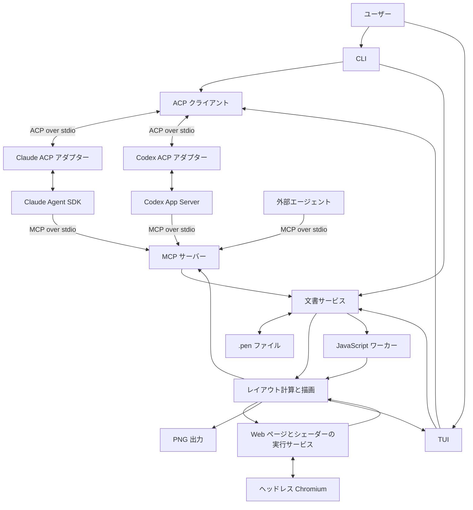

# lazypencil 設計書

作成日: 2026-10-23

設計版: 0.10

状態: 基本設計、Rust、Skia CPU と SkParagraph、MIT ライセンス、標準フォントの Noto Sans JP、Kitty・Sixel の採用を確定。JavaScript・Web ページ・シェーダーを正式な対応対象とし、対応形式の版と実行環境の互換性を初期検証で確定する。

lazypencil は、Pencil の `.pen` ファイルを読み書きし、画像として描画できるオープンソースのツールである。既存のデザインの継続利用と、AI による新規デザインの作成をともに対象とする。ユーザーは CLI または TUI からプロンプトを送り、画像を確認しながら修正を指示する。

アプリ内の AI 連携には ACP クライアントを、外部エージェントからの操作には MCP サーバーを用いる。両方の経路で、共通の文書編集・描画エンジンを使う。人が図形を直接編集する GUI は提供しない。

## 目的と対象範囲

### 達成すること

- 既存の `.pen` を開き、情報を失わずに編集・保存する。
- 空の文書から、AI にデザインを作成させる。
- PNG として書き出し、アプリを起動せずに成果物を閲覧できるようにする。
- lazypencil の CLI・TUI 内から、Claude Code または Codex を使って編集を指示する。
- 外部の Claude Code・Codex などから、MCP 経由で同じ編集・描画機能を使う。
- 対応端末の TUI 内で、画像の拡大・縮小、表示位置の移動、ノードへの移動を行う。
- AI を利用しない検証・画像出力・閲覧を、ローカルで完結させる。
- `.pen` の `script` ノード、`browser` ノード、`shader` の塗り・エフェクトを、CLI・MCP・TUI の共通描画経路で扱う。
- デザイン指針とスタイル、再利用部品、計算済みレイアウトを AI に渡し、参考画像を貼り付け・添付して制作を指示する。

「軽い」は、本体の起動時間・メモリ・待機時 CPU 使用率・再描画の応答時間で評価する。ブラウザー実行環境と外部エージェントを含めた実際の使用量も別に記録する。外部 Web ページの読み込みにはネットワークが必要だが、通常の文書・ローカルスクリプト・ローカルシェーダーの描画にはネットワークを必須にしない。

### 対象外

- ネイティブのデスクトップ GUI、Electron・WebView による編集画面。
- ドラッグによる配置、リサイズハンドル、プロパティ入力など、人向けの直接編集 UI。
- 独自の LLM 実行ループ、サブスクリプションの認証トークン管理。
- 初期版でのクラウド保存、ホスティング、複数人の同時共同編集。
- Pencil の全 MCP ツール・独自実行言語との完全な API 互換。

CLI の構造化された編集操作は、自動化と MCP の実装基盤として提供する。TUI に手動のデザインエディターは設けない。

## 設計上の決定

| 項目 | 決定 |
| --- | --- |
| 文書形式 | `.pen` を正本として扱う。独自形式への変換を必須にしない |
| アプリ内 AI | ACP を標準の接続インターフェースとする |
| 初期エージェント | Claude Code と Codex の両方に対応する |
| 外部 AI | stdio の MCP サーバーを提供する |
| 編集処理 | CLI・MCP・TUI が共通の文書サービスを利用する |
| 保存 | 編集バッチごとに検証し、リビジョン確認と排他制御のもとで保存する |
| プレビュー | 同じ描画経路を画像出力・TUI・AI への画像返却に利用する |
| 常駐処理 | 本体の常駐デーモンを必須にしない |
| 配布 | 本体と外部エージェント・ACP アダプターを分離する |
| 実装言語 | 本体は Rust で実装する |
| 描画 | `skia-safe` 経由で Skia CPU と SkParagraph を利用する |
| 動的コンテンツ | JavaScript・Web ページ・GLSL シェーダーの実行と画像化を初期リリースに含める |
| 追加ランタイム | 必要な文書でだけ実行し、通常の図形・文字の描画にはブラウザーを起動しない |
| Chromium の導入 | 本体に同梱せず、`lazypencil runtime setup chromium` で検証済みの版と補助ファイルを別途取得する |
| 互換性 | 保存・編集・描画の対応状況を分けて公開する |
| ライセンス | 本プロジェクトのコードと文書は MIT ライセンスとする |
| 初回リリースの対応環境 | macOS Apple Silicon、Linux x64／arm64（glibc 系）の3環境。Intel Mac は対象外、Windows は後日対応 |
| フォント | 固定版の Noto Sans JP を同梱し、ユーザーの追加フォントと既存文書の指定フォントを扱う |
| 端末画像 | Kitty Graphics Protocol と Sixel の両方を初期リリースに含める |
| AI 向け設計支援 | 独自のガイド・スタイル・作例を提供し、既存文書では元の部品と変数を尊重する |
| 部品とレイアウト | 外部ライブラリ、スロット、アイコン、文字の成長方式と計算結果の取得を初期リリースに含める |
| 画像入力 | CLI の `--image` と TUI の貼り付け・ファイル添付。macOS は `Ctrl+V` で画像を添付する |

ライセンス本文は [LICENSE](../LICENSE) に置く。外部ライブラリ・ランタイム・フォントなどを配布する場合は、それぞれのライセンスと著作権表記も保持する。

## システム構成



図の MCP サーバーは論理的に同じ機能を表す。実際にはエージェントごとに stdio の子プロセスを起動し、それぞれが共通の文書サービスを組み込む。同じ文書への更新は、ファイル単位のロックとリビジョンで調停する。

### モジュールの責務

| モジュール | 責務 |
| --- | --- |
| Document | 損失を抑えた構文保持、ID 索引、参照解析、対応形式の管理 |
| Operations | ノードの検索・挿入・更新・削除・移動・複製、変数操作、検証 |
| Store | 読み込み、リビジョン、ロック、保存、変更履歴、復旧 |
| Layout | 参照・変数の解決、文字の計測、サイズ・座標の計算 |
| Renderer | 描画、切り出し、画像エンコード、描画キャッシュ |
| Guidance | 版を持つデザイン指針・スタイル・独自作例と、対応条件の公開 |
| Asset Catalog | 利用可能な部品・フォント・アイコンと、版・ライセンス・導入状態の公開 |
| Attachments | 画像の貼り付け・ファイル添付、検証、不変保存、ACP への画像入力と素材への取り込み |
| ScriptRuntime | スクリプトと入力からノードを生成し、生成結果を文書サービスへ返す |
| BrowserRuntime | ページを読み込み、指定サイズ・ズーム・スクロール位置で画像化する |
| ShaderRuntime | GLSL、uniform、入力画像、時刻から塗り・エフェクトの画像を生成する |
| Agent Host | ACP 接続、会話、イベント、承認、キャンセル、プロセス管理 |
| MCP | 文書サービスを MCP ツールとして公開し、結果と画像を返却 |
| CLI | 引数・標準入出力・終了コードを共通処理へ変換 |
| TUI | プレビュー、閲覧操作、対象ノードの指定、会話、実行状況の表示 |

Document・Operations・Store は、端末・ACP・MCP に依存しない。描画を必要としない読み取り・編集では、描画環境や AI を初期化しない。

## アプリ内の AI 連携

### 接続方式

lazypencil が ACP クライアントとして、外部の ACP アダプターを起動する。会話中は接続を維持し、構造化された要求とイベントを交換する。`claude -p` や `codex exec` の単発実行を、アプリ内連携の基本方式にはしない。

ACP のローカル通信は JSON-RPC over stdio を利用する。会話の作成・再開、プロンプト送信、更新通知、キャンセルなどをプロトコルとして扱う。[ACP の概要](https://agentclientprotocol.com/get-started/introduction)

| エージェント | アダプター | アダプターの接続先 |
| --- | --- | --- |
| Claude Code | `@agentclientprotocol/claude-agent-acp` | Claude Agent SDK |
| Codex | `@agentclientprotocol/codex-acp` | Codex App Server |

この接続先は各アダプターの公開実装に基づく。lazypencil はアダプター内部の API に直接依存しない。[Claude アダプター](https://github.com/agentclientprotocol/claude-agent-acp)、[Codex アダプター](https://github.com/agentclientprotocol/codex-acp)

初期実装は ACP v1 を対象とし、初期化時に互換性と capability を確認する。ドラフトの次期版へ自動的に切り替えない。アダプターとランタイムについて、検証したバージョンの組み合わせを記録する。

### 認証と課金経路

サインインと認証情報の保存・更新は、各エージェントとアダプターに任せる。lazypencil は ChatGPT や Claude の認証トークンを読み取ったり、独自に保持したりしない。

サブスクリプションを利用する設定を標準経路とする。接続時に課金経路を取得できる場合は表示し、判定できない場合は「未確認」とする。API キーなどの環境設定が優先される可能性もあるため、エージェントを選んだだけでサブスクリプション利用を保証した表示にはしない。

認証失敗・利用上限・モデル利用不可が発生したら、その理由と再接続方法を表示する。別の課金方式や別のエージェントへ自動的に切り替えない。サブスクリプションの利用可否・上限は、提供元の仕様に従う。[Claude の公式案内](https://support.claude.com/en/articles/15036540-use-the-claude-agent-sdk-with-your-claude-plan)

### 会話とプロセスの寿命

1. ユーザーがエージェントを選び、最初のプロンプトを送った時点でアダプターを起動する。
2. ACP を初期化し、画像・会話再開・MCP 接続などの capability を確認する。
3. 作業ディレクトリと、対象ファイルに束縛した MCP サーバー設定を渡して会話を作成する。
4. プロンプトに、対象ファイル、対象ノード、現在のリビジョン、必要な画像を添付する。
5. イベントを受信し、応答・ツール実行・承認要求・失敗を UI へ反映する。
6. 同じ会話への次のプロンプトでは接続を再利用する。明示終了またはアプリ終了時に子プロセスを終了する。

ACP の会話作成では作業ディレクトリと MCP サーバーの一覧を渡せる。会話再開は capability がある場合に限る。[会話の作成と再開](https://agentclientprotocol.com/protocol/v1/session-setup)

初期版は一つの会話につき、一つのエージェントと一つの対象文書を割り当てる。プロバイダーを変更すると新しい会話を開始する。過去ログを送る場合は、履歴の引き継ぎとして扱い、内部コンテキストの完全な移行とは区別する。

### AI による編集手順

会話の初期指示には、対象形式の版、対応機能、MCP の使い方、編集後に画像を確認する手順を含める。説明とツールの入力スキーマは、同じ文書エンジンの対応定義から生成し、未対応機能を使う指示を与えない。

AI 向けに独自のデザインガイド、用途別スタイル、編集可能な作例を提供する。ガイドは文字と余白、色と状態、情報の優先順位、部品の再利用、具体的な編集操作を扱う。`get_guidance`・`list_styles`・`get_style` で必要な資料を段階的に取得し、ガイド・スタイルの版とハッシュを会話に記録する。既存文書では元のスタイルを尊重する。[AI 向けデザイン指針](design-guidance.md)

同梱する AI 向けガイド・スタイルの説明・操作例・ツール説明は英語とする。ユーザーへの応答とデザイン内の文章は、ユーザーの指定、依頼の言語、対象の言語・地域に合わせる。ガイドが英語であることを理由に出力を英語へ統一しない。

本家の公開された機能構成を参考にするが、本家 Skill の抽出・同梱は前提にしない。Design Assets の Unlicense、ソフトウェアの EULA、非公式 Skill の MIT は対象を区別する。初期の本文・スタイル・作例は独自に記述する。確認した利用条件と採用方針は [ライセンスの確認](design-guidance.md#pencil-の-skill-とライセンス) に記録する。

標準の手順は、要件と参考画像の確認、現在の文書・変数・部品と必要なガイドの読み取り、構成の決定、必要な範囲の編集、構造と計算済みレイアウトの検証、描画結果の確認、必要な再編集とする。新規作成でも空の文書に同じ手順を適用する。ユーザーへ返す結果には、変更概要、最終リビジョン、プレビュー、残った診断を含める。

再編集は設定された回数・実行時間の上限内で行い、上限到達時は保存済みの成果と未完了の内容を報告する。画像を扱えない接続は、標準の画像確認付き編集を満たさないため、機能を制限した接続であることを明示する。

参考画像はファイルまたはクリップボードから添付し、ACP の画像コンテンツとして実データを渡す。ユーザーが添付した画像を、文書の画像レイヤーへ暗黙に挿入しない。詳細は [画像の貼り付けと添付](image-attachments.md) に定める。

### イベントと承認

UI へ渡すイベントは、会話の状態、応答の差分、ツール開始・更新・終了、承認要求、使用量、診断、文書変更に整理する。未対応のイベントはログへ残し、プロトコルの構造を壊すメッセージは接続エラーとする。stdout はプロトコル専用、ログは stderr とする。

TUI は承認要求をダイアログで受け付ける。CLI は対話端末がある場合に同じ要求へ回答できる。`--non-interactive` では、あらかじめ解決されていない承認要求を拒否し、継続に必要な操作が拒否された場合は失敗として終了する。

文書操作への同意と、エージェントが要求するシェル・外部ファイル操作への承認は別に扱う。lazypencil が提供する MCP の権限制限だけでは、外部エージェント全体をサンドボックス化できない。ランタイム側の制限も設定し、その適用状況を接続診断で確認する。

### キャンセルと異常終了

通常の中断は ACP のキャンセル要求で行う。一定時間応答がない場合に子プロセスを終了する。キャンセル時点で完了した編集バッチは保存済みとして残し、未完了のバッチを部分適用しない。保存の確定処理に入ったバッチは完了させてから中断し、その変更を保存済みとして報告する。

「AI の処理を止める」と「保存済みの変更を戻す」は別の操作とする。中断後は、開始時点からの文書変更と、戻せる履歴を表示する。プロセスが異常終了した場合も、ファイルの実リビジョンを再確認する。

ログとネイティブの会話 ID を保存するが、再開はアダプターの対応状況に従う。再開できない場合は新しい会話を作り、現在の文書と必要な要約から継続する。失敗したプロンプトや編集を無条件に再送しない。

再開機能を広告しない場合は新しいネイティブ会話への切り替えを明示する。再開機能があるのに読み込みが失敗した場合は原因を報告し、自動でプロンプトを送らず、利用者が `--session ID --restart-session` で明示的に切り替えられるようにする。ローカル会話・保存済み画像・transcript は保持し、現在の文書リビジョンと上限付きの履歴抜粋を参考情報として渡す。モデルの記憶を復元したとは表示しない。

ネイティブ会話 ID の保存だけでは文脈の引き継ぎ完了とは扱わない。新しいネイティブ会話での依頼がローカルでも完了するまで引き継ぎ待ちの状態を保存し、中断・失敗後の次の明示的な依頼へ現在の文書と履歴抜粋を渡す。ネイティブの再開が成功した場合も同じ規則とし、再度会話を作り直したとは表示しない。

## MCP と CLI の編集インターフェース

### 文書への束縛

MCP サーバーは `lazypencil mcp --file <path>` で起動し、一つの文書に束縛する。起動時にパスを正規化し、ツール呼び出しで別の任意ファイルへ切り替えられる設計にはしない。依存ライブラリと許可済みの作例・添付は読み取り可能にするが、依存文書への書き込みは行わない。複数文書を編集する外部クライアントは、文書ごとにサーバーを登録する。

アプリ内 ACP 接続では、対象文書に束縛した MCP 設定を会話へ渡す。ユーザーのグローバルな MCP 設定を書き換えずに接続する。外部 AI から利用する場合も、同じ起動コマンドを使う。

### 初期ツール

以下は lazypencil 独自の公開 API とする。Pencil のツール名や独自 DSL への互換層は、必要性が判明してから追加する。

| ツール | 主な入力 | 結果 |
| --- | --- | --- |
| `get_document` | 取得する情報の範囲 | パス、形式の版、文書・依存リビジョン、ルート、対応状況、ガイドの入口、許可された添付のメタデータ |
| `get_guidance` | ガイド ID。省略時は入口 | 本文、版、対応条件、参照先、内容ハッシュ |
| `list_styles`・`get_style` | 用途・ページ条件、またはスタイル ID | スタイル一覧、またはトークン・指針・部品・作例と内容ハッシュ |
| `list_components` | 対象文書・許可済みライブラリ、名前・用途、ページ条件 | 部品のアドレス、元文書、スロット、必要な素材 |
| `list_fonts`・`list_icons` | パック・名前、ページ条件 | 利用可能な名前・太さ・版・導入状態とライセンス |
| `read_nodes` | ID・名前・型・部品のアドレス、深さ、件数、カーソル、明示した計算または保持した計算 ID | 保存済み・展開済み・計算済みノード、参照元、生成元、計算時の属性と位置、次ページ、文書・依存リビジョン |
| `read_asset` | 参照アセット、取得範囲 | スクリプト・シェーダーなどの内容とハッシュ |
| `put_asset` | 種類、内容または許可された添付 ID | 内容ハッシュに対応する管理アセットの相対パス |
| `apply_operations` | 要求 ID、期待リビジョン、必要時の期待依存リビジョン、操作配列、dry run 指定 | 新リビジョン、変更 ID、生成 ID、診断 |
| `get_variables` | 名前、対象ノード・テーマなどの条件 | 変数・テーマの定義、解決値、文書・依存リビジョン |
| `get_layout` | ノード、深さ、ページ条件、期待文書・依存リビジョン、任意のスナップショット ID | 計算済み矩形、変形、行数・ベースライン・使用フォント、あふれ、スナップショット ID |
| `validate_document` | 検証範囲 | 形式・参照・レイアウトの診断、リビジョン |
| `render` | ノードまたは領域、倍率、期待文書・依存リビジョン、任意のスナップショット ID、時刻・ページ取得条件 | PNG 画像、領域、実リビジョン、依存ハッシュ、スナップショット ID、取得条件、診断 |
| `get_history` | 件数、カーソル | 編集バッチの履歴と復元可能なチェックポイント |
| `restore_checkpoint` | 要求 ID、復元先、期待リビジョン、必要時の期待依存リビジョン | 新リビジョンと変更概要 |

文書を読む結果には文書と解決した依存のリビジョンを含める。ガイド・スタイル・パックにはそれぞれの版とハッシュを含める。計測・描画の期待リビジョンが一致しなければ、別の版の結果を返す代わりに競合を返す。件数・深さ・画像の画素数・応答サイズには上限を設け、全ノード・全画像を毎回送らない。

コードの実行後にだけ分かる依存は、宣言済みの依存と区別して実行時依存リビジョンを持つ。計算スナップショットは両方を固定し、再利用時に検査する。計算結果に基づく編集の要求では、その計算条件と実行時依存も保存前条件として確認する。初期実装は `expected_runtime_dependency_revision` の指定によって保存前にコードをロック外で再評価し、取得したローカル素材を保存直前にも再検査する。描画・読み取り・編集前条件の検証状況は [動的コンテンツの検証状況](dynamic-content.md#javascript-初期実装の検証状況) に記録する。

`validate_document` は既定の構造検証と `scope: "layout"` を区別する。後者は通常の script・文字・配置の計算を行い、計測・描画と同じ計算 ID と依存を返す。MCP では計算 ID を検証・ページ取得・画像に再利用でき、失効・文書や依存の変更時は拒否する。診断の件数上限とカーソルを持ち、エラー・警告の集計はページ外も含める。警告だけなら妥当とし、診断エラーがあれば不成立とする。`complete` は指定した検査の完了のみを表す。画像の見た目・すべての塗り・browser・shader の実行を検証済みとはしない。CLI は同じ検証を使うが、別の起動間では再計算する。[検証範囲](mcp.md#validation-scopes)

`render` は画像のローカルパスだけでなく、MCP の画像コンテンツとして返せるようにする。これにより、エージェントが描画結果を確認して再編集できる。画像入力・画像結果の取り扱いは、モデルとアダプターを組み合わせて検証する。[MCP ツール仕様](https://modelcontextprotocol.io/specification/2026-07-28/server/tools)、[ACP の画像コンテンツ](https://agentclientprotocol.com/protocol/v1/content)

MCP のプロトコル版は、対象アダプターとの接続試験に合格した版をサポート一覧へ固定する。最新仕様であることだけを理由に、既存クライアントが使えない版へ更新しない。

`read_asset` は対象文書が参照する許可済みアセットを読み取る。`put_asset` は内容ハッシュによる新しい不変ファイルを `assets/lazypencil/` 配下に作成し、同じ内容は再利用する。AI がコードを新規作成・変更する場合は、その後の `apply_operations` で `scriptUri` やシェーダーの参照を更新する。参照先の既存ファイルを直接上書きしないため、文書の復元で以前の管理コードも再び参照できる。

`put_asset` はコードの UTF-8 テキスト、画像の MIME 型付き Base64 データ、会話に登録された添付 ID のいずれか一つを受け取る。画像の形式・寸法・容量を共通のアセット処理で検証し、許可された添付以外の任意パスを読み込む入力にはしない。画像を保存した後、通常の編集バッチで画像の塗りを作成する。

### 編集バッチ

基本操作は `insert`、`update`、`delete`、`move`、`copy`、`set_variable`、`remove_variable` とする。部品・スロット・テーマ・ライブラリに対する明示操作も加え、[部品とレイアウトの仕様](pen-semantics.md#編集操作の追加) に編集先と意味を定める。バッチ内の順序は明示し、ID の重複、子孫への移動、参照切れ、不正な値を保存前に検出する。

新規 ID はエンジン側で生成し、複製時には必要な内部参照も更新する。参照されているノードの削除は、同じバッチで参照が解消されない限り拒否する。コンポーネントのインスタンスに対する変更は、上書きと元コンポーネントの変更を区別する。

操作に `client_ref` を付け、同じバッチ内の後続操作から `{ "result_of": "client_ref" }` で生成ノードを参照できる。ID の対応表は結果へ返す。ライブラリの解決結果を利用する編集は、文書だけでなく期待依存リビジョンも検証する。

バッチは全操作を適用するか、一つも適用しないかのいずれかとする。`dry_run` は同じ検証を行い、ファイルを書き換えない。1 回の AI 要求に複数の編集バッチが含まれることは許容するが、AI 要求全体を長時間のファイルトランザクションにはしない。

保存する編集要求には文書内で一意な要求 ID を付け、結果とともに履歴へ記録する。同じ ID と同じ内容の再要求には保存済みの結果を返し、同じ ID を異なる内容で再利用した場合は拒否する。これにより、保存後の接続断で応答だけを失った場合に、挿入などを二重に適用しない。復元操作も同じ規則を使う。CLI では ID を生成して結果へ含め、必要時に `--request-id` で指定できるようにする。

### 診断と失敗

内部エラーは、少なくとも次のコードに分類する。

| コード | 意味 |
| --- | --- |
| `INVALID_DOCUMENT` | 構文または必須構造が不正 |
| `UNSUPPORTED_VERSION` | 書き込み対応していない形式の版 |
| `UNSUPPORTED_FEATURE` | 必要な編集・描画機能が未対応 |
| `RESOURCE_LIMIT` | 計算・描画に必要な分割数や生成量が設定上限を超える |
| `REVISION_CONFLICT` | 読み取り後に文書が変更された |
| `INVALID_OPERATION` | ID・参照・操作引数が不正 |
| `ASSET_NOT_FOUND` | 画像・フォント・ライブラリなどを解決できない |
| `REFERENCE_CYCLE` | 部品・変数などの参照が循環している |
| `LAYOUT_UNRESOLVED` | 寸法の依存関係を一意に解決できない |
| `SNAPSHOT_UNAVAILABLE` | 指定した計算スナップショットが保持されていない |
| `ATTACHMENT_INVALID` | 添付画像の形式・内容・容量が利用条件を満たさない |
| `CLIPBOARD_UNAVAILABLE` | 実行環境のクリップボードから画像・テキストを取得できない |
| `AGENT_UNAVAILABLE` | エージェント・認証・必要 capability が利用不可 |
| `RUNTIME_UNAVAILABLE` | 必要な JavaScript・ブラウザー・WebGL の実行環境が利用不可 |
| `SCRIPT_EXECUTION_FAILED` | スクリプトの実行または生成ノードの検証が失敗 |
| `SHADER_COMPILE_FAILED` | シェーダーのコンパイル・リンク・入力の検証が失敗 |
| `PAGE_LOAD_FAILED` | Web ページの読み込み・取得条件を満たせない |
| `RENDER_TIMEOUT` | 動的コンテンツの取得・実行が時間上限を超えた |
| `CANCELLED` | ユーザーによる中断 |

MCP・CLI・TUI は同じ診断コードを使う。MCP はプロトコルに従ったツールエラーとして返し、CLI は JSON 出力時にコードと詳細を返す。競合時は最新状態の読み取りと再計画を要求する。

宣言済みのローカル画像・JS・GLSL・shader 画像入力の欠損は、参照元と予定パス・用途を診断し、欠損状態も依存リビジョンへ含める。通常の編集では既存の欠損を残した部分修復を許し、新しい欠損先・用途の追加は拒否する。期待する文書・依存リビジョン、ドライラン、履歴と要求の再送は通常の編集規則を維持する。明示的なチェックポイント復元は過去の欠損を戻せるが、欠損診断を結果へ含める。既知の欠損がある文書の検証・計測・描画は成功としない。`assets_complete` は宣言ファイルの有無を表し、描画やコード実行の成功を保証しない。詳細と残る対応範囲は [欠損素材の修復](mcp.md#repairing-missing-assets) に記録する。

## 文書形式と互換性

### 元データと描画用データ

文書は、元の構文を保持するデータと、編集・描画のために解釈したデータを分ける。既知のプロパティだけを型へ変換して再保存する方式は採らず、未知のプロパティも保持する。

JSON とコメント付き JSON を読み取る。無編集の読み書きはバイト単位で保持し、編集時も対象箇所を中心に構文を更新する。プロパティ順、コメント、数値表記などに不要な変更を加えない。意味に関わる未知の情報を保持できない場合は、書き込みを拒否する。

`.pen` には形式の版があり、公式仕様は破壊的変更の可能性を示している。入力の版を自動で書き換えない。未対応版は診断と読み取り可能な情報の取得までとし、対応を確認するまで保存しない。[公式の形式説明](https://docs.pencil.dev/for-developers/the-pen-format)

### 対応範囲の管理

| 区分 | 判定する内容 |
| --- | --- |
| 保存互換性 | 変更対象外のデータ、ID、参照、未知フィールドを保持できるか |
| 編集互換性 | 操作後の構造と参照を検証できるか |
| 描画互換性 | レイアウトと見た目をどこまで再現できるか |

初期の描画対象は、フレーム・グループ・基本図形・パス・テキスト・画像、アイコン、注記・文脈ノード、公開スキーマのレイアウト、変数・テーマ、ローカル・外部コンポーネントの参照・上書き・スロットとする。塗り・線・効果も対応項目を明記する。[部品とレイアウトの仕様](pen-semantics.md) に対象一覧、参照解決、API、計算規則を定める。実装順を分けても、既存文書と新規作成の両方で同じ機能を使う。

`script`、`browser`、`shader` の3機能も正式な対応対象とする。実装順は分けるが、初期リリースの完了条件から除外しない。実行、入力の変更、参照コードの新規作成・更新、描画結果の取得までを含める。動的コンテンツの設計と保証条件は [動的コンテンツの実行](dynamic-content.md) にまとめる。

未知のノード型は不透明なデータとして保持する。そのノードや解釈できない参照へ影響する変更は拒否する。既知の独立した部分の編集は、未知データを保持できる範囲で許可する。

新規文書には、実際の互換試験に合格した形式の版を使う。初期検証で実ファイルとスキーマの版を記録し、対応表を作る。特定時点の全仕様への完全対応を先に宣言しない。

既定の新規文書は公開スキーマ `2.21` とし、本家 CLI が保存した `2.19` も明示した処理対象に加える。既存文書とユーザーの参照先は自動で版を変更しない。版別の証拠と未確認の範囲は [形式の意味論](pen-semantics.md) に記録する。公開仕様の明記した規則と、明記のない部分に対する暫定規則を分ける。未確認の既定値や参照記法を、本家との互換性を確認済みの仕様として扱わない。

## 保存と変更履歴

### ファイルを正本とする保存

メモリ上の編集中文書を正本にせず、編集バッチの完了時に `.pen` へ保存する。TUI の文書モデルと画像は、ファイルから再構築できるキャッシュとする。

リビジョンはファイルの実バイト列に対する SHA-256 とする。コメントだけの外部変更も検出する。文書を識別する正規化済みのパスと、リビジョンを分けて管理する。

保存手順は次のとおりとする。

1. 文書の正規化済みパスに対応する安定したロックファイルを取得する。保存先 `.pen` の inode 自体をロック先にしない。
2. 要求 ID に対応する保存済みの結果があれば返す。新しい要求ではファイルを読み直し、期待リビジョンと比較する。
3. メモリ上で全操作を適用し、構造・参照を検証する。
4. 変更前後の内容とハッシュを含む、復旧用の履歴を記録して永続化する。
5. 同じディレクトリの一時ファイルへ出力し、同期・権限の保持を行って置き換える。保存直前にも外部変更を確認する。
6. 履歴を確定し、ロックを解放する。変更通知を出して再描画を予約する。

置き換え前のエラーでは元ファイルを維持する。置き換え後に応答や履歴の確定が失敗した場合は、実ファイルと未確定履歴から保存結果を確認し、「未保存」と誤って報告しない。ファイルの置き換えの原子性とクラッシュ時の永続性は、対象 OS・ファイルシステムで検証する。

lazypencil のロックを使わない外部アプリとの、完全に同時の書き込みまでは排他できない。初期版では同じ文書を外部アプリと同時に保存する運用を保証せず、検出した変更には競合を返す。ロックによる調停は、同じユーザーとローカルファイルシステムで動く lazypencil プロセス間を保証対象とする。

### 複数プロセスと監視

CLI・MCP・TUI は同じロック規則を使い、保存中だけ排他する。AI の応答待ちや描画中に書き込みロックを保持しない。読み取り・描画は、一つのリビジョンの不変スナップショットを使う。

TUI はファイルとアセットの変更を監視し、保存による置き換えも検出する。通知をまとめて処理し、必要時にはハッシュを再確認する。外部変更を検出したら文書と画像を更新し、次の AI 要求へ最新リビジョンを渡す。古い描画結果が後から到着しても、新しいプレビューへ上書きしない。

### 元に戻す操作と復旧

編集バッチ単位の履歴を保存し、AI 要求の開始・終了にもチェックポイントを記録する。ユーザーは直前のバッチ、または指定したチェックポイントへ戻せる。

復元も通常の編集と同様に、現在のリビジョンを確認して新しい履歴として保存する。開始後に別の書き手が変更した場合、その変更を黙って消す一括復元は行わない。初期版の復元は履歴の連続した末尾を対象とし、任意の過去バッチだけを取り消す機能は提供しない。

保存途中の履歴は未確定として残す。再起動時に、ディスク上のハッシュが変更前・変更後のどちらと一致するかで状態を解決する。どちらとも異なる場合は自動復元せず、元データと復旧候補を保持する。

初期版の原子的な編集単位は一つの `.pen` とする。画像の取り込みでは、衝突しない名前でアセットを先に確定し、その後で文書の参照を保存する。失敗時に残った未参照アセットは後で回収できるようにし、既存アセットは上書き・自動削除しない。

## レイアウトと描画

### 共通の描画経路

```text
Document snapshot
  -> Reference and variable resolution, script expansion, and layout
  -> Browser snapshots and shader results as required
  -> Display list
  -> Skia rasterization and compositing
  -> PNG encoding or terminal preview
```

CLI、TUI、MCP のすべてで、同じ解決・計測・レイアウト・描画処理を使う。表示範囲の切り出しはレイアウト計算の後に行い、画面外の要素が可変サイズへ与える影響も考慮する。

初期の画像出力は PNG とする。SVG・PDF などは追加可能な出力先として分離するが、初期版の完了条件には含めない。通常の図形・文字は Skia CPU で描画し、Web ページとシェーダーの互換実行に必要な場合だけヘッドレス Chromium を起動する。Pencil・OpenPencil の実行環境には依存しない。

### 採用する描画バックエンド

Skia の CPU 描画と SkParagraph を採用する。Rust からは `skia-safe` を利用する。基本的な図形の描画に加え、日本語の段落と影・ぼかし・合成を実装する総コストを重視した選択である。選定理由、代替案、実測の手順は [描画バックエンド比較](rendering-backends.md) にまとめる。

文書レイアウト、文字の組版、ラスター描画の責務を分離する。文字の計測に使った組版結果を描画でも使い、Skia は CPU 描画に機能を絞る。SVG を正本や唯一の中間形式にはしない。P0 では採用構成の見た目・性能・配布を確認する。resvg 系は必要時に再検討する代替案として残し、二つ目のバックエンドの試作を実装開始の前提にはしない。

自動配置、固定・内容・親に従う寸法、絶対配置、文字の成長方式、行高の意味を [レイアウト仕様](pen-semantics.md#レイアウトと文字の計測) に定める。`get_layout` と CLI の `layout` から計算済みの矩形・段落・あふれを返し、画像と数値で同じスナップショットを使う。通常のあふれは警告、参照欠損や計算不能は不完全な描画として区別する。

JavaScript は独立したワーカーでノードを生成し、通常のレイアウト・Skia 描画へ戻す。Web ページと GLSL はヘッドレス Chromium の別コンテキストで画像化し、Skia が最終合成する。SkSL への変換は検証済みの効果に対する将来の最適化とし、GLSL 互換性の前提にはしない。

### 再現性

フォントは既存文書の指定を尊重し、プロジェクト内のファイル・標準パック・システムフォントを解決する。新規文書には版を固定して同梱する Noto Sans JP を標準とする。同名のシステムフォントより同梱版を優先し、プロジェクトで明示したファイルはさらに優先する。ユーザーは OS へのインストール、ユーザーの検索先、プロジェクト設定を通じてフォントを追加できる。指定フォントの欠損は暗黙に成功扱いにせず、代替プレビューと厳格な書き出しを区別する。具体的な解決順とクロスプラットフォームの検証条件は [フォントと対応環境](fonts-and-platforms.md) にまとめる。

文字の折り返し、日本語と英数字の混在、フォントの代替、行高、可変サイズ、クリッピング、コンポーネントの上書きを重点的に検証する。一般的な Flexbox ライブラリや SVG 変換だけで、Pencil の意味を再現できるとは仮定しない。

フォントと画像の解決結果を描画メタデータへ含める。比較テストでは同じフォントファイルを指定し、OS のフォールバックによる差を分離する。参照画像やフォントが見つからない場合は診断を返す。

不完全な描画は `complete: false` と未対応機能の一覧を持つ。CLI の `render` と MCP の `render` は、標準では不完全な描画を失敗にする。明示的な部分描画の指定がある場合に限って出力し、TUI では不完全であることを常時表示する。

スクリプト・Web ページ・シェーダーの実行失敗は、対象ノードと原因が分かる診断として返す。必要なランタイムがない場合は導入方法を示し、空白画像を成功として返さない。Pencil 固有の画像識別子や外部ライブラリも、実際に解決できた範囲だけを描画対応とする。

### 描画量とキャッシュ

TUI では、表示範囲とズームに応じた解像度で描画する。パン操作では既存画像を再利用し、操作が落ち着いた時点で必要な領域を再描画する。ズーム時は必要な画素数で描き直し、拡大した低解像度画像だけに依存しない。

キャッシュキーには、文書のリビジョン、領域・倍率、描画エンジンの版、テーマ、フォントと画像の内容ハッシュを含める。初期版は変更時にレイアウト全体を無効化して正しさを優先し、計測結果に基づいて部分更新を追加する。キャッシュには容量上限を設ける。

動的コンテンツでは、参照コード・入力・実行環境の版・時刻・取得条件を追加する。Web ページは文書のリビジョンだけでは内容が固定されないため、取得画像のハッシュと取得時刻を記録し、明示更新と期限管理を行う。描画中の参照コードの変更も検出し、一つの出力へ異なる版を混在させない。

## TUI

### 画面と操作

プレビューを中心に、対象ノードの一覧、プロンプト入力、会話・ツールの実行状況を配置する。ノード選択は、表示位置の移動と AI への編集対象の指定に使う。座標や色などを直接編集するフォームは作らない。

| 操作 | 初期キーバインド |
| --- | --- |
| 表示位置の移動 | プレビューにフォーカス中の `hjkl`・矢印 |
| 拡大・縮小 | `+`・`-` |
| 全体表示 | `0` |
| 選択ノードへ移動 | `f` |
| パネルの切り替え | `Tab` |
| 対象ノードの検索 | ノード一覧で `/` |
| AI 処理の中断 | 実行中の `Ctrl+C` |
| プロンプト送信 | `Ctrl+Enter`。未対応端末では代替キーを設定可能にする |
| 画像の貼り付け | プロンプト入力中の `Ctrl+V`。macOS で必須とし、端末に応じた代替キーも設定可能にする |
| チェックポイントの復元 | コマンドパレットから選択 |
| 終了 | プロンプト入力欄以外で `q` |

キーはフォーカスと実行状態に応じて解釈し、プロンプト入力中の文字を閲覧操作へ流用しない。日本語入力と複数行入力、端末サイズ変更を検証する。実行中の終了操作では、会話を停止して子プロセスを回収する。

画像の貼り付けは Codex CLI・Claude Code に近い操作を提供する。OS のクリップボードから取得した画像を添付一覧へ表示し、送信前の確認・削除と複数画像に対応する。ファイルからの `/attach <path>` と、キーを使えない場合の `/paste-image` も用意する。画像がなくテキストがある場合の `Ctrl+V` は通常の文字入力とする。[画像の貼り付けと添付](image-attachments.md)

### 端末内の画像

画像バックエンドは Kitty Graphics Protocol と Sixel の両方を初期リリースに含める。最初に Kitty を実装し、続いて Sixel を実装する。端末の応答で利用可否を調べ、設定で上書きできるようにする。iTerm2 固有の画像プロトコルは追加バックエンドとして分離する。[Kitty の仕様](https://sw.kovidgoyal.net/kitty/graphics-protocol/)、[Microsoft の Sixel 対応紹介](https://devblogs.microsoft.com/commandline/windows-terminal-preview-1-22-release/)、[iTerm2 の画像表示](https://iterm2.com/documentation-images.html)

非対応端末では、TUI の会話・ノード一覧と画像ファイル出力を利用できるようにし、外部ビューアを開く操作を提供する。外部ビューアにはキーボードによるパン・ズームを保証しない。端末内の高精細プレビューを保証する端末・バージョンは、実機試験を通した一覧で示す。

tmux・SSH 経由の画像表示は別の互換試験項目とし、端末単体で表示できることから対応を推定しない。

## CLI

以下を初期のコマンド体系とする。

```sh
lazypencil init new.pen
lazypencil inspect design.pen --json
lazypencil validate design.pen --json
lazypencil validate design.pen --scope layout --json
lazypencil variables design.pen --node home --name color.accent --json
lazypencil render design.pen --node home -o preview.png
lazypencil render design.pen --time 0 --refresh -o preview.png
lazypencil apply design.pen --operations operations.json --expected-revision <revision>
lazypencil prompt design.pen --agent claude "Make the header more compact"
lazypencil prompt new.pen --create --agent codex "Create a login page"
lazypencil prompt design.pen --session <session-id> "Increase the spacing"
lazypencil prompt design.pen --image reference.png "Match this reference"
lazypencil layout design.pen --node home --json
lazypencil guidance
lazypencil styles
lazypencil style standard-ui
lazypencil fonts list
lazypencil icons list
lazypencil icons setup feather
lazypencil tui design.pen
lazypencil history design.pen --json
lazypencil conversations list design.pen --json
lazypencil conversations turns design.pen <local-session-id> --json
lazypencil conversations read design.pen <local-session-id> <turn-id> --json
lazypencil restore design.pen --checkpoint <checkpoint-id> --expected-revision <revision>
lazypencil mcp --file /absolute/path/design.pen
lazypencil doctor
lazypencil runtime setup chromium
```

`<revision>` などの山括弧は説明用のプレースホルダーであり、実行時には値へ置き換える。

`init` は存在するファイルを上書きしない。`prompt --create` はファイルが存在しない場合だけ初期文書を作る。既存ファイルに対して `--create` を指定した場合はエラーにし、意図しない初期化を防ぐ。

`apply` と `restore` は期待リビジョンを必須とする。単発の編集でも競合検出を省略しない。新規作成を除くコマンドでは、存在しないファイルを暗黙に作成しない。

参照解決を使う `apply`・`restore` と、`layout`・`render` は `--expected-dependency-revision` で依存のリビジョンも指定できる。参照解決に依存する編集・復元ではこの指定を必須にする。`layout`・`render` の `--snapshot` は同じ計算済みの状態を利用するための指定とし、失効時は診断する。TUI は保持している両リビジョンとスナップショット ID を共通 API へ渡す。

人向けの出力と `--json` の機械向け出力を分ける。ログ・進捗は stderr、結果は stdout とする。`prompt --json` は開始・イベント・完了を NDJSON で出力し、通常の読み取りコマンドの `--json` は単一の JSON オブジェクトを返す。

終了コードは成功を `0`、引数エラーを `2`、競合を `3`、形式・検証・描画の失敗を `4`、エージェント連携の失敗を `5`、その他の失敗を `1` とする。SIGINT による中断は `130` とする。詳細は診断コードで伝える。

`doctor` は本体・アダプター・エージェントのバージョン、接続可否、取得可能な認証状態、端末の画像表示、フォント・描画環境を確認する。診断だけの実行ではデザインを変更せず、認証トークンを表示しない。

`render --time` はシェーダーの評価時刻を秒単位で指定し、既定値は `0` とする。`--refresh` は Web ページの取得結果を更新する。MCP・TUI も同じ設定を使う。`runtime setup chromium` は全機能を利用するためのブラウザー実行環境を導入する明示的な操作とし、通常の描画中に暗黙のダウンロードを行わない。

## 設定とローカルデータ

プロジェクト設定は任意の `lazypencil.toml` とし、既定エージェント、実行ファイルと引数、フォント・アセット検索先、動的コンテンツの実行・取得条件、描画とキャッシュの上限を記録する。秘密情報は格納しない。

ユーザー共通の設定は OS の設定ディレクトリに置く `config.toml` とし、フォントでは項目ごとにプロジェクトの明示値、ユーザーの明示値、組み込み既定値の順で選ぶ。配列は連結せず、空配列も明示的な上書きとして扱う。相対パスは値を指定した設定ファイルの物理ディレクトリを基準にする。`config init --user`・`show --user`・`schema --user` と `LAZYPENCIL_CONFIG_DIR` を提供し、通常の読み取りで設定先を作成しない。両設定のバイト列と有効なフォントを依存へ含め、保存時のロック・計算結果の失効を共通化する。ACP の子 MCP にも起動時に選んだ絶対設定先を渡す。フォント以外の共通設定は引き続き実装対象とする。[設定の詳細と検証範囲](configuration.md)

プロジェクトのガイド・スタイル・ライブラリ検索先、画像添付の容量とキー設定も扱う。CLI の `--image` は複数回指定でき、実行ディレクトリからパスを解決する。

ユーザー設定の `[agents]` で既定エージェント、`[agents.codex]`／`[agents.claude]` でアダプター・引数・認証方式・モデル・モード・承認方針・タイムアウトを指定する。CLI と TUI は起動時に共通の処理で解決し、CLI の明示値を優先する。実行ファイルの相対パスはユーザー設定の物理ディレクトリを基準にし、引数をシェルで解釈しない。進行中の会話は解決済みの設定を保つ。これはユーザー設定の実装範囲であり、プロジェクトからの実行指定・信頼の実装完了を示さない。[profile と検証範囲](configuration.md#user-agent-profiles)

アダプターの実行ファイルと引数を個別に渡し、プロンプトや文書内の文字列をシェルコマンドへ展開しない。プロジェクト設定からの実行ファイル指定は、ユーザーが許可したプロジェクトだけで有効にする。

| データ | 保存先の方針 |
| --- | --- |
| `.pen` と必要なアセット | プロジェクト内。持ち運べる成果物として扱う |
| ユーザー設定 | OS のユーザー設定ディレクトリ |
| 会話ログ・変更履歴・チェックポイント | OS の永続的なユーザーデータ領域 |
| 会話に添付した画像 | OS の永続的なユーザーデータ領域。プロジェクトへ取り込んだ素材とは保持・回収を分ける |
| 組み込みガイド・スタイル・作例 | 本体のリソース。版・ハッシュを持ち、基本分はオフラインで読める |
| アイコンパック | 基本の Lucide は本体に含め、追加パックは専用コマンドでユーザーデータ領域へ導入する |
| 描画キャッシュ | OS のキャッシュ領域 |
| Chromium とその補助ファイル | OS のユーザーデータ領域。検証済みの版を管理する |
| ロック | 全プロセスが同じ場所を参照するユーザーのキャッシュ領域。履歴の保存先の上書きから独立させる |
| 外部 AI の認証情報 | 各エージェントの管理先 |

文書のパスから履歴の識別子を作り、ファイルの移動時は新しい文書として登録する。旧パスの履歴は明示的な移行操作で引き継ぐ。キャッシュの削除で変更履歴が失われる構成にはしない。

画像・スクリプト・シェーダーの相対パスは `.pen` のあるディレクトリを基準に解決する。新しく取り込むアセットは、プロジェクト内の管理ディレクトリへ配置する。ネットワーク上のアセット取得と Web ページへのアクセス条件は設定へ明示し、オフライン時は取得済みデータか欠損診断を返す。外部で直接変更されたコードは監視・ハッシュで検出するが、その編集履歴の復元までは保証しない。

## 性能と配布

### 初期の性能目標

次は実測値ではなく、実装を評価するための暫定目標である。初期検証で基準機・文書・フォント・端末を固定し、結果を記録して調整する。

| 項目 | 暫定目標 |
| --- | --- |
| 基準文書 | 1,000 ノード、ローカルアセット、1920 × 1080 相当の表示領域 |
| TUI 起動から入力可能になるまで | 500 ms 以下。描画・AI 起動は非同期 |
| 初回プレビュー | 2 秒以下 |
| キャッシュ利用時のパン・ズームの表示応答 | p95 で 100 ms 以下 |
| 本体の常用メモリ | 基準文書でプロセス群の RSS 合計 200 MiB 以下 |
| 待機時 CPU | 平均 1% 未満を目指し、定期的な全描画をしない |

上記の描画時間・メモリ目標は、Web ページ・シェーダーの実行を含まない通常の文書を基準とする。本体のメモリには MCP 子プロセスと起動中の JavaScript ワーカーも含める。Web ページ・シェーダーを含む文書では Chromium のプロセス群も加えた合計を別に測り、性能目標を P0 で定める。通常文書と同じ使用量であるとは扱わない。AI ランタイム・ACP アダプター・端末も別に集計し、アセットのサイズ、コールド・ウォーム状態、測定回数とばらつきを記録する。

### 実装技術と配布

本体は Rust で実装し、コンパイル済みの CLI・TUI として配布する。描画と文字の組版は `skia-safe` 経由の Skia CPU・SkParagraph を利用する。Rust と Skia の具体的な版、必要な feature、文書の構文保持・レイアウト計算・TUI・ACP・MCP のライブラリ構成は、初期検証と詳細設計で固定する。

採用構成の検証では、通常の文書はブラウザー不要で描画でき、追加ランタイムを使う文書は3機能を省略せず画像化できることを確認する。P0 では段落の組版、効果、コード実行、ページ取得、GLSL と合成、対象 OS での配布を検証する。テキスト計測と文書レイアウトの調停は共通エンジン側に残す。

スクリプトは Rust の子プロセスへ組み込む軽量 JS エンジン、Web ページと GLSL は外部のヘッドレス Chromium で実行する。実行サービスは遅延起動し、同時実行数と待機時の終了条件を設ける。Chromium は本体へ同梱せず、`lazypencil runtime setup chromium` で OS・CPU に対応する検証済みの版と補助ファイルを別途取得する。取得元・版・ハッシュを固定し、ユーザーデータ領域で管理する。通常の描画ではダウンロード・更新を行わない。3機能を含む全機能のセットアップ手順を提供する。エンジンと Rust バインディングの具体的な組み合わせは [動的コンテンツの実行](dynamic-content.md) の初期検証で固定する。

外部アダプターに Node.js などが必要な場合でも、それを本体の画像出力・閲覧の必須依存にはしない。未導入のエージェントを選んだ場合は、必要なパッケージと接続手順を案内する。ユーザーの確認なしにインストールや更新を行わない。

初回リリースの対応環境は macOS Apple Silicon（`aarch64-apple-darwin`）、Linux x64（`x86_64-unknown-linux-gnu`）、Linux arm64（`aarch64-unknown-linux-gnu`）の3環境とする。Intel Mac はサポート対象外とし、Windows は後日対応する。Windows の既存実装と試験 fixture は保持するが、追加実装・対応保証・リリース判定には含めない。保存・描画・動的コンテンツ・AI 接続・TUI・配布を対象3環境で検証し、最低 OS バージョンと保証する端末は実際の互換試験結果で固定する。[フォントと対応環境](fonts-and-platforms.md)

## 検証と受け入れ条件

以下の条件は、初回リリースの対象3環境すべてで満たす。通常 CI は対象の1環境で変更箇所を先行検証し、成功後に3環境のネイティブ試験・描画・Chromium・release 検証と依存監査を行い、すべて成功した場合だけソース配布物を確定する。OS・CPU の範囲以外の機能・互換性・性能・ライセンス・配布・実端末の完成条件は変更しない。Windows と Intel Mac の結果を初回の必須条件にせず、過去の成功も現行リリースの完成とは読み替えない。

### 文書と保存

- 実際の既存ファイルで、無編集の読み書きがバイト単位で一致する。
- 一部のノードを編集しても、未知フィールド・コメント・無関係な参照を保持する。
- 同じリビジョンに対する競合した書き込みのうち、後の操作が競合になる。
- 保存の各段階で失敗させても、元データまたは確定した新データと復旧情報が残る。
- 保存後に応答を失って同じ要求を再送しても、編集を二重に適用しない。
- コンポーネントの複製・上書き・削除、履歴の復元で参照を壊さない。
- 外部ライブラリとスロットを利用する編集で元の定義を暗黙に変更せず、依存の変更も競合として検出できる。

### 描画

- 日本語、混在テキスト、折り返し、可変サイズ、コンポーネント、変数、画像を含む代表文書を描画できる。
- 同じアセット・フォントで用意した基準画像と比較し、文字・座標の差とピクセル差を分けて記録する。
- ノード単位・表示範囲単位の切り出しで、全体描画と対応する領域が一致する。
- 欠損・未対応機能を含む画像を、完全な描画として報告しない。
- `script` の入力変更とコード変更を反映し、生成したノードをレイアウト・描画できる。
- `browser` の URL・サイズ・デバイス設定・ズーム・スクロール位置を反映し、Web ページの取得画像を合成できる。
- GLSL の塗りとエフェクトを、uniform・画像入力・時刻・適用順序を含めて実行できる。
- GPU を使わない検証環境でも、シェーダーをソフトウェア実行できる構成を確認する。
- コードと外部ページがある文書でも、CLI・MCP・TUI が同じ取得条件で同じ画像を使える。
- アイコン、外部部品、スロット、テーマ、文字の成長方式を計測・描画し、`get_layout` と画像の条件が一致する。

基準画像には利用条件を確認した検証用成果物を使う。本家のサービスや出力からの収集・転用を、許諾の確認なしに検証計画の前提にしない。通常の実行と自動検証で外部アプリの起動を必須にしない。本家に近い総合的なデザイン品質を判定する基準は、別途設計する。

### AI と TUI

- Claude と Codex の両方で、新規作成と既存ファイル編集が完了する。
- 編集後の画像がエージェントへ渡り、画像を踏まえた再編集ができる。
- 外部の Claude Code と Codex からも、同じ MCP 操作ができる。
- 会話継続、対応時の会話再開、キャンセル、承認拒否、認証失敗、利用上限を扱える。
- 子プロセスの異常終了後も、文書・履歴を保ち、孤立したプロセスを残さない。
- 対応端末で日本語入力、表示位置の移動、拡大・縮小、サイズ変更、画像更新が成立する。
- Kitty・Sixel のそれぞれで、画像更新、消去、サイズ変更、パン・ズームを検証する。
- macOS Apple Silicon・Linux x64／arm64 の各対象環境で、少なくとも一つの端末による画像閲覧とキーボード操作を検証する。
- ガイド・スタイル・部品・計算済みレイアウトを両エージェントから取得できる。
- macOS の `Ctrl+V` を含む画像添付、送信前の削除、複数画像、CLI の `--image` が両エージェントへの画像入力として成立する。

保存・競合処理は自動テスト、描画は固定フィクスチャによる比較、ACP は疑似エージェントを使うプロトコル試験と実接続試験で確認する。実接続試験は通常の単体テストから分け、アダプター更新時にも実施する。

## 実装段階

| 段階 | 成果物 | 完了条件 |
| --- | --- | --- |
| P0 接続と描画の検証 | Rust・Skia・JS・Chromium・WebGL の試作、ACP 接続、MCP 画像返却 | 3機能の実行と合成、ソフトウェア WebGL、両エージェントへの画像返却、性能・配布を確認できる |
| P1 文書サービスと CLI | 部品・素材・レイアウト、編集、コードの管理、動的コンテンツ、PNG、履歴 | 外部部品・スロット・アイコンを含めて編集・保存・計測・描画できる |
| P2 MCP | 文書に束縛したツール群、独自ガイド・スタイル・作例 | 外部エージェントが指針と部品を取得し、編集・計測・描画・確認を繰り返せる |
| P3 アプリ内 ACP | 画像付き `prompt`、会話、イベント、承認、中断 | Claude・Codex の両方で画像と指針を使い CLI から一連の作業が完了する |
| P4 TUI | Kitty・Sixel のプレビュー、閲覧操作、画像貼り付け、対象指定、会話 | 両画像バックエンドと画像添付が動作し、TUI 内で確認とプロンプト編集が完結する |

P0 では接続と描画を別々に検証し、一方の未完了によってもう一方の検証を止めない。初期リリースは P4 までと、JavaScript・Web ページ・シェーダーの3機能を含める。単にデータを保持できるだけでは3機能の完了としない。対応形式の版と検証条件を明示し、代表的な既存ファイルと新規作成の両方を完了条件にする。

## 残る設計事項と検証項目

Rust、Skia CPU・SkParagraph、MIT ライセンス、標準フォントの Noto Sans JP、追加フォントの利用、Kitty・Sixel は採用済みであり、JavaScript・Web ページ・シェーダーの対応も確定している。初回は macOS Apple Silicon・Linux x64／arm64 を対象とし、Chromium は専用コマンドで別途取得する。基本アーキテクチャと配布方針に関する選択は固まっており、残る詳細と、実装によって確認する事項を分ける。

### 未決の設計事項

| 項目 | 判断に使う結果 |
| --- | --- |
| `.pen` の対応版と互換性の検証条件 | 3機能を含む対応対象を維持し、スキーマと実ファイルから対応版と保証する動作を確定する |
| 最低 OS・端末 | 対象3環境を維持し、最低 OS バージョン、Linux ディストリビューション、Kitty・Sixel と端末の組み合わせを実機試験から定める |
| 依存ライブラリとプロトコルの対応版 | Rust・Skia・JS エンジン・Chromium の版と feature、ソフトウェア WebGL の構成、文書・レイアウト・TUI・ACP・MCP の検証済みの組み合わせを固定する |
| 運用上限と既定値 | 履歴・キャッシュ容量、画素数、コード実行とページ取得の条件、AI の再編集回数とタイムアウトを定める |
| 総合的なデザイン品質の評価基準 | 今回は保留とし、本家との品質比較の対象・条件・合格基準を後で設計する |

部品のアドレス・編集操作・同じバッチ内の ID 参照、計算結果、画像添付の動作は個別仕様に定める。機械可読の JSON スキーマ、設定スキーマ、フォントの再現用補助ファイルは詳細設計で固定する。Noto Sans JP の具体的な版と可変・静的フォントの配布構成も、組版と配布の検証結果から固定する。これらは上記の基本アーキテクチャの変更を必要としない。

製品の基本方針は確定している。最初の保証環境、形式の版、依存の対応版と取得元、具体的な上限と性能値は、初期検証の結果に基づいて固定できる。Chromium の同梱版は初期リリースの配布対象に含めない。すべての細部の確定を実装開始の前提にはしない。

### 実装で確認する事項

- 実ファイルと指定フォントで、日本語の組版・レイアウト・必要な効果を再現できること。
- JavaScript・Web ページ・シェーダーの実行仕様と合成を再現し、追加ランタイムの使用量を計測できること。
- 両エージェントで画像返却・会話・キャンセル・承認を含む接続が成立すること。
- ファイルの保存・競合・復旧・履歴の復元が、対象環境で成立すること。
- 基準機とフィクスチャを固定し、暫定の性能目標と実測結果を比較できること。

性能目標を変更する必要が生じた場合は、実測結果と変更理由を記録する。採用済みの技術であることと、互換性・性能を検証済みであることを混同しない。

ACP で不足する機能が確認された場合は、Agent Host 内にネイティブ接続用の実装を追加できるようにする。その場合も、文書サービス・MCP・TUI の基本構造は維持する。独自 OAuth や独自の LLM 実行ループは、初期設計の前提に追加しない。
