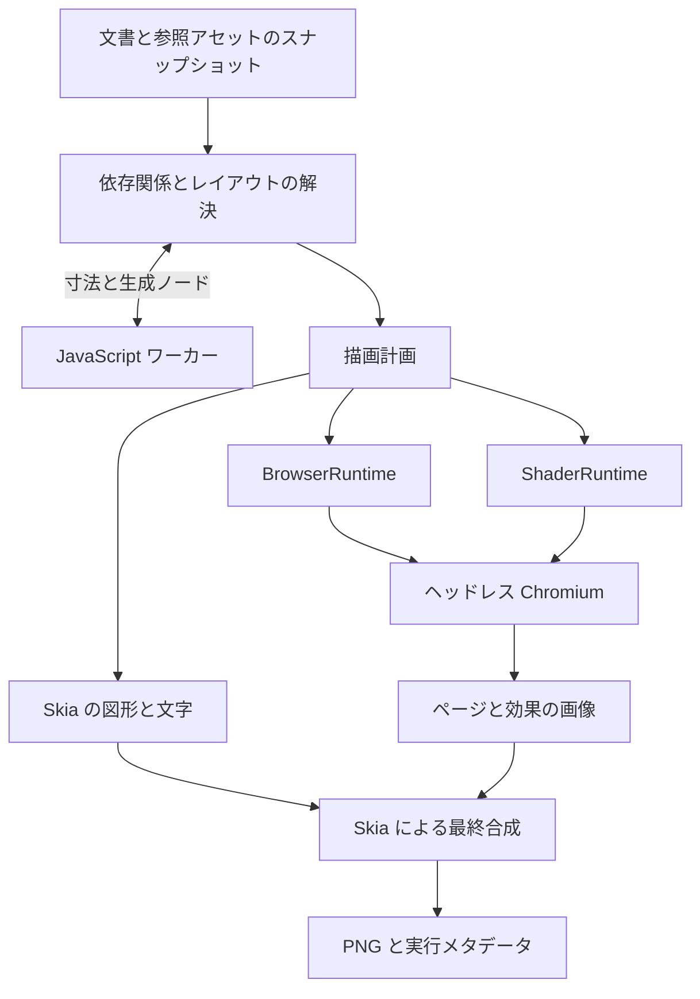

# lazypencil 動的コンテンツの実行

設計日: 2026-10-23

状態: JavaScript・Web ページ・シェーダーの対応を確定。実行環境の版と互換性の詳細は初期検証で固定する。

`.pen` の `script` ノード、`browser` ノード、`shader` の塗り・エフェクトを、初期リリースの正式な対応対象とする。元データを保存できるだけでは完了とせず、実行と画像化、AI による入力・参照コードの編集、CLI・MCP・TUI への統合までを含める。

Rust 本体と Skia CPU・SkParagraph の採用は維持する。通常の図形・文字は Skia で描き、JavaScript の生成結果も同じレイアウトへ渡す。Web ページと GLSL は必要時に起動するヘッドレス Chromium で画像化し、Skia が最終合成する。

## 実行構成

BrowserRuntime と ShaderRuntime は、本体の描画バックエンドと別の実行サービスである。同じブラウザープロセスを再利用しても、Web ページとシェーダーのコンテキスト・入力を分離する。文書全体を HTML に変換してブラウザーに描かせる構成にはしない。

すべての読み取りは、`.pen` と参照コード・画像を取得したスナップショットに基づく。実行の途中でソースが変わった場合は、その出力を新しい版へ混ぜずに再実行するか、依存の変更として診断する。

## JavaScript

### 実行する内容

Script ノードの寸法と入力を渡し、スクリプトから返ったノード配列を展開して描画する。公式資料には、同期実行、DOM・ネットワーク・ファイルシステムへのアクセスなし、入力ヘッダーと `pencil` オブジェクトを使う仕組みが示されている。[Pencil の Code on Canvas](https://docs.pencil.dev/core-concepts/code-on-canvas)

lazypencil では次を実装対象とする。

- 対応する `@schema` と `@input` 宣言の読み取り、既定値と入力の検証。
- `pencil.width`、`pencil.height`、`pencil.input` と、返り値のノード配列。
- ノードの寸法、入力、変数・テーマ、参照コードが変わったときの再実行。
- 実行ごとに固定される乱数の扱いと、Pencil の出力との互換性の検証。
- 生成結果の構造・参照・出力件数を検証し、通常の文書レイアウトへ渡す処理。

公開仕様と公式の例で互換性を検証する。乱数列などの具体的な挙動を確認できていない部分は、検証済みと表記しない。対応しているコードの実行を、生成物の静的保存だけで代替しない。

### エンジンと分離

軽量な QuickJS 系エンジンを Rust のワーカーへ組み込む。初期検証では `rquickjs` と QuickJS-NG の組み合わせを評価し、対応する版を固定する。確認時点の `rquickjs` は QuickJS-NG のバインディングであり、元の QuickJS と同じ版として扱わない。[QuickJS-NG](https://quickjs-ng.github.io/quickjs/)、[rquickjs](https://github.com/DelSkayn/rquickjs)

ワーカーには許可した入力とコードを渡し、ホストのファイル・ネットワーク API を公開しない。実行時間・メモリ・生成ノード数に上限を持たせ、無限ループや異常終了が TUI・MCP・文書保存を停止させないようにする。上限の具体値は対応版の Pencil の実行条件を調べて固定する。

スクリプトの寸法と生成ノードのサイズが親のレイアウトへ影響するため、依存関係に沿って必要な計測と再実行を行う。収束しない循環は打ち切り、対象ノードの診断として返す。

### 生成物と編集

生成ノードは派生データとして扱い、元の `script` を通常のノードへ暗黙に置き換えない。生成ノードには実行結果内で識別できる ID を与え、文書に保存される ID と区別する。

AI は入力・コード・スクリプトノードの属性を編集する。派生ノードの直接更新は、次の実行で失われるため拒否し、元の入力またはコードを示す。生成ノードを読み取り、画像とともに結果を確認することは可能にする。

## Web ページ

### 取得と合成

Browser ノードの URL をヘッドレス Chromium で読み込み、ノードの寸法、対応するデバイス設定、ズーム、スクロール位置を反映して画像を取得する。HTML・CSS・ページの JavaScript はブラウザーに処理させる。Skia は取得画像へ回転・角丸・クリッピング・不透明度・後続の効果を適用する。

Chrome は表示 UI なしで実行でき、DevTools Protocol にはページの画像取得がある。Rust から DevTools Protocol を操作し、Node.js や Puppeteer を必須の中継として追加しない。[Chrome Headless](https://developer.chrome.com/docs/automation-and-testing/headless)、[DevTools Protocol の Page](https://chromedevtools.github.io/devtools-protocol/tot/Page/)

CLI は取得条件を満たした一時点の PNG を出力する。TUI は同じページ状態を保持して更新を取得でき、明示更新と上限付きの更新周期を提供する。ユーザーが Web ページを操作するブラウザー UI は設けず、URL・スクロール位置などの変更はプロンプトまたは構造化操作で行う。

### 取得条件と再現性

読み込みの完了条件、フォントの準備、追加待ち時間、全体のタイムアウトを取得条件として扱う。常時通信するページで無期限に待たない。URL だけでなく、最終 URL、取得時刻、ブラウザーの版、寸法・デバイス設定、準備条件、画像ハッシュを記録する。

アニメーションや外部の更新を含むページは、実際に取得した時点の状態として扱う。別の時刻の再取得が同じピクセルになるとは保証しない。ネットワークに依存しない互換試験では、ローカルのテストページとフォントを固定する。

通常利用するブラウザープロファイルを流用せず、文書用の分離されたコンテキストを使う。認証が必要なページは明示的に設定した専用プロファイルを使い、認証情報を `.pen`・会話ログ・公開する描画メタデータへ書き出さない。

## シェーダー

### 互換実行の経路

対象は対応する `.pen` 仕様の GLSL による塗りとエフェクトである。公式仕様には WebGL 1.0 のフラグメントシェーダー、uniform の宣言、画像入力などの定義がある。[Pencil の形式スキーマ](https://docs.pencil.dev/for-developers/the-pen-format#typescript-schema)

初期の互換実行は、ヘッドレス Chromium の WebGL で行う。入力コードを SkSL として扱わず、GLSL のコンパイル・リンク、uniform の設定、テクスチャの準備、描画結果の取得を ShaderRuntime が担当する。BrowserRuntime の通常の Web ページとは別の実行コンテキストを使う。

次を実装と互換試験の対象に含める。

- 通常の塗りとしての出力と、描画済みノードへ適用するエフェクトとしての出力。
- 宣言された数値・色・ベクトル・画像などの入力、変数による値の解決。
- 解像度・時刻の組み込み入力と、描画するノード・背景を参照する画像入力。
- 対象の寸法と効果用の領域、座標原点・上下方向・画像の向き。
- 色空間、アルファの扱い、ブレンド、複数の塗りと効果の適用順序。

最終的なページ取得画像とシェーダー画像は、共通の画像表現に正規化して Skia へ渡す。エフェクトが背景を参照する場合は、それ以前の描画結果を用意する。対象ノードだけを単独で描いて背景を省略しない。

### 時刻と更新

画像出力では評価時刻を明示し、既定値を `0` 秒とする。TUI では同じ時刻の表示に加え、上限付きのフレーム更新を有効にできる。静止したプレビューでは無駄な再描画を止め、同じコード・入力・時刻の結果を再利用する。

Skia の SkSL Runtime Effects を使う最適化は追加可能だが、GLSL と言語・座標・テクスチャの扱いが異なる。変換を行う場合は WebGL の基準出力との比較を必須にし、変換できないシェーダーは WebGL 経路で実行する。[SkSL の説明](https://skia.org/docs/user/sksl/)

### GPU がない環境

通常描画は Skia CPU を使う。GLSL についても、SwiftShader などのソフトウェア経路を持つ検証済み Chromium 構成を用意し、GPU がない保証環境を含める。

Chromium は SwiftShader を使う CPU 実行の構成を持つ一方、WebGL の利用可否をすべての環境で保証していない。自動フォールバックに依存せず、固定した版・設定と分離されたプロセスでソフトウェア実行を試験する。ソフトウェア実行に必要な起動設定とその制約を配布手順へ明記する。[Chromium の SwiftShader 資料](https://chromium.googlesource.com/chromium/src/+/HEAD/docs/gpu/swiftshader.md)

コンテキストを作れない、描画が上限を超える、GPU プロセスが停止する場合は、ランタイムまたは描画の失敗として返す。効果を無視した画像を、正常な出力として返さない。

## コードとアセットの管理

既存の `.js`・シェーダーファイルは `.pen` の参照に従って読み取る。AI が新規作成・変更する場合は、MCP の `put_asset` で内容ハッシュによる不変ファイルを作り、編集バッチでノードの参照を更新する。

この順序では原子的な文書更新を一つの `.pen` に保ち、失敗時には未参照のアセットだけが残る。文書のチェックポイントを復元すると、以前の不変アセットも参照される。管理アセットの回収では現行文書だけでなく、保持中の履歴からの参照も調べる。

ユーザーが外部エディターで参照コードを直接変更した場合も、ハッシュと監視で再実行する。ただし、その外部編集の履歴を lazypencil が復元できるとは扱わない。文書とアセットを持ち運べるようにし、実行結果のキャッシュを正本にしない。

## ランタイムの寿命と配布

JavaScript ワーカーと Chromium は、対象のノード・効果の評価が必要になってから起動する。参照コード・入力・時刻に変化がなければ結果を再利用する。短時間の連続描画ではランタイムを再利用し、待機が続いたら終了する。同時実行数、画像の画素数、実行時間、キャッシュ容量に上限を設ける。

Chromium と必要な補助ファイルは本体に同梱せず、専用コマンドで別途取得する。3機能の対応は製品の標準スコープとし、本体だけを入れた環境でランタイムが不足している場合は、具体的な導入方法を返す。Chromium 同梱版は初期リリースの配布対象に含めない。

`lazypencil runtime setup chromium` を明示的な導入操作として提供する。OS・CPU ごとに検証済みの取得元・版・ハッシュを固定し、取得したファイルを検証してからユーザーデータ領域へ配置する。実行ファイルだけでなく、必要なライブラリ・リソース・ソフトウェア描画の補助ファイルもまとめて管理する。通常の導入に管理者権限を必須にせず、Linux などで必要なシステムライブラリは `doctor` で確認し導入方法を案内する。

導入済みの対応版は再利用する。本体の更新で必要な版が変わった場合も、セットアップを明示的に実行して取得する。更新中や取得失敗で使用中の版を壊さないように版ごとに配置する。既存の対応ブラウザーを指定する設定も用意するが、管理する検証済みの版とは区別して互換性を診断する。描画を契機に無断でダウンロード・更新しない。具体的な配布元と実行環境の版は、Web ページ・WebGL・ソフトウェア描画の初期検証で固定する。

ユーザーによる中断はワーカーとページ・シェーダーのジョブへ伝播する。停止しないジョブは分離した実行プロセスを終了させ、書き込み済み文書は保持する。文書の保存ロックを、コード実行やネットワーク待ちの間に保持しない。

## キャッシュと診断

| 対象 | キャッシュの条件 |
| --- | --- |
| スクリプト | コードと実行環境の版、寸法、入力、参照する変数・テーマ、乱数の条件 |
| Web ページ | 取得条件、文書用コンテキスト、取得画像の ID・ハッシュ、取得時刻と期限 |
| シェーダー | コード、宣言と uniform、入力画像、時刻、寸法、色条件、実行環境の版 |
| 最終画像 | 文書のリビジョン、すべての依存ハッシュと取得 ID、領域・倍率、Skia の版 |

ローカルコードと画像の依存ハッシュを、`.pen` のリビジョンと別に記録する。Web ページの再取得では同じ文書リビジョンでも新しい結果になり得るため、TUI は依存の取得 ID でも古い結果を判定する。

診断には対象ノード、参照アセット、実行段階、原因を含める。スクリプトの行位置、シェーダーのコンパイルログ、ページの取得失敗を可能な範囲で返し、AI がコードや入力を修正できるようにする。秘密情報を含む URL・ヘッダー・プロファイル情報をそのままログへ出力しない。

## 受け入れ条件

- 公式のスクリプト例を実行し、入力・寸法・テーマ・コードの変更を反映した画像が得られる。
- 無限ループ・出力過多・不正な生成ノードを処理し、文書と UI を維持できる。
- 固定したローカルページで、CSS・JavaScript・Web フォント、サイズ・デバイス設定、ズーム・スクロールを検証できる。
- ページの明示更新、常時通信するページの待ち時間上限、読み込み失敗を扱える。
- GLSL の塗りとエフェクトを、画像・背景・時刻・変数などの入力を含めて描画できる。
- シェーダーの座標、アルファ、色空間、適用順序を Pencil の基準出力と比較できる。
- GPU がない保証環境で、ソフトウェア実行と画像取得が成立する。
- CLI・MCP・TUI で、同じスナップショットと取得条件から同じ画像・診断を利用できる。
- AI がコードを作成・変更して参照を更新し、描画結果を確認して再編集できる。
- 通常文書の起動時には Chromium を起動せず、3機能を使う場合は追加プロセスも含めた時間とメモリを測定できる。
- 対象 OS・CPU のランタイムを専用コマンドで導入・再利用でき、取得失敗や中断で既存の使用可能な版を壊さない。
- ランタイム未導入時には導入方法を返し、通常の描画ではダウンロード・更新を行わない。

これらは実装の完了条件であり、現時点の実装済み機能を示すものではない。3機能の採用自体は未決事項へ戻さず、ランタイムの版、既定の上限、再現性の詳細を初期検証で固定する。
