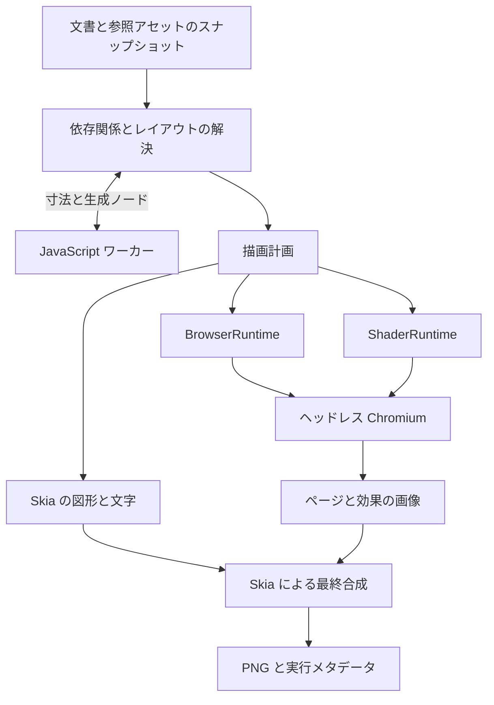

# lazypencil 動的コンテンツの実行

設計日: 2026-10-23

状態: JavaScript・Web ページ・シェーダーの初期実行・描画、MCP と TUI の基本経路、待機時の終了を実装・試験した。全形式の互換性、状態を保つページ更新、時刻・再生の操作、各 OS の検証などは未完成であり、3機能全体の完成を示すものではない。

`.pen` の `script` ノード、`browser` ノード、`shader` の塗り・エフェクトを、初期リリースの正式な対応対象とする。元データを保存できるだけでは完了とせず、実行と画像化、AI による入力・参照コードの編集、CLI・MCP・TUI への統合までを含める。

Rust 本体と Skia CPU・SkParagraph の採用は維持する。通常の図形・文字は Skia で描き、JavaScript の生成結果も同じレイアウトへ渡す。Web ページと GLSL は必要時に起動するヘッドレス Chromium で画像化し、Skia が最終合成する。

## 実行構成



BrowserRuntime と ShaderRuntime は、本体の描画バックエンドと別の実行サービスである。同じブラウザープロセスを再利用しても、Web ページとシェーダーのコンテキスト・入力を分離する。文書全体を HTML に変換してブラウザーに描かせる構成にはしない。

すべての読み取りは、`.pen` と参照コード・画像を取得したスナップショットに基づく。実行の途中でソースが変わった場合は、その出力を新しい版へ混ぜずに再実行するか、依存の変更として診断する。

## JavaScript

### 実行する内容

Script ノードの寸法と入力を渡し、スクリプトから返ったノード配列を展開して描画する。公式資料には、同期実行、DOM・ネットワーク・ファイルシステムへのアクセスなし、入力ヘッダーと `pencil` オブジェクトを使う仕組みが示されている。[Pencil の Code on Canvas](https://docs.pencil.dev/core-concepts/code-on-canvas)

lazypencil では次を実装対象とする。

- 対応する `@schema` と `@input` 宣言の読み取り、既定値と入力の検証。
- `pencil.width`、`pencil.height`、`pencil.input` と、返り値のノード配列。
- ノードの寸法、入力、変数・テーマ、参照コードが変わったときの再実行。
- 実行ごとに固定される乱数の扱いと、Pencil の出力との互換性の検証。
- 生成結果の構造・参照・出力件数を検証し、通常の文書レイアウトへ渡す処理。

公開仕様と公式の例で互換性を検証する。乱数列などの具体的な挙動を確認できていない部分は、検証済みと表記しない。対応しているコードの実行を、生成物の静的保存だけで代替しない。

### エンジンと分離

軽量な QuickJS 系エンジンを Rust のワーカーへ組み込む。初期検証では `rquickjs` と QuickJS-NG の組み合わせを評価し、対応する版を固定する。確認時点の `rquickjs` は QuickJS-NG のバインディングであり、元の QuickJS と同じ版として扱わない。[QuickJS-NG](https://quickjs-ng.github.io/quickjs/)、[rquickjs](https://github.com/DelSkayn/rquickjs)

ワーカーには許可した入力とコードを渡し、ホストのファイル・ネットワーク API を公開しない。実行時間・メモリ・生成ノード数に上限を持たせ、無限ループや異常終了が TUI・MCP・文書保存を停止させないようにする。上限の具体値は対応版の Pencil の実行条件を調べて固定する。

スクリプトの寸法と生成ノードのサイズが親のレイアウトへ影響するため、依存関係に沿って必要な計測と再実行を行う。収束しない循環は打ち切り、対象ノードの診断として返す。

### 生成物と編集

生成ノードは派生データとして扱い、元の `script` を通常のノードへ暗黙に置き換えない。生成ノードには実行結果内で識別できる ID を与え、文書に保存される ID と区別する。

AI は入力・コード・スクリプトノードの属性を編集する。派生ノードの直接更新は、次の実行で失われるため拒否し、元の入力またはコードを示す。生成ノードを読み取り、画像とともに結果を確認することは可能にする。

生成物の詳細には MCP の `read_nodes` へ `calculated: true` を渡す。`get_layout`・描画・計算を含む検証の `snapshot_id` を渡した場合は、その保持した計算をコードの再実行なしに読む。解決済み属性、属性の出所、テーマ、`generated_by` と同じ計算の `layout` を返し、入れ子の生成物も対象とする。継承した対象は通常のアドレス、生成した対象は返された最上位の不透明な `id` で選択する。依存の変更は再利用を拒否し、ページは計算と検索条件へ束縛する。CLI は `inspect --calculated` を使い、プロセス間では再計算する。通常の読み取りはコードを実行しないため、壊れたコードの修復にも使える。[取得の条件と上限](mcp.md#calculated-and-generated-nodes)

### 外部スクリプトの切り離しと参照元

外部部品の切り離しでは、JS を書き換えたり、生成した子を静的な図形へ置き換えたりしない。`scriptUri` は移動先文書から元の JS ファイルへ結び直し、生成物の部品・変数・画像・入れ子のスクリプトは元の文書から解決する。ヘッダーの既定の参照入力も実行元の文書を使い、明示入力の参照先は入力が指定された文書を使う。元ライブラリと JS・素材は依存として残す。

この参照元は `metadata.lazypencil.script_scope` v1 へ保存する。公開スキーマの `Entity.metadata` は任意の追加情報を保持できるが、この名前空間の実行上の意味は lazypencil 独自の拡張である。本家でこの情報が実行へ反映されるとは扱わず、本家との往復描画互換は未検証とする。[公開スキーマ](https://docs.pencil.dev/for-developers/the-pen-format#typescript-schema)

`script_uri` は対象コードの URI、`library` はメタデータの指定元文書からたどる宣言済みライブラリの別名である。空文字列はその指定元文書を表す。入力には必要な場合だけ `inputs.hash` と `inputs.library` を記録する。ハッシュは保存する入力値のオブジェクトを再帰的にキー順で整列し、空白なしの JSON にしたバイト列の SHA-256 とする。ほかのメタデータや `type` は保持し、既存の名前空間がオブジェクトでない場合は上書きせず編集を失敗させる。

保存済みコード URI が変われば、生成物には新しい `scriptUri` の指定元を使う。保存済み入力値が変われば、その入力には新しい `inputs` の指定元を使う。インスタンスの明示的な上書きもそれぞれの指定元を使い、JSON の値が同じでも元定義の入力・コードの文書に戻さない。コードと入力の結び付きは別々に判定する。未知の版・形式・宣言されていない別名を推測して解決しない。ライブラリ別名はファイルパスや許可領域の追加として扱わない。

切り離しの前後では、実効プロパティ・テーマ・子構造・素材の正規化パスに加えて、生成物と入力の解決元文書も比較する。実行結果の PNG 比較は `tests/script_scope.rs`、実 stdio MCP は `tests/mcp.rs` で検証する。この経路は元ライブラリへリンクした切り離しであり、スクリプトを含む部品の独立したコピーは引き続き実装対象である。

## Web ページ

### 取得と合成

Browser ノードの URL をヘッドレス Chromium で読み込み、ノードの寸法、対応するデバイス設定、ズーム、スクロール位置を反映して画像を取得する。HTML・CSS・ページの JavaScript はブラウザーに処理させる。Skia は取得画像へ回転・角丸・クリッピング・不透明度・後続の効果を適用する。

Chrome は表示 UI なしで実行でき、DevTools Protocol にはページの画像取得がある。Rust から DevTools Protocol を操作し、Node.js や Puppeteer を必須の中継として追加しない。[Chrome Headless](https://developer.chrome.com/docs/automation-and-testing/headless)、[DevTools Protocol の Page](https://chromedevtools.github.io/devtools-protocol/tot/Page/)

CLI は取得条件を満たした一時点の PNG を出力する。TUI は同じページ状態を保持して更新を取得でき、明示更新と上限付きの更新周期を提供する。ユーザーが Web ページを操作するブラウザー UI は設けず、URL・スクロール位置などの変更はプロンプトまたは構造化操作で行う。

### 取得条件と再現性

読み込みの完了条件、フォントの準備、追加待ち時間、全体のタイムアウトを取得条件として扱う。常時通信するページで無期限に待たない。URL だけでなく、最終 URL、取得時刻、ブラウザーの版、寸法・デバイス設定、準備条件、画像ハッシュを記録する。

アニメーションや外部の更新を含むページは、実際に取得した時点の状態として扱う。別の時刻の再取得が同じピクセルになるとは保証しない。ネットワークに依存しない互換試験では、ローカルのテストページとフォントを固定する。

通常利用するブラウザープロファイルを流用せず、文書用の分離されたコンテキストを使う。認証が必要なページは明示的に設定した専用プロファイルを使い、認証情報を `.pen`・会話ログ・公開する描画メタデータへ書き出さない。

## シェーダー

### 互換実行の経路

対象は対応する `.pen` 仕様の GLSL による塗りとエフェクトである。公式仕様には WebGL 1.0 のフラグメントシェーダー、uniform の宣言、画像入力などの定義がある。[Pencil の形式スキーマ](https://docs.pencil.dev/for-developers/the-pen-format#typescript-schema)

初期の互換実行は、ヘッドレス Chromium の WebGL で行う。入力コードを SkSL として扱わず、GLSL のコンパイル・リンク、uniform の設定、テクスチャの準備、描画結果の取得を ShaderRuntime が担当する。BrowserRuntime の通常の Web ページとは別の実行コンテキストを使う。

次を実装と互換試験の対象に含める。

- 通常の塗りとしての出力と、描画済みノードへ適用するエフェクトとしての出力。
- 宣言された数値・色・ベクトル・画像などの入力、変数による値の解決。
- 解像度・時刻の組み込み入力と、描画するノード・背景を参照する画像入力。
- 対象の寸法と効果用の領域、座標原点・上下方向・画像の向き。
- 色空間、アルファの扱い、ブレンド、複数の塗りと効果の適用順序。

### 宣言と数値入力

現在は precision qualifier とコメントを含む uniform 宣言、同じ型の複数宣言、1次元の数値配列を扱う。`float`・`int`・`bool`、`vec2/3/4`・`ivec2/3/4`・`bvec2/3/4`、`mat2/3/4` を受け付ける。配列は平坦な数値リストで保存し、`vec3 colors[2]` は6個、`mat2 transforms[2]` は8個の数値を使う。行列は column-major、boolean のベクトルと配列は数値の0・1で指定する。scalar bool は従来どおり JSON boolean とする。色文字列は scalar の vec3・vec4 へ結び、画像は scalar sampler2D または1次元の sampler2D 配列を使う。配列は画像 URI の文字列リストとし、各要素で文字列変数・別名・テーマの参照元を保持する。要素ごとの依存を捕捉し、切り離しでも同じ参照を維持する。固定画像の配列と相対ローカル URI の文字列変数は、元 library から独立したコピーを作れる。文字列の literal だけを画像と同じ管理 bundle の通常 `.pen` library へ置き、root の変数・別名・テーマは接続を保つ。本文の元の文字列を変更しない。絶対パス、異なる画像が衝突する symlink 経路の投影、大文字小文字の衝突などは診断して拒否し、全互換の残作業に含める。

整数リテラルの配列長は Rust 側で検査し、定数・マクロ・式の寸法はソースを変更せず WebGL のコンパイラーへ渡す。実際に使われる linked uniform の型・要素数を取得し、最適化で使われなくなった配列末尾を除いて設定する。定数式のサイズでは active な範囲より短い入力を拒否するが、コンパイラーが公開しない inactive な末尾の厳密な長さを保証しない。未指定の数値・ベクトル・行列・active な数値配列には WebGL のゼロ既定値を使い、`.pen` や GLSL へ書き戻さない。

ブロックコメントの `@resolution`・`@time` は単語を正確に照合し、`@time_step` やメールアドレス中の文字列は組み込み入力にしない。宣言前と同じ行の宣言後のコメントを扱い、隣接するコメントを統合する。複数名の宣言では同じ注釈を共有し、組み込み入力の配列・保存済み上書きを拒否する。この宣言規則は現在の lazypencil の実行規則であり、公開資料で未確定な Pencil 固有の注釈既定値まで互換と認定しない。[公開形式](https://docs.pencil.dev/for-developers/the-pen-format#typescript-schema)

ソースは1 MiB、解析は262,144 token、uniform 名は256個、配列は256要素、明示値・linked numeric component は4,096を上限とする。sampler 配列にも同じ宣言長・active prefix の検査を適用し、未指定要素には透明画像を使う。実際の fragment texture unit 上限を検査し、同じ入力画像は unit を共有する。画像の符号化済み入力は1要求64 MiBを上限とする。多次元配列、struct とマクロで生成する uniform 宣言、Pencil 固有の既定値注釈と完全な vertex interface は未完成。定数式に使うマクロは実 WebGL へ渡す。小さい値や実行期限を削って描画成功に見せる処理は行わない。独自の編集可能な [作例](../examples/uniform-study.pen) は同じ [GLSL](../examples/assets/uniform-study.glsl) を配色配列・行列で再利用する。

最終的なページ取得画像とシェーダー画像は、共通の画像表現に正規化して Skia へ渡す。エフェクトが背景を参照する場合は、それ以前の描画結果を用意する。対象ノードだけを単独で描いて背景を省略しない。

### 変数で指定した画像の参照元

画像 uniform に変数を指定した場合、lazypencil は別名と現在のテーマ条件をたどり、最後に値を定義した文書から画像の相対パスを解決する。塗り・線・エフェクトで同じ規則を使う。計算結果で画像パスを定義元文書へ結び、実際に使う素材を取得・描画するときに正規化して許可領域と依存を検査する。非表示ノードや無効な塗り・線・効果の画像は開かない。保存する変数や、その変数を使うテキストの文字列は変更しない。部品の切り離し後も元の変数への参照を保つため、その後の編集が文字列と画像へ反映される。追加のメタデータは使わない。

この参照元の選択は lazypencil の現在の実行規則として明記し、本家との往復描画互換は別途検証する。文字列を画像とテキストの両方で使う場合、画像用の変数を独立に複製するだけでは変更の連動が失われる。そのため、独立した部品コピーの対応では、この連動と名前の衝突も含めて維持することを必須とする。対応完了まではコピー時に明示的に拒否する。

### 時刻と更新

画像出力では評価時刻を明示し、既定値を `0` 秒とする。TUI では同じ時刻の表示に加え、上限付きのフレーム更新を有効にできる。静止したプレビューでは無駄な再描画を止め、同じコード・入力・時刻の結果を再利用する。

Skia の SkSL Runtime Effects を使う最適化は追加可能だが、GLSL と言語・座標・テクスチャの扱いが異なる。変換を行う場合は WebGL の基準出力との比較を必須にし、変換できないシェーダーは WebGL 経路で実行する。[SkSL の説明](https://skia.org/docs/user/sksl/)

### GPU がない環境

通常描画は Skia CPU を使う。GLSL についても、SwiftShader などのソフトウェア経路を持つ検証済み Chromium 構成を用意し、GPU がない保証環境を含める。

Chromium は SwiftShader を使う CPU 実行の構成を持つ一方、WebGL の利用可否をすべての環境で保証していない。自動フォールバックに依存せず、固定した版・設定と分離されたプロセスでソフトウェア実行を試験する。ソフトウェア実行に必要な起動設定とその制約を配布手順へ明記する。[Chromium の SwiftShader 資料](https://chromium.googlesource.com/chromium/src/+/HEAD/docs/gpu/swiftshader.md)

コンテキストを作れない、描画が上限を超える、GPU プロセスが停止する場合は、ランタイムまたは描画の失敗として返す。効果を無視した画像を、正常な出力として返さない。

## コードとアセットの管理

既存の `.js`・シェーダーファイルは `.pen` の参照に従って読み取る。AI が新規作成・変更する場合は、MCP の `put_asset` で内容ハッシュによる不変ファイルを作り、編集バッチでノードの参照を更新する。

この順序では原子的な文書更新を一つの `.pen` に保ち、失敗時には未参照のアセットだけが残る。文書のチェックポイントを復元すると、以前の不変アセットも参照される。管理アセットの回収では現行文書だけでなく、保持中の履歴からの参照も調べる。

ユーザーが外部エディターで参照コードを直接変更した場合も、ハッシュと監視で再実行する。ただし、その外部編集の履歴を lazypencil が復元できるとは扱わない。文書とアセットを持ち運べるようにし、実行結果のキャッシュを正本にしない。

## ランタイムの寿命と配布

JavaScript ワーカーと Chromium は、対象のノード・効果の評価が必要になってから起動する。参照コード・入力・時刻に変化がなければ結果を再利用する。短時間の連続描画ではランタイムを再利用し、待機が続いたら終了する。同時実行数、画像の画素数、実行時間、キャッシュ容量に上限を設ける。

Chromium と必要な補助ファイルは本体に同梱せず、専用コマンドで別途取得する。3機能の対応は製品の標準スコープとし、本体だけを入れた環境でランタイムが不足している場合は、具体的な導入方法を返す。Chromium 同梱版は初期リリースの配布対象に含めない。

`lazypencil runtime setup chromium` を明示的な導入操作として提供する。OS・CPU ごとに検証済みの取得元・版・ハッシュを固定し、取得したファイルを検証してからユーザーデータ領域へ配置する。実行ファイルだけでなく、必要なライブラリ・リソース・ソフトウェア描画の補助ファイルもまとめて管理する。通常の導入に管理者権限を必須にせず、Linux などで必要なシステムライブラリは `doctor` で確認し導入方法を案内する。

導入済みの対応版は再利用する。本体の更新で必要な版が変わった場合も、セットアップを明示的に実行して取得する。更新中や取得失敗で使用中の版を壊さないように版ごとに配置する。既存の対応ブラウザーを指定する設定も用意するが、管理する検証済みの版とは区別して互換性を診断する。描画を契機に無断でダウンロード・更新しない。具体的な配布元と実行環境の版は、Web ページ・WebGL・ソフトウェア描画の初期検証で固定する。

ユーザーによる中断はワーカーとページ・シェーダーのジョブへ伝播する。停止しないジョブは分離した実行プロセスを終了させ、書き込み済み文書は保持する。文書の保存ロックを、コード実行やネットワーク待ちの間に保持しない。

## キャッシュと診断

| 対象 | キャッシュの条件 |
| --- | --- |
| スクリプト | コードと実行環境の版、寸法、入力、参照する変数・テーマ、乱数の条件 |
| Web ページ | 取得条件、文書用コンテキスト、取得画像の ID・ハッシュ、取得時刻と期限 |
| シェーダー | コード、宣言と uniform、入力画像、時刻、寸法、色条件、実行環境の版 |
| 最終画像 | 文書のリビジョン、すべての依存ハッシュと取得 ID、領域・倍率、Skia の版 |

ローカルコードと画像の依存ハッシュを、`.pen` のリビジョンと別に記録する。Web ページの再取得では同じ文書リビジョンでも新しい結果になり得るため、TUI は依存の取得 ID でも古い結果を判定する。

診断には対象ノード、参照アセット、実行段階、原因を含める。スクリプトの行位置、シェーダーのコンパイルログ、ページの取得失敗を可能な範囲で返し、AI がコードや入力を修正できるようにする。秘密情報を含む URL・ヘッダー・プロファイル情報をそのままログへ出力しない。

## JavaScript 初期実装の検証状況

Rust の別プロセスへ `rquickjs` 0.14.0 と、その配布ソースが含む QuickJS-NG 0.16.2 を組み込んだ。モジュールローダー・ホストのファイル・ネットワーク・DOM・タイマーの API を提供しない。MCP・TUI ではプロセスを再利用するが、各評価で JS ランタイムとコンテキストを作り直す。最終実行から60秒の待機でプロセスを終了・回収する。独自の xorshift32 による固定乱数列を使い、本家との数列の一致は未検証とする。実行結果キャッシュの永続化は残る実装項目である。

既定の上限は評価2秒・JS ヒープ64 MiB・待機60秒・8反復・128評価・レイアウト10秒とする。ユーザー／プロジェクトの `[runtime.javascript]` で項目ごとに上書きし、計算ごとに捕捉した設定を CLI・MCP・TUI で使う。親の監視は実効評価時間＋1秒とし、レイアウトの絶対期限でも実行中ワーカーを止める。JS スタック512 KiB、コード1 MiB、返却 JSON 4 MiB、出力1,000ノード・深さ64のガードは独立して維持する。native pass の前後でも期限を検査するが、同期 native layout 自体を途中停止するものではない。この新しい設定統合は GHA で検証する。初期値を全環境の性能保証とは扱わない。[項目と範囲](configuration.md#javascript-execution-limits)

ヘッダーは明示した `@schema 2.19` と `@schema 2.21`、6種類の入力を受け付ける。両版で共通の実行 API を使い、本家の版別スクリプト挙動との一致は未確認とする。既定値のない入力は未指定のままとし、未宣言の入力はエラーにする。入力の型、数値の範囲、列挙値、参照先の再利用可能性を検査する。文書の変数・テーマを入力へ反映し、参照入力は指定元の文書のスコープを保つ。生成物の ID は保存済み ID と分け、レイアウトの `generated_by` から元スクリプトを示す。生成した子の直接編集はできず、元の入力やコードを編集する。

親からの fill サイズと、寸法に依存しない生成物の内容サイズを計算できる。内容サイズを計算するスクリプトがその寸法を読む場合は明示的なフォールバックを要求し、収束しない場合は診断する。現在の依存検出は寸法の読み取り単位で保守的に判定するもので、すべての JavaScript 式の依存を解析するものではない。

文書・部品・入力から宣言的に確定する依存は従来の `dependency_revision` に含める。実行後に初めて分かる画像や入れ子のコードは、別の `runtime_dependencies` と `runtime_dependency_revision` へ記録する。描画する前にコードを実行しない読み取りや構造編集でも、文書の依存リビジョンが安定して使えるようにするための区別である。計算スナップショットの ID には両方の依存、生成物の属性、実行条件を含め、再利用時には両方の不変バイト列を検査する。

計算結果に基づく編集では、MCP の `expected_runtime_dependency_revision` または CLI の `--expected-runtime-dependency-revision` に計算結果の値を指定できる。保存ロックを取る前にスクリプトを再評価し、取得した実行時依存のハッシュを比較する。保存中は取得した依存の共有ロックを保持し、文書の置換直前にも不変バイト列を検査する。通常の保存とドライランの両方で変更を競合として拒否し、結果へ編集前の `validated_runtime_dependency_revision` を記録する。既に保存した同一要求の再送は、コードが後で壊れても再実行せず保存済みの結果を返す。実行不能なコードの構造修復を妨げないよう、この追加前条件は明示指定とする。外部 Web ページの更新を凍結する条件ではない。

ヘッダー・構文・JavaScript 例外の診断は、元ソースの行・列、前後を含む最大3行・各240文字の抜粋を返す。列は1始まりの UTF-8 バイト位置とし、BOM とヘッダーも元の位置に含める。LF・CRLF・CR・Unicode の行区切りを扱い、実行用ラッパーの行数を除く。構文解析時、実行時、ヘッダーの宣言位置、動的コードへの呼び出し位置、ソース終端を区別する。位置がない例外に行番号を推測して付けない。例外スタックはコード自身が置き換えられるため、位置は修正の手がかりとして使い、保存時のリビジョン検査とは分ける。元コードのハッシュ・パス・所有アドレスを親へ返す際も抜粋を保持し、通常の CLI・TUI 表示にも該当行を含める。[取得する診断の形式](mcp.md#script-execution)

実行・入力変更・生成図形と日本語・部品参照・入れ子のスクリプト・実行時素材の更新・取消・無限ループ・メモリ不足を `tests/scripts.rs`、`tests/script_render.rs`、`tests/mcp.rs` で検証した。実行時依存の編集前条件は実 CLI・MCP、ドライラン、再送、準備中の外部素材変更でも試験している。独自の `examples/script-chart.pen` は960×600で描画し目視確認した。生成ノードの詳細取得は `tests/calculated_nodes.rs` で、元ソースの位置と抜粋は `tests/script_diagnostics.rs` で検証する。TUI の基本プレビュー・待機時終了・明示更新は下記の実 PTY 試験で確認した。本家の旧ヘッダー、公式例との互換性、TUI の全操作と各 OS の試験は引き続き必要である。

## Web ページ・GLSL の初期実装の検証状況

Chrome for Testing headless shell 156.0.8078.47 の版別公式 ZIP と全ファイルのサイズ・ハッシュを固定した。専用コマンドから HTTPS 取得または固定したローカル ZIP の導入・検査・再利用を行い、変更された導入先は上書きせず拒否する。macOS arm64 で実際の HTTPS 導入、ローカル ZIP 導入、実ブラウザー描画を確認した。ほかの OS・CPU のアーカイブも記録しているが、lazypencil の実動作を検証済みとはしない。[導入と試験手順](runtimes.md)

Browser ノードは HTTP(S)・HTML data URL・about:blank、寸法・ズーム・スクロール・基本の desktop/phone/tablet を扱う。読み込み・フォント・画像デコード・2回の描画フレームを待ち、取得条件・時刻・画像 ID・版・画像ハッシュを記録する。URL の query・fragment・資格情報・HTML 本文を取得メタデータから除く。取得ごとに新しい隔離コンテキストを用意し、MCP では取得画像を容量・件数制限のあるメモリキャッシュから再利用する。`refresh` で明示取得し直せる。認証専用プロファイル・状態を保つページ更新・待ち条件の設定・本家の全デバイス ID は未完成である。

GLSL は通常ページと別プロセスで明示的に SwiftShader WebGL を選ぶ。Chromium 自身の OS sandbox は維持し、シェーダー用コンテキストで HTTP(S)・file・FTP の取得を拒否する。`@resolution`・`@time`、数値・真偽・ベクトル・色・画像入力、塗り・線・効果、対象画像・親レイヤーを含む背景の入力、効果の順次適用を実装した。画像の向き・透明度、UV varying の precision、微分関数の extension と描画画素も試験した。注釈の全既定値・配列などの宣言互換、塗り段階の対象画像入力、本家との出力比較は未完成である。

動的な画像の固定上限は一辺8,192・16メガピクセル・PNG 32 MiBとする。キャッシュの既定値は32件・64 MiB、起動15秒、ページ30秒、シェーダー15秒、描画全体45秒とし、ユーザー／プロジェクトの `[runtime.browser]`・`[runtime.shader]`・`[runtime.dynamic]` で上書きできる。CLI・MCP・TUI の共通描画入口で捕捉した設定を適用し、起動にも処理全体・共通描画の残り期限を適用する。期限は CDP の段階ごとに延長しない。取得結果に実効 `limits` を記録し、方針が変わったら以前の取得 cache を失効させる。容量か件数が0なら cache を使わず、単体で容量を超す PNG は返却だけして保持しない。PNG encoding 後にも期限と取消を確認するが、同期 native 処理の途中停止やプロセス全体のメモリ上限ではない。この設定統合は GHA で検証する。[値と保証範囲](configuration.md#browser-shader-and-raster-cache-limits)

CLI の割り込みと MCP の取消で停止しないジョブを終了し、次の要求ではランタイムを起動し直せる。プロセス全体のメモリ上限、TUI の周期更新・時刻操作と全 OS の検証は残る。

通常テストから分けた実機試験は `tests/dynamic_render.rs`、`tests/mcp.rs`、`tests/runtime.rs` にある。独自の `examples/dynamic-panel.pen` を1000×640 PNGに変換し、日本語・ページ・GLSLの合成を目視確認した。初期の経路が動作したことと、3機能全体の互換性・公開品質の完成は区別する。

## 待機時のプロセス解放

JavaScript・ページ・シェーダーの各プロセスは、既定では実際の実行を終えた時刻から個別に60秒で待機期限となる。`runtime.javascript`・`runtime.browser`・`runtime.shader` の `idle_seconds` で個別に変更でき、0では直ちに回収する。キャッシュ画像を使うだけでは期限を延長しない。MCP の文書スレッドは要求または最も早い終了期限まで待ち、TUI のプレビュースレッドは同じ期限を条件変数の待ち時間に使う。処理は所有スレッド上で要求の間に行い、実行中のジョブを待機タイマーで中断しない。定期的な全描画や専用の回収スレッドは追加しない。

終了時には子プロセスを停止して wait で回収する。取得済みの画像と未失効の計算スナップショットは保持し、再実行や明示更新が必要になったときに起動し直す。MCP の計算スナップショットも作成から5分の期限に達したら、追加要求を待たずに解放する。CLI の一度の処理ではコマンド終了時にランタイム自体を破棄する。ライブラリを直接組み込む呼び出し側は、`idle_deadline` に合わせて `expire_idle` を呼ぶ責任を持つ。設定の再読込は次の計算／描画時に行い、待機中だけの期限判定は最後に適用した値を使う。

`tests/scripts.rs` は実ワーカーの再利用、期限直前・期限到達、回収、再起動、入力検査だけの失敗で期限を延長しないことを検査する。`tests/dynamic_render.rs` の実 Chromium 試験は、2プロセスの個別終了、回収、画像の再利用と再取得、同じ画素への復帰を確認する。MCP の実時間試験では追加要求を送らずに60秒待ち、3子プロセスの終了と回収、キャッシュだけでの描画、再計算・明示更新による復帰を確認した。

`tests/tui.rs` の実 PTY 試験は JavaScript・ページ・GLSL を一つの文書へ合成し、Kitty の RGBA を独立に復号して赤・緑・青の画素を確認する。実際の60秒の待機で3子プロセスが終了した後もプレビューと日本語の下書きを保持し、更新操作で新しい3プロセスから同じ内容を描画できた。これらの実機試験は macOS arm64 の結果であり、物理端末・各 OS のプロセスツリー回収・性能目標全体を保証するものではない。

```sh
LAZYPENCIL_TEST_CHROMIUM=/path/to/chrome-headless-shell \
cargo test --test dynamic_render page_and_shader_processes -- --ignored
LAZYPENCIL_TEST_CHROMIUM=/path/to/chrome-headless-shell \
cargo test --test mcp idle_mcp -- --ignored
LAZYPENCIL_TEST_CHROMIUM=/path/to/chrome-headless-shell \
cargo test --test tui real_pty_dynamic_previews -- --ignored
```

## 受け入れ条件

- 公式のスクリプト例を実行し、入力・寸法・テーマ・コードの変更を反映した画像が得られる。
- 無限ループ・出力過多・不正な生成ノードを処理し、文書と UI を維持できる。
- 固定したローカルページで、CSS・JavaScript・Web フォント、サイズ・デバイス設定、ズーム・スクロールを検証できる。
- ページの明示更新、常時通信するページの待ち時間上限、読み込み失敗を扱える。
- GLSL の塗りとエフェクトを、画像・背景・時刻・変数などの入力を含めて描画できる。
- シェーダーの座標、アルファ、色空間、適用順序を Pencil の基準出力と比較できる。
- GPU がない保証環境で、ソフトウェア実行と画像取得が成立する。
- CLI・MCP・TUI で、同じスナップショットと取得条件から同じ画像・診断を利用できる。
- AI がコードを作成・変更して参照を更新し、描画結果を確認して再編集できる。
- 通常文書の起動時には Chromium を起動せず、3機能を使う場合は追加プロセスも含めた時間とメモリを測定できる。
- 対象 OS・CPU のランタイムを専用コマンドで導入・再利用でき、取得失敗や中断で既存の使用可能な版を壊さない。
- ランタイム未導入時には導入方法を返し、通常の描画ではダウンロード・更新を行わない。

これらは実装の完了条件であり、現時点の実装済み機能を示すものではない。3機能の採用自体は未決事項へ戻さず、ランタイムの版、既定の上限、再現性の詳細を初期検証で固定する。
