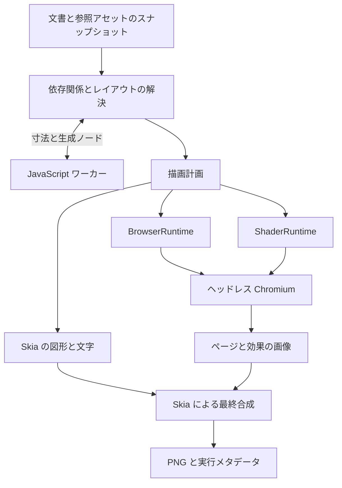

# lazypencil 動的コンテンツの実行

設計日: 2026-10-23

状態: JavaScript・Web ページ・シェーダーの初期実行・描画、MCP と TUI、待機時の終了、手動時刻・上限付き再生・LRU cache と状態付き page 更新を実装した。source `e6a1bfb` の GHA は初回対象3環境で通常／core・実 Chromium・MCP・実 PTY を成功した。これは記載する試験の範囲であり、全形式の互換性、専用認証コンテキスト、物理端末・最低 OS・全プロセスの性能保証や3機能全体の完成を示すものではない。新しい入力22ケースの検証は継続する。

`.pen` の `script` ノード、`browser` ノード、`shader` の塗り・エフェクトを、初期リリースの正式な対応対象とする。元データを保存できるだけでは完了とせず、実行と画像化、AI による入力・参照コードの編集、CLI・MCP・TUI への統合までを含める。

Rust 本体と Skia CPU・SkParagraph の採用は維持する。通常の図形・文字は Skia で描き、JavaScript の生成結果も同じレイアウトへ渡す。Web ページと GLSL は必要時に起動するヘッドレス Chromium で画像化し、Skia が最終合成する。

## 実行構成



BrowserRuntime と ShaderRuntime は、本体の描画バックエンドと別の実行サービスである。同じブラウザープロセスを再利用しても、Web ページとシェーダーのコンテキスト・入力を分離する。文書全体を HTML に変換してブラウザーに描かせる構成にはしない。

すべての読み取りは、`.pen` と参照コード・画像を取得したスナップショットに基づく。実行の途中でソースが変わった場合は、その出力を新しい版へ混ぜずに再実行するか、依存の変更として診断する。

## JavaScript

### 実行する内容

Script ノードの寸法と入力を渡し、スクリプトから返ったノード配列を展開して描画する。公式資料には、同期実行、DOM・ネットワーク・ファイルシステムへのアクセスなし、入力ヘッダーと `pencil` オブジェクトを使う仕組みが示されている。[Pencil の Code on Canvas](https://docs.pencil.dev/core-concepts/code-on-canvas)

lazypencil では次を実装対象とする。

- 対応する `@schema` と `@input` 宣言の読み取り、既定値と入力の検証。
- `pencil.width`、`pencil.height`、`pencil.input` と、返り値のノード配列。
- ノードの寸法、入力、変数・テーマ、参照コードが変わったときの再実行。
- 実行ごとに固定される乱数の扱いと、Pencil の出力との互換性の検証。
- 生成結果の構造・参照・出力件数を検証し、通常の文書レイアウトへ渡す処理。

公開仕様と公式の例で互換性を検証する。乱数列などの具体的な挙動を確認できていない部分は、検証済みと表記しない。対応しているコードの実行を、生成物の静的保存だけで代替しない。

### 入力の既定値と保存済みの旧項目

入力の省略と `null` は宣言の既定値へ戻す。宣言に既定値がなければ、number は0を min／max へ収め、string と ref は空文字列、boolean は false、color は `#000000`、enum は先頭の選択肢を使う。値は実行時だけ補い、`.pen` や JS ヘッダーへ書き込まない。空の ref は未選択として渡し、生成コードがそのまま部品参照に使う場合は既存の参照検査に従う。空でない参照は再利用可能な部品へ解決する。

ヘッダーから削除された保存済み入力は元ファイルへ保持し、`pencil.input` と変数解決から除外する。宣言された入力だけを、キャプチャ済みのヘッダーが判明した時点で一度解決する。新しく生成された入れ子の script はコードの依存を取得してから解決し、壊れたコードの読み取りでは実行を要求しない。`null` で部品参照を戻した場合はスクリプト側の既定値のライブラリを使い、同名の root 部品へ置き換えない。

自作22ケースを、明示した型別の入力契約から独立に期待値を定義して検証する。型ごとの値・null・空の ref・残った旧入力と未定義変数の無視を含む。実 worker の返却 JSON と、2形式・scale 2 の512×528画像全成分を、Rust の契約値・UTF-16 符号化による期待値へ照合する。本家の PNG・観測 JSON は現在のソースに含めず、個別許諾のない本家出力を正解にしない。明示値の型・enum の選択肢の検査、入れ子とライブラリの解決を維持する。置換後の試験は source `f11c10c` の通常 GHA `40219343928` で初回対象3環境を通過した。

### エンジンと分離

軽量な QuickJS 系エンジンを Rust のワーカーへ組み込む。初期検証では `rquickjs` と QuickJS-NG の組み合わせを評価し、対応する版を固定する。確認時点の `rquickjs` は QuickJS-NG のバインディングであり、元の QuickJS と同じ版として扱わない。[QuickJS-NG](https://quickjs-ng.github.io/quickjs/)、[rquickjs](https://github.com/DelSkayn/rquickjs)

ワーカーには許可した入力とコードを渡し、ホストのファイル・ネットワーク API を公開しない。実行時間・メモリ・生成ノード数に上限を持たせ、無限ループや異常終了が TUI・MCP・文書保存を停止させないようにする。上限の具体値は対応版の Pencil の実行条件を調べて固定する。

スクリプトの寸法と生成ノードのサイズが親のレイアウトへ影響するため、依存関係に沿って必要な計測と再実行を行う。収束しない循環は打ち切り、対象ノードの診断として返す。

### 生成物と編集

生成ノードは派生データとして扱い、元の `script` を通常のノードへ暗黙に置き換えない。生成ノードには実行結果内で識別できる ID を与え、文書に保存される ID と区別する。

AI は入力・コード・スクリプトノードの属性を編集する。派生ノードの直接更新は、次の実行で失われるため拒否し、元の入力またはコードを示す。生成ノードを読み取り、画像とともに結果を確認することは可能にする。

生成物の詳細には MCP の `read_nodes` へ `calculated: true` を渡す。`get_layout`・描画・計算を含む検証の `snapshot_id` を渡した場合は、その保持した計算をコードの再実行なしに読む。解決済み属性、属性の出所、テーマ、`generated_by` と同じ計算の `layout` を返し、入れ子の生成物も対象とする。継承した対象は通常のアドレス、生成した対象は返された最上位の不透明な `id` で選択する。依存の変更は再利用を拒否し、ページは計算と検索条件へ束縛する。CLI は `inspect --calculated` を使い、プロセス間では再計算する。通常の読み取りはコードを実行しないため、壊れたコードの修復にも使える。[取得の条件と上限](mcp.md#calculated-and-generated-nodes)

### 外部スクリプトの切り離しと参照元

外部部品の切り離しでは、JS を書き換えたり、生成した子を静的な図形へ置き換えたりしない。`scriptUri` は移動先文書から元の JS ファイルへ結び直し、生成物の部品・変数・画像・入れ子のスクリプトは元の文書から解決する。ヘッダーの既定の参照入力も実行元の文書を使い、明示入力の参照先は入力が指定された文書を使う。元ライブラリと JS・素材は依存として残す。

この参照元は `metadata.lazypencil.script_scope` v1 へ保存する。公開スキーマの `Entity.metadata` は任意の追加情報を保持できるが、この名前空間の実行上の意味は lazypencil 独自の拡張である。本家でこの情報が実行へ反映されるとは扱わず、本家との往復描画互換は未検証とする。[公開スキーマ](https://docs.pencil.dev/for-developers/the-pen-format#typescript-schema)

`script_uri` は対象コードの URI、`library` はメタデータの指定元文書からたどる宣言済みライブラリの別名である。空文字列はその指定元文書を表す。入力には必要な場合だけ `inputs.hash` と `inputs.library` を記録する。ハッシュは保存する入力値のオブジェクトを再帰的にキー順で整列し、空白なしの JSON にしたバイト列の SHA-256 とする。ほかのメタデータや `type` は保持し、既存の名前空間がオブジェクトでない場合は上書きせず編集を失敗させる。

保存済みコード URI が変われば、生成物には新しい `scriptUri` の指定元を使う。保存済み入力値が変われば、その入力には新しい `inputs` の指定元を使う。インスタンスの明示的な上書きもそれぞれの指定元を使い、JSON の値が同じでも元定義の入力・コードの文書に戻さない。コードと入力の結び付きは別々に判定する。未知の版・形式・宣言されていない別名を推測して解決しない。ライブラリ別名はファイルパスや許可領域の追加として扱わない。

切り離しの前後では、実効プロパティ・テーマ・子構造・素材の正規化パスに加えて、生成物と入力の解決元文書も比較する。実行結果の PNG 比較は `tests/script_scope.rs`、実 stdio MCP は `tests/mcp.rs` で検証する。この経路は元ライブラリへリンクした切り離しであり、スクリプトを含む部品の独立したコピーは引き続き実装対象である。

独立コピーの前提となる参照の再割り当てとして、`metadata.lazypencil.script_bindings` v1 を実装する。`script_uri` が保存済みコード URI と一致する間、`components` は JS が生成する部品名からメタデータを所有する文書の再利用可能 ID、`variables` は変数名、`themes` はテーマ軸への対応表として使う。`descendants` は元の部品名ごとに元の完全な上書き経路から新しい経路への対応を持つ。コード本文・生成 ID・名前・任意のメタデータは書き換えない。参照入力には内部 handle を使い、JS 本文の部品名と利用者の明示入力が同じ文字列でも区別する。

ヘッダーの ref 既定値は対応表を使う。保存済み入力にも適用する場合は、キーを整列した JSON の SHA-256 を `inputs_hash` に記録する。入力の変更やインスタンスの明示上書きはその入力の対応だけを失効させ、null はヘッダーの既定値を使う。同じ URI の明示的なコード上書きも対応表を失効させる。対象はメタデータの所有文書、または省略可能な library で指定した宣言済み別名の文書内に存在する部品・変数・テーマに限り、この拡張で新しいファイルパスや許可領域を追加しない。未知の版、未知の項目、欠損した対象、衝突した軸・上書き経路、未登録の生成参照は診断する。対応状態の hash は計算条件と script 実行記録へ含める。

`import_component` の copy は、script が解決元の文書とその import から参照できる再利用可能な部品・変数・テーマを取り込み、JS の生成結果に対する対応表を保存する。現在実行した分岐の出力だけを保存する方式ではなく、コピー中に JS は実行しない。コード本文は不変の管理アセットへ元のバイト列のままコピーする。宣言済み素材と、画像の内容を持つ文字列変数の参照先を取り込み、元ライブラリを削除した後にも解決する。画像を表す文字列変数は既存の private library へ原文の文字列を置く方法を共有し、本文との連動と利用者が新しい URI へ編集した場合のコピー先の解決元を保つ。

JS 内でだけ構築する素材名は `options.script_assets` に追加する。キーは名前の衝突ポリシーと同じ元ノードの修飾キー、値は `[{"kind":"image|shader|script","uri":"relative/path"}]` とする。URI はその script の生成物の元文書から解決し、通常の許可範囲・リビジョン・不変ファイル・保存前の変更検査を適用する。`assets` 対応表にない生成パスを、コピー先の同名ファイルや元ライブラリへ推測して接続しない。元の parent traversal は symlink を通る場合があるため、`a/../` を別の経路へ字句的に統合しない。検査済みの実パスと元の綴りをそれぞれ対応付ける。生成する入れ子の script は、追加した JS と同じ対応表を有限の容量制限内で引き継ぐ。生成した ref の script 入力も型を確認し、内部 handle で生成元の部品を保持する。

通常の ref 入力と既定の ref 入力を区別し、必要な場合は `input_components` を別に保存する。明示的な利用者のインスタンス入力はコピー先の文書で解決する。複数の元文書で同じテーマ軸を共有する場合は同じコピー先の軸を明示的に再利用し、別々の軸へ分離して元の継承を変える指定は拒否する。ライブラリ経路は最大4096、参照名は最大100,000・4 MiB、生成する入れ子への対応表の継承も出力ごとの容量制限を持ち、上限時に残りを黙って省かない。

対応表を持つ script の再コピーでは、元の名前と ID の identity fallback、保存済み入力・default の別スコープ、変数・テーマ・descendant 経路・素材の対応を新しいコピー先へ合成する。JS は書き換えず、追加素材は再コピー時にも指定できる。元の対応表が拒否していた素材名を同名のコピー先ファイルへ結ばない。新しい対応表は1 script 4 MiB、1 copy 操作の合計は文書の64 MiB枠で生成中に制限し、超過時は部分保存しない。素材の対応も構築中に検査する。自動で追加していた元ファイルの絶対パスの別名は新規に保存せず、明示した URI と確認済みの相対名を使う。

対応表付き script の切り離しは、対応先の所有文書を省略可能な `script_bindings.library` に保持する。別名はメタデータの指定元文書から宣言済み import だけをたどり、ファイルパスや新しい許可範囲を渡さない。コード URI は再配置した値へ結び、入力の対応は切り離し前に有効だった場合だけ新しい raw 入力の hash へ更新する。同じ JSON の明示入力やコード上書きで失効した対応は復活させず、通常のメタデータは保持する。生成する入れ子は既に解決した所有文書を使い、別名を二重に適用しない。

切り離しは既存のコード・部品・素材への依存を保持する。独立コピーを選んだ場合は、転送された所有文書も含めて閉包を作り、新しいコピー先のローカル対応表へ合成する。切り離しの検査では保存形式の URI・別名・hash の綴りを比較する代わりに、正規化したコードの場所、実効プロパティ・テーマ・部品／変数／素材の対応先と入力の失効状態を比較する。disabled な script のヘッダーも snapshot に捕捉し、宣言済みの入力だけを移し、古い未知の入力は解決せず保存する。JS は切り離し中にも実行しない。

継承した script の保存済み入力は `script_input_context` v1 でコード生成用の対応表から分離する。元の入力式・変数・参照部品を新しいコピー先へ結び、ヘッダーの既定値にはコードのスコープを使う。未使用の古い入力を評価せず保持し、宣言済みの入力として使う時点で検証する。入力・コードの明示的な再設定は、同じ JSON でもその項目の古い対応を失効させる。

部分上書きで指定した script の追加素材は、所有する ref の ID と descendant 経路を `/` で結んだキーを文書の別名で修飾し、`script_assets` に渡す。例えば `ui:inner/draw` は ui 文書の inner ref が draw へ適用するコードの素材を表す。元のコード URI・生成スコープを使って素材を検査し、入力だけの上書きからコードの所有権を変更しない。

通常の metadata を継承する部分上書きには、専用の `metadata.lazypencil.script_override` v1 を保存する。`input` と `output` を個別に保持し、`metadata:null` は通常のユーザーメタデータを継承する。解決したノードには内部 envelope を公開せず、実効 metadata と参照範囲を計算へ渡す。上書きしていない入力や metadata はコピー後の元定義の編集にも追従する。これらも lazypencil 独自の補助情報であり、本家での実行互換を示すものではない。両形式・6種類の部分上書きで、実 worker、元ライブラリ削除、再コピー、同値の明示更新、継承・切り離しを GHA で検証する。

明示的な通常 metadata は envelope の `metadata` に保持し、入力・コードの対応表とは独立して上書きする。通常 metadata の変更だけで、継承元の実行コンテキストを固定しない。`reset_override` は対象項目を元定義へ戻し、存在しない項目の unset/reset では対応表を失効させない。元定義の入力や同じ URI のコードを後から明示更新した場合も、部分上書きがその変更を隠さない。`script_bindings`・`script_scope`・`script_input_context` を明示する場合は、それぞれが所有する対応だけを適用する。

コピーした generator が生成する ref の `scriptUri` と、descendants 内のコード上書きを、登録済みの `script_assets` から解決する。出力の対応表だけを生成元から継承し、指定していない保存済み入力と通常 metadata は参照先の定義から継承する。明示入力は生成元の名前空間、null は置き換えたヘッダーの既定値を使う。ヘッダーの捕捉前に未使用の旧入力を評価せず、宣言された入力だけを厳密に書き換える。対応表は既存の生成出力量上限内で共有して計数する。実 worker と画素、元 library／コピー元 assets の削除、2形式・直接／子孫／型付き置換・5種の入力／metadata と再コピー、未登録コード・明示スコープ・容量超過の拒否を試験する。

参照入力を確定する前に、参照先とその子孫の実効テーマだけを導出する。ヘッダーが未確定の入力や通常プロパティの評価は、この準備処理では行わない。型付きの子孫置換と children 置換にも、対象コンテナのテーマを伝える。別名へコピーしたテーマで参照先を選び、再コピー後にコンテナのテーマを変更・復元する実 worker／画素の試験を追加した。基本30組と追加のテーマ6組は、別々の一時プロジェクト・素材・JS プロセスを使い、スキーマ別に最大2並列で実行する。判定するケースと既存の期限・画素基準は維持する。追加のテーマ処理と並列化は GHA で検証する。

生成 browser の独立コピーは、script の生成元文書が宣言した Web 素材を既存の bundle と補助ライブラリへ保存し、`script_bindings.browser_library` に宣言済み別名を保持する。生成した browser の URL、ref の URL 上書き、descendant の部分上書き・置換、children の置換、入れ子の script に同じ所有文脈を適用する。URL を上書きしない参照は部品定義の素材を継承する。URL・HTML・CSS・JS 本文を変更せず、再コピーで別名を合成する。未宣言の file URL はコピー先の同名 URL へ結ばない。追加する文脈は既存の生成出力容量制限へ算入する。両形式・7経路・元ファイル削除後と再コピー後の42画像は、`b15bfa5` の [GHA `40234583740`](https://github.com/EkeMinusYou/lazypencil/actions/runs/40234583740) で初回3環境とも成功した。合計126画像・64,512画素、source／PNG hash、前後の PNG バイト列と素材 revision も独立に照合した。

生成した `browser_scope`／`browser_override` の明示別名には、`script_bindings.browser_libraries` の対応表を使う実装を追加した。コピー元の宣言済み import 探索から Web 素材を持つ文書の別名を保存し、空の別名は生成元自身、多段別名はその宣言先へ結ぶ。再コピーは元の名前と前回の対応先を合成し、入れ子の generator にも継承する。参照の metadata だけの上書きは参照先 URL を用いて有効性を判定し、通常の metadata は専用 envelope の内側に保持する。URL を所有する生成ノードの不一致スコープは生成元の捕捉済み既定文脈を使う。URL を上書きせず不一致スコープだけを指定した場合は、元の URL 所有文脈の保持が未完成のため診断する。古い閉包に対応表がない場合や、捕捉していない別名・Web 素材のない文書も診断し、同名のコピー先へフォールバックしない。両形式・22経路、元ファイル削除と再コピー後の132画像を含む追加試験は GHA 未確認である。

生成時に明示する script スコープの合成、上記の残る browser 文脈と本家との往復描画互換は引き続き必要である。生成結果の静的な保存や元ライブラリへのリンクで代替しない。独立コピー全体と初期リリースの完了条件は維持する。


## Web ページ

### ローカル素材の固定と持ち運び

文書の `metadata.lazypencil.browser_resources` v1 は、元の `file:` ディレクトリ URL と、その文書から見た素材ディレクトリを `roots: [{url, path}]` で対応付ける。許可された project root と私有データの境界を検査し、内容・ディレクトリの追加／削除・リンク先を不変入力へ捕捉する。この宣言は本家の `.pen` 属性ではなく lazypencil の補助情報である。

共通編集バッチの `{"op":"pack_browser_resources"}` は、この文書の宣言済み素材を `assets/lazypencil/<hash>.bundle/` へ保存し、宣言を `bundle: {uri, sha256}` に置き換える。版付き `resources.json` が元 URL・MIME・内容 hash・容量を保持し、同じ内容の payload は共有する。HTML・CSS・JavaScript 内の URL は書き換えず、空の CSS や拡張子なしファイルも保持する。原本のディレクトリは変更しない。`.pen` と生成された `assets` を一緒に移動でき、再実行では同じ内容の bundle を再利用する。

dry-run と後続操作の失敗では素材を公開しない。欠損した入力、改変されたカタログ／payload、私有データへの参照を拒否する。欠損状態でも通常の文書編集と修復は可能である。管理素材の出力先を捕捉元のディレクトリ内へ置く操作は、検証中の入力を変更しないよう公開前に拒否する。素材用ディレクトリと `assets` は分ける。

独立コピーでは、URL を所有する文書の捕捉済み namespace を bundle と補助ライブラリへ移す。同じ URL を使う別ライブラリやコピー先の素材と混同しない。`metadata.lazypencil.browser_scope` v1 は元の URL と宣言済みライブラリの別名だけを保持し、任意のファイルパスを開く指定には使わない。browser の URL は [形式仕様](https://docs.pencil.dev/for-developers/the-pen-format) の通常の文字列として扱い、query・fragment・`$` の文字を変数として展開しない。寸法などの対応する変数はコピー先の名前・テーマへ結び直す。HTML・CSS 内の URL は保持し、元ライブラリの削除と別文書への再コピーに対応する。

URL の部分上書きには `browser_override` v1 の専用 metadata envelope を使う。ユーザーの metadata と素材の参照文脈を分け、指定していない metadata や URL は元定義への継承を保つ。切り離しは有効な参照元をルート文書の宣言済み別名へ結び直し、保存前に実効プロパティ・テーマ・素材の参照元が変わらないことを検査する。通常の metadata だけの更新・unset は実行文脈を保持し、URL の明示更新は同じ JSON でも古い対応を失効させる。URL の override を reset すると元定義への継承に戻る。

共通編集バッチの `{"op":"set_browser_resources","roots":[{"url":"file:///original/site/","path":"web"}]}` で宣言を設定し、空配列でこの文書の宣言を解除する。宣言は既存の Project の許可 root を拡張せず、私有データの境界を越えられない。共通描画入口は file URL を所有する文書の捕捉済み namespace だけに結び、未登録の file 要求をホストから読まない。捕捉元と素材 revision を raster cache／保持 page の識別子へ含め、素材が変わった場合は画面外の保持 context も閉じる。寸法だけの変更は DOM を保つ。取消は描画入口で処理し、最初の確認で中止した場合も既存の browser／shader process と動的 cache を回収する。新経路は GHA で検証中である。ネイティブ file の日時・range／media・worklet／popup・全 worker 起動方式、本家との往復描画互換と製品全体の残件は引き続き必要である。

### 取得と合成

Browser ノードの URL をヘッドレス Chromium で読み込み、ノードの寸法、対応するデバイス設定、ズーム、スクロール位置を反映して画像を取得する。HTML・CSS・ページの JavaScript はブラウザーに処理させる。Skia は取得画像へ回転・角丸・クリッピング・不透明度・後続の効果を適用する。

Chrome は表示 UI なしで実行でき、DevTools Protocol にはページの画像取得がある。Rust から DevTools Protocol を操作し、Node.js や Puppeteer を必須の中継として追加しない。[Chrome Headless](https://developer.chrome.com/docs/automation-and-testing/headless)、[DevTools Protocol の Page](https://chromedevtools.github.io/devtools-protocol/tot/Page/)

CLI は取得条件を満たした一時点の PNG を出力する。TUI は同じページ状態を保持して更新を取得でき、明示更新と上限付きの更新周期を提供する。ユーザーが Web ページを操作するブラウザー UI は設けず、URL・スクロール位置などの変更はプロンプトまたは構造化操作で行う。

### 取得条件と再現性

読み込みの完了条件、フォントの準備、追加待ち時間、全体のタイムアウトを取得条件として扱う。常時通信するページで無期限に待たない。URL だけでなく、最終 URL、取得時刻、ブラウザーの版、寸法・デバイス設定、準備条件、画像ハッシュを記録する。

`[runtime.browser].additional_wait_ms` は既定0・最大60,000msで、読込／selector条件の後、最終のfont・画像decode・2 animation frameの前に待つ。ページ側のtimerに依存せず、取得／描画の残り期限と取消を共有する。ユーザー設定の待機はプロジェクトの明示0で解除でき、取得metadataとcacheの識別へ含める。設定継承・遅れて追加される画像・host時計・期限・取消／回収／復帰の試験は `360813d` の全3環境CI `40605012001` で成功した。

`[runtime.browser].animation_policy` は既定 `running`、明示 `paused` で取得条件の完了後に native document animation の再生率を0にする。CSS animation・transition・Web Animations を対象にし、JavaScript timer・video・画像decode・別processのframe全体を停止する時計ではない。固定時刻へのseekは行わず、同じ保持contextの更新では停止した状態を取得する。方針変更時は既存の設定再読込に従いcontextを破棄し、metadataと取得cacheも更新する。3種類のnative animation・停止後に作成するanimation・画素・通常frameの継続と設定継承の追加試験はGHA未検証である。

アニメーションや外部の更新を含むページは、実際に取得した時点の状態として扱う。別の時刻の再取得が同じピクセルになるとは保証しない。ネットワークに依存しない互換試験では、ローカルのテストページとフォントを固定する。

`[runtime.browser].network_policy` は既定 `online`。準備中の `offline` はHTTP(S)／WebSocketをcontext単位で拒否し、localhost・worker・子frameにも適用する。宣言済みの捕捉したローカル素材・data・about:blankは既存のファイル境界内で利用でき、外部の主文書が必要な取得は診断を返す。明示したprojectのonlineはuserのofflineを上書きする。取得metadataとlimitsへ含め、設定変更時はcacheと保持contextを更新する。既定onlineではlistener／threadを開始しない。8e9c3b8の先行・初回3環境の全体検証でHTTP／WS成功対照・HTTPS／WSS接続試行対照・拒否・worker／frame・新context・cache・回復を通過した。次の差分ではページ用プロセスの起動時にWebRTCをproxy経由へ制限し、network方針の変更時は通常取得と保持取得の両方でプロセスを更新する。STUN／TURN(TCP)・ページ／workerのWebTransportについて、所有sinkへの正の接続対照、1500msの観測、拒否、refreshとonline復帰をRust試験に加える。sinkは接続を完了せず、正常なmedia／contentの対照とはしない。この追加Rustと固定GHA版は未検証であり、さらに広いprotocol／host全体の通信制御は残る。

通常利用するブラウザープロファイルを流用せず、文書用の分離されたコンテキストを使う。認証が必要なページは明示的に設定した専用プロファイルを使い、認証情報を `.pen`・会話ログ・公開する描画メタデータへ書き出さない。

## シェーダー

### 互換実行の経路

対象は対応する `.pen` 仕様の GLSL による塗りとエフェクトである。公式仕様には WebGL 1.0 のフラグメントシェーダー、uniform の宣言、画像入力などの定義がある。[Pencil の形式スキーマ](https://docs.pencil.dev/for-developers/the-pen-format#typescript-schema)

初期の互換実行は、ヘッドレス Chromium の WebGL で行う。入力コードを SkSL として扱わず、GLSL のコンパイル・リンク、uniform の設定、テクスチャの準備、描画結果の取得を ShaderRuntime が担当する。BrowserRuntime の通常の Web ページとは別の実行コンテキストを使う。

次を実装と互換試験の対象に含める。

- 通常の塗りとしての出力と、描画済みノードへ適用するエフェクトとしての出力。
- 宣言された数値・色・ベクトル・画像などの入力、変数による値の解決。
- 解像度・時刻の組み込み入力と、描画するノード・背景を参照する画像入力。
- 対象の寸法と効果用の領域、座標原点・上下方向・画像の向き。
- 色空間、アルファの扱い、ブレンド、複数の塗りと効果の適用順序。

### 宣言と数値入力

マクロ・条件分岐がある shader は、実 WebGL コンパイラーで元の GLSL を検査し、そのコンパイラーの predefined macro を使ってブラウザー内の上限付き Wasm で展開してから、選択された宣言を Rust の型検査へ渡す。型・名前・構造体 field・配列長を生成する object／function macro と、異なる型を持つ条件分岐を同じ経路で扱う。選択された宣言の documentation の既定値・時刻・解像度も維持する。注釈と宣言の間にある directive は展開後に消えても区切りとして保持し、元の行・ファイル番号や byte 位置を変更しない内部コピーを使う。コメント内の色などの `#` は directive と区別する。未選択または未知の名前への保存済み override はエラーとし、元のコード・文書は書き換えない。展開ソースは4 MiB、宣言トークン・型・添字の既存の上限を保ち、Wasm にホスト側のファイル・ネットワーク機能を渡さない。宣言取得と型付き入力の準備・描画は一つの shader 期限を共有する。展開ソースと PNG は同じ LRU の容量・件数制限に従い、cache の読み取りで待機期限を延長しない。自作8ケースを両形式・塗り／効果・1倍／2倍で検査し、inactive な時刻・型エラー・未対応版・idle 後の再利用も確認する。新しい Rust／実 WebGL の結果は GHA で検証し、本家との全互換性とは扱わない。

現在は precision qualifier とコメントを含む uniform 宣言、同じ型の複数宣言、1次元の数値配列を扱う。`float`・`int`・`bool`、`vec2/3/4`・`ivec2/3/4`・`bvec2/3/4`、`mat2/3/4` を受け付ける。配列は平坦な数値リストで保存し、`vec3 colors[2]` は6個、`mat2 transforms[2]` は8個の数値を使う。行列は column-major、boolean のベクトルと配列は数値の0・1で指定する。scalar bool は従来どおり JSON boolean とする。色文字列は scalar の vec3・vec4 へ結び、画像は scalar sampler2D または1次元の sampler2D 配列を使う。配列は画像 URI の文字列リストとし、各要素で文字列変数・別名・テーマの参照元を保持する。要素ごとの依存を捕捉し、切り離しでも同じ参照を維持する。固定画像の配列と相対ローカル URI の文字列変数は、元 library から独立したコピーを作れる。文字列の literal だけを画像と同じ管理 bundle の通常 `.pen` library へ置き、root の変数・別名・テーマは接続を保つ。本文の元の文字列を変更しない。絶対パス、異なる画像が衝突する symlink 経路の投影、大文字小文字の衝突などは診断して拒否し、全互換の残作業に含める。

構造体は名前付き・inline・匿名・入れ子の型を解析し、`lamp.color` や `lights[1].gain` のような修飾した末端名で、既存の平坦な `uniforms` オブジェクトへ値を保存する。構造体の配列、構造体フィールドの配列、配列を含む構造体の入れ子も同じ規則で扱う。構造体配列の内部表現には添字のパターンを使い、WebGL が返す実際の末端名・型に結び付ける。未指定値・field の既定値・画像入力には既存の型と容量の検査を適用する。field の注釈はその宣言だけに適用し、構造体全体への `@default`・`@time`・`@resolution` は拒否する。構造体配列の末端へ自動の時刻・解像度を設定しない。展開は256末端パターン・16段、識別子は1024バイト、修飾名は4096バイトで区切る。[WebGL の uniform 取得](https://registry.khronos.org/webgl/specs/latest/1.0/#5.14.10) と [OpenGL ES の構造体の末端名](https://raw.githubusercontent.com/KhronosGroup/OpenGL-Refpages/main/es2.0/glGetActiveUniform.xml) を参照する。自作10ケースの CLI 0.3.9 はすべて宣言解析エラーとなったため、その画像を互換性の正解にはしない。新しい8ケースを2形式で、自作 GLSL の計算値と実 WebGL の全画素で検証し、同 CLI との一致や全体の構造体互換性は主張しない。新しい Rust／実 WebGL の実行は GHA で確認する。

対象の GLSL ES 1.00 は直接の配列の配列と、構造体内での新しい型定義を認めないため、それらは構文エラーとして拒否する。既に宣言した型を field として使う入れ子と、構造体を介した複数段の添字は扱う。[GLSL ES 1.00 §4.1.8–4.1.9](https://registry.khronos.org/OpenGL/specs/es/2.0/GLSL_ES_Specification_1.00.pdf)

元の宣言またはマクロ展開で整数リテラルになった配列長は Rust 側で検査し、残る定数式の寸法は WebGL のコンパイラーへ渡す。保存されたソースは変更しない。実際に使われる linked uniform の型・要素数を取得し、最適化で使われなくなった配列末尾を除いて設定する。定数式のサイズでは active な範囲より短い入力を拒否するが、コンパイラーが公開しない inactive な末尾の厳密な長さを保証しない。未指定の数値・ベクトル・行列・active な数値配列には WebGL のゼロ既定値を使い、`.pen` や GLSL へ書き戻さない。

宣言直前の最も近い documentation comment（`/** ... */`）の `@resolution`・`@time` を単語として照合する。空行は許すが、別の comment・通常のコード・プリプロセッサ行を挟むと先行注釈を破棄する。セミコロン後の注釈は同じ行でも次の宣言へ適用し、宣言内の注釈や末尾だけの注釈は適用しない。複数名の宣言では同じ注釈を共有する。組み込み入力の配列・保存済み上書きと、`@time`／`@default` の併用は拒否する。自作20ケースの GLSL と明示した注釈契約から期待色を独立に求め、2形式・scale 1/2 の全画素を検査する。本家出力は期待値に使用しない。拡大出力時の logical 座標・resolution は以下の経路で実装し、比較試験で検証する。最新形式の完全な互換性は未完了とする。

拡大座標を補正する前処理は独立した Rust／Wasm component を共通の描画経路から実行する。塗り・罫線はノード内の論理寸法、effect は合成画像の論理寸法を解像度とし、`gl_FragCoord.xy` を同じ単位へ変換する。z/w は WebGL の値を保持する。GLSL のマクロ・条件分岐を展開した後に残る組み込み座標だけを変換し、元のソースと hash は保持する。Chromium 内の import memory を最大64 MiBに制限し、ファイル・ネットワーク・WASI の import は与えない。component は本体の Cargo.lock と native build cache から分離し、変更時は GHA の Wasm／実行試験と原ライセンス収集を重い native 検証より先に行う。元の WebGL ソースを先に検証し、実コンパイラーへ GL_ macro の定義状態を問い合わせる。GHA で生成・検証した481,016バイトの module を同梱し、通常の利用と native build に Node や Wasm target の導入は要らない。ソース54ファイル・binary・69 package の原表示・wasm32 の標準 library 54点を照合する。元の source hash と module hash・論理寸法を取得結果へ記録する。現行の試験では、自作10ケースの2倍画像と注釈20ケースの1倍／2倍画像を、独立した式と明示した入力契約から求めた期待値で照合する。元の行番号、実コンパイラーの macro と effect／z/w も検査する。期待値の置換後は source `f11c10c` の対象3環境で成功した。従来の本家参照画像は現行ソースに含めず、過去の比較記録を現在の検証根拠にはしない。その他の宣言・注釈・適用領域を含む全互換性は未完成である。

宣言前の `/** ... */` comment の `@default` は、数値・`@color` の色・カンマ区切りの成分を指定できる。grouped 宣言は共有し、保存済みの uniform 値を優先する。配列は先頭要素だけを初期化し、リンクされた残りを0にする。通常 comment は既定値にしない。宣言後の documentation comment は、上記の隣接規則に従って次の宣言へ適用する。自作14ケースの literal／constant 配列の2方式を保持し、独立した式で求めた色と実 WebGL 出力の全画素を、従来の最大差1の基準で照合する。本家の参照 PNG は保持しない。現在の試験は lazypencil の文書化された契約を検証し、最新形式全体の互換性を証明するものではない。置換後の実行は同 source の対象3環境で成功した。

ソースは1 MiB、解析は262,144 token、uniform 名は256個、配列は256要素、明示値・linked numeric component は4,096を上限とする。sampler 配列にも同じ宣言長・active prefix の検査を適用し、未指定要素には透明画像を使う。実際の fragment texture unit 上限を検査し、同じ入力画像は unit を共有する。画像の符号化済み入力は1要求64 MiBを上限とする。マクロ・条件分岐を含めた本家との全 shader 互換性、残る Pencil 注釈と完全な vertex interface の確認は未完了。小さい値や実行期限を削って描画成功に見せる処理は行わない。独自の編集可能な [作例](../examples/uniform-study.pen) は同じ [GLSL](../examples/assets/uniform-study.glsl) を配色配列・行列で再利用する。

最終的なページ取得画像とシェーダー画像は、共通の画像表現に正規化して Skia へ渡す。エフェクトが背景を参照する場合は、それ以前の描画結果を用意する。対象ノードだけを単独で描いて背景を省略しない。

### 変数で指定した画像の参照元

画像 uniform に変数を指定した場合、lazypencil は別名と現在のテーマ条件をたどり、最後に値を定義した文書から画像の相対パスを解決する。塗り・線・エフェクトで同じ規則を使う。計算結果で画像パスを定義元文書へ結び、実際に使う素材を取得・描画するときに正規化して許可領域と依存を検査する。非表示ノードや無効な塗り・線・効果の画像は開かない。保存する変数や、その変数を使うテキストの文字列は変更しない。部品の切り離し後も元の変数への参照を保つため、その後の編集が文字列と画像へ反映される。追加のメタデータは使わない。

この参照元の選択は lazypencil の現在の実行規則として明記し、本家との往復描画互換は別途検証する。独立コピーでは別名・テーマ・テキストとの連動を維持し、画像をコピー先の管理素材と変数ライブラリへ取り込む。相対パスはライブラリ内で同じ表記を保つ。絶対パスは、テキストとしての元の文字列を保持し、画像として解決するときだけ管理素材の相対パスへ結ぶ。コピー先の変数を後から編集した場合は、その新しい値と定義元を使う。明示的に再利用した変数はコピーせず、既存の参照を保つ。

絶対パスの対応には、生成した変数ライブラリの `metadata.lazypencil.sampler_images` に `{ "version": 1, "images": { "元の文字列": "images/内容ハッシュ.png" } }` を保存する。拡張子は元の PNG・JPEG・WebP の内容に合わせる。これは lazypencil 独自の補助データであり、本家の公開仕様や本家での往復描画保証ではない。画像に使う変数の末端の定義元だけに作用し、通常の文字列・画像 URL・コード・import の解決には適用しない。最大4,096項目・文字列合計4 MiB・各パス4,096バイトで、未知版・未知項目・絶対の転送先・親移動・URL・不正な型を拒否する。転送先にも通常の許可領域・依存変更の検査を適用し、未使用の画像は開かない。文書と素材一式を移動した後や再コピーでも、元の絶対パスを開き直さない。

相対パスでも、symlink を通った `jump/../pixel.png` と `pixel.png` が別の画像を指す場合や、ファイル／ディレクトリ・大文字小文字の投影が衝突する場合は、同じ `sampler_images` を使って画像だけを内容ハッシュのパスへ分ける。元の文字列・テーマ・別名は保持する。衝突しない相対参照は従来のディレクトリ配置を保ち、画像ごとに大量のライブラリへ分割しない。転送の判断は実ファイル操作の前の共通パス検査だけで行い、保存先の既存ファイル・symlink・内容変更の衝突を転送で回避しない。元の source と素材は通常の許可領域・依存の検査を受け、保存と容量・パス数の上限も維持する。

### 時刻と更新

画像出力では評価時刻を明示し、既定値を `0` 秒とする。TUI では同じ時刻の表示に加え、上限付きのフレーム更新を有効にできる。静止したプレビューでは無駄な再描画を止め、同じコード・入力・時刻の結果を再利用する。

TUI の `/play [fps]` と Preview の Space は、既定5・最大10 fps の再生を要求する。単調時計から評価時刻を求め、描画中・待機要求・未表示の結果がある間はフレームを捨てる。既存の描画を timer で取消せず、遅れたフレームを後から連続実行しない。`/pause` または Space で次の要求を止め、実行中の1フレームはその要求時刻で完了できる。時刻の手動変更は再生を止める。`@time` を持つ実描画の acquisition がない場合は開始せず、描画エラーと静的な結果への変更で停止する。overlay と添付画像の閲覧中はフレーム要求を保留するが、論理時計は進む。停止中は再生の timer を起こさない。元の文書・会話へ再生状態や時刻を保存しない。初回 source `1936598` の macOS arm64 `40052100177`（260試験）と Linux x64 `40052102399`（262試験）が実 PTY・両構成 Clippy を含めて成功し、artifact の digest・必須試験の成功・取得 metadata・画像を照合した。停止時刻を完了済み画像へ結び付ける後続 `5fd4ddc` の検証は実行中である。

Skia の SkSL Runtime Effects を使う最適化は追加可能だが、GLSL と言語・座標・テクスチャの扱いが異なる。変換を行う場合は WebGL の基準出力との比較を必須にし、変換できないシェーダーは WebGL 経路で実行する。[SkSL の説明](https://skia.org/docs/user/sksl/)

### GPU がない環境

通常描画は Skia CPU を使う。GLSL についても、SwiftShader などのソフトウェア経路を持つ検証済み Chromium 構成を用意し、GPU がない保証環境を含める。

Chromium は SwiftShader を使う CPU 実行の構成を持つ一方、WebGL の利用可否をすべての環境で保証していない。自動フォールバックに依存せず、固定した版・設定と分離されたプロセスでソフトウェア実行を試験する。ソフトウェア実行に必要な起動設定とその制約を配布手順へ明記する。[Chromium の SwiftShader 資料](https://chromium.googlesource.com/chromium/src/+/HEAD/docs/gpu/swiftshader.md)

コンテキストを作れない、描画が上限を超える、GPU プロセスが停止する場合は、ランタイムまたは描画の失敗として返す。効果を無視した画像を、正常な出力として返さない。

## コードとアセットの管理

既存の `.js`・シェーダーファイルは `.pen` の参照に従って読み取る。AI が新規作成・変更する場合は、MCP の `put_asset` で内容ハッシュによる不変ファイルを作り、編集バッチでノードの参照を更新する。

この順序では原子的な文書更新を一つの `.pen` に保ち、失敗時には未参照のアセットだけが残る。文書のチェックポイントを復元すると、以前の不変アセットも参照される。管理アセットの回収では現行文書だけでなく、保持中の履歴からの参照も調べる。

ユーザーが外部エディターで参照コードを直接変更した場合も、ハッシュと監視で再実行する。ただし、その外部編集の履歴を lazypencil が復元できるとは扱わない。文書とアセットを持ち運べるようにし、実行結果のキャッシュを正本にしない。

## ランタイムの寿命と配布

JavaScript ワーカーと Chromium は、対象のノード・効果の評価が必要になってから起動する。参照コード・入力・時刻に変化がなければ結果を再利用する。短時間の連続描画ではランタイムを再利用し、待機が続いたら終了する。同時実行数、画像の画素数、実行時間、キャッシュ容量に上限を設ける。

Chromium と必要な補助ファイルは本体に同梱せず、専用コマンドで別途取得する。3機能の対応は製品の標準スコープとし、本体だけを入れた環境でランタイムが不足している場合は、具体的な導入方法を返す。Chromium 同梱版は初期リリースの配布対象に含めない。

`lazypencil runtime setup chromium` を明示的な導入操作として提供する。OS・CPU ごとに検証済みの取得元・版・ハッシュを固定し、取得したファイルを検証してからユーザーデータ領域へ配置する。実行ファイルだけでなく、必要なライブラリ・リソース・ソフトウェア描画の補助ファイルもまとめて管理する。通常の導入に管理者権限を必須にせず、Linux などで必要なシステムライブラリは `doctor` で確認し導入方法を案内する。

導入済みの対応版は再利用する。本体の更新で必要な版が変わった場合も、セットアップを明示的に実行して取得する。更新中や取得失敗で使用中の版を壊さないように版ごとに配置する。既存の対応ブラウザーを指定する設定も用意するが、管理する検証済みの版とは区別して互換性を診断する。描画を契機に無断でダウンロード・更新しない。具体的な配布元と実行環境の版は、Web ページ・WebGL・ソフトウェア描画の初期検証で固定する。

ユーザーによる中断はワーカーとページ・シェーダーのジョブへ伝播する。停止しないジョブは分離した実行プロセスを終了させ、書き込み済み文書は保持する。文書の保存ロックを、コード実行やネットワーク待ちの間に保持しない。

## キャッシュと診断

| 対象 | キャッシュの条件 |
| --- | --- |
| スクリプト | コードと実行環境の版、寸法、入力、参照する変数・テーマ、乱数の条件 |
| Web ページ | 取得条件、文書用コンテキスト、取得画像の ID・ハッシュ、取得時刻と期限 |
| シェーダー | コード、宣言と uniform、入力画像、時刻、寸法、色条件、実行環境の版 |
| 最終画像 | 文書のリビジョン、すべての依存ハッシュと取得 ID、領域・倍率、Skia の版 |

ローカルコードと画像の依存ハッシュを、`.pen` のリビジョンと別に記録する。Web ページの再取得では同じ文書リビジョンでも新しい結果になり得るため、TUI は依存の取得 ID でも古い結果を判定する。

診断には対象ノード、参照アセット、実行段階、原因を含める。スクリプトの行位置、シェーダーのコンパイルログ、ページの取得失敗を可能な範囲で返し、AI がコードや入力を修正できるようにする。秘密情報を含む URL・ヘッダー・プロファイル情報をそのままログへ出力しない。

## JavaScript 初期実装の検証状況

Rust の別プロセスへ `rquickjs` 0.14.0 と、その配布ソースが含む QuickJS-NG 0.16.2 を組み込んだ。モジュールローダー・ホストのファイル・ネットワーク・DOM・タイマーの API を提供しない。MCP・TUI ではプロセスを再利用するが、各評価で JS ランタイムとコンテキストを作り直す。最終実行から60秒の待機でプロセスを終了・回収する。乱数は Mulberry32 の seed 0 に変更し、評価ごとに同じ列を開始する。自作4ケースは先頭32個と65,536回目までの離れた位置を含む37個を検査し、寸法・入力を変えても列がリセットされることを確認する。独立した Rust の整数演算で期待値を求め、実 QuickJS の返却値と、両形式の画像の全成分を厳密一致で検査する。原作者の [CC0 公開](https://gist.github.com/tommyettinger/46a874533244883189143505d203312c)と元の表示・ソース hash は [NOTICE](../resources/licenses/script-random/NOTICE.txt) に保持する。本家出力は試験に使わない。置換後の実 QuickJS と画像試験は source `f11c10c` の対象3環境で成功し、独立した計算による画像の再検査も完了した。実行結果キャッシュの永続化は残る項目である。

スクリプトの `@schema` は2.21・2.19に加え、[公式例](https://docs.pencil.dev/core-concepts/code-on-canvas)で使われる2.11ヘッダーを受け付ける。2.11文書の読み込み対応とは区別し、対応する2.19／2.21文書で既存ソースを保持して実行する。乱数の試験には前段の独立した期待値を使う。従来の本家参照画像は現行ソースから除いており、現在の検証結果を本家との画素一致の証明には使わない。版別の入力・生成ノード・寸法を含む全互換性は未確認である。

既定の上限は評価2秒・JS ヒープ64 MiB・待機60秒・8反復・128評価・レイアウト10秒とする。ユーザー／プロジェクトの `[runtime.javascript]` で項目ごとに上書きし、計算ごとに捕捉した設定を CLI・MCP・TUI で使う。親の監視は実効評価時間＋1秒とし、レイアウトの絶対期限でも実行中ワーカーを止める。JS スタック512 KiB、コード1 MiB、返却 JSON 4 MiB、出力1,000ノード・深さ64のガードは独立して維持する。native pass の前後でも期限を検査するが、同期 native layout 自体を途中停止するものではない。この新しい設定統合は GHA で検証する。初期値を全環境の性能保証とは扱わない。[項目と範囲](configuration.md#javascript-execution-limits)

ヘッダーは `@schema 2.11`・`@schema 2.19`・`@schema 2.21`、6種類の入力を受け付ける。共通の実行 API を使い、本家の版別スクリプト挙動との一致は未確認とする。既定値のない入力は未指定のままとし、未宣言の入力はエラーにする。入力の型、数値の範囲、列挙値、参照先の再利用可能性を検査する。文書の変数・テーマを入力へ反映し、参照入力は指定元の文書のスコープを保つ。生成物の ID は保存済み ID と分け、レイアウトの `generated_by` から元スクリプトを示す。生成した子の直接編集はできず、元の入力やコードを編集する。

親からの fill サイズと、寸法に依存しない生成物の内容サイズを計算できる。内容サイズを計算するスクリプトがその寸法を読む場合は明示的なフォールバックを要求し、収束しない場合は診断する。現在の依存検出は寸法の読み取り単位で保守的に判定するもので、すべての JavaScript 式の依存を解析するものではない。

文書・部品・入力から宣言的に確定する依存は従来の `dependency_revision` に含める。実行後に初めて分かる画像や入れ子のコードは、別の `runtime_dependencies` と `runtime_dependency_revision` へ記録する。描画する前にコードを実行しない読み取りや構造編集でも、文書の依存リビジョンが安定して使えるようにするための区別である。計算スナップショットの ID には両方の依存、生成物の属性、実行条件を含め、再利用時には両方の不変バイト列を検査する。

計算結果に基づく編集では、MCP の `expected_runtime_dependency_revision` または CLI の `--expected-runtime-dependency-revision` に計算結果の値を指定できる。保存ロックを取る前にスクリプトを再評価し、取得した実行時依存のハッシュを比較する。保存中は取得した依存の共有ロックを保持し、文書の置換直前にも不変バイト列を検査する。通常の保存とドライランの両方で変更を競合として拒否し、結果へ編集前の `validated_runtime_dependency_revision` を記録する。既に保存した同一要求の再送は、コードが後で壊れても再実行せず保存済みの結果を返す。実行不能なコードの構造修復を妨げないよう、この追加前条件は明示指定とする。外部 Web ページの更新を凍結する条件ではない。

ヘッダー・構文・JavaScript 例外の診断は、元ソースの行・列、前後を含む最大3行・各240文字の抜粋を返す。列は1始まりの UTF-8 バイト位置とし、BOM とヘッダーも元の位置に含める。LF・CRLF・CR・Unicode の行区切りを扱い、実行用ラッパーの行数を除く。構文解析時、実行時、ヘッダーの宣言位置、動的コードへの呼び出し位置、ソース終端を区別する。位置がない例外に行番号を推測して付けない。例外スタックはコード自身が置き換えられるため、位置は修正の手がかりとして使い、保存時のリビジョン検査とは分ける。元コードのハッシュ・パス・所有アドレスを親へ返す際も抜粋を保持し、通常の CLI・TUI 表示にも該当行を含める。[取得する診断の形式](mcp.md#script-execution)

実行・入力変更・生成図形と日本語・部品参照・入れ子のスクリプト・実行時素材の更新・取消・無限ループ・メモリ不足を `tests/scripts.rs`、`tests/script_render.rs`、`tests/mcp.rs` で検証した。実行時依存の編集前条件は実 CLI・MCP、ドライラン、再送、準備中の外部素材変更でも試験している。独自の `examples/script-chart.pen` は960×600で描画し目視確認した。生成ノードの詳細取得は `tests/calculated_nodes.rs` で、元ソースの位置と抜粋は `tests/script_diagnostics.rs` で検証する。TUI の基本プレビュー・待機時終了・明示更新は下記の実 PTY 試験で確認した。本家の旧ヘッダー、公式例との互換性、TUI の全操作と各 OS の試験は引き続き必要である。

## Web ページ・GLSL の初期実装の検証状況

Chrome for Testing headless shell 156.0.8078.47 の版別公式 ZIP と全ファイルのサイズ・ハッシュを固定した。専用コマンドから HTTPS 取得または固定したローカル ZIP の導入・検査・再利用を行い、変更された導入先は上書きせず拒否する。macOS arm64 で実際の HTTPS 導入、ローカル ZIP 導入、実ブラウザー描画を確認した。ほかの OS・CPU のアーカイブも記録しているが、lazypencil の実動作を検証済みとはしない。[導入と試験手順](runtimes.md)

Browser ノードは HTTP(S)・HTML data URL・about:blank、寸法・ズーム・スクロール・基本の desktop/phone/tablet を扱う。読み込み・フォント・画像デコード・2回の描画フレームを待ち、取得条件・時刻・画像 ID・版・画像ハッシュを記録する。URL の query・fragment・資格情報・HTML 本文を取得メタデータから除く。CLI・MCP は取得ごとに新しい隔離コンテキストを用意し、取得画像を容量・件数制限のあるメモリキャッシュから再利用する。`refresh` で明示取得し直せる。TUI は文書・ノードの address/source に結び付けた隔離 context を最大8件保持し、明示再取得で DOM を引き継ぐ。寸法・scale・zoom・scroll 変更では再利用し、URL/device 変更は作り直す。LRU で上限を保ち、削除・無効化されたノードは次の有効 snapshot で閉じる。viewport 外に移動しただけでは捨てない。snapshot 変更時には TUI の動的 raster cache を失効させ、以前の URL の古い画像が復活するのを防ぐ。browser 方針の変更・文書の結び直し・待機回収・実行失敗・eviction では状態を失い得る。`page_state` に retained/id/reused/retained_limit を記録し、cache metadata は元の取得時を示す。TUI preview も取得 metadata を保持する。状態保持と周期的なページ取得は実装済みで、`35e959f` の初回3環境の実 Chromium／PTY 検証が成功した。`/play` は既定5fps・最大10fpsで既存 DOM を取得し、停止後は開始済みの1フレームを除いて周期取得しない。認証専用 profile・残る取得方針・本家の全 device ID は未完成である。

GLSL は通常ページと別プロセスで明示的に SwiftShader WebGL を選ぶ。Chromium 自身の OS sandbox は維持し、シェーダー用コンテキストで HTTP(S)・file・FTP の取得を拒否する。`@resolution`・`@time`、数値・真偽・ベクトル・色・画像入力、塗り・線・効果、対象画像・親レイヤーを含む背景の入力、効果の順次適用を実装した。画像の向き・透明度、UV varying の precision、微分関数の extension と描画画素も試験した。注釈の全既定値・配列などの宣言互換、塗り段階の対象画像入力、本家との出力比較は未完成である。

動的な画像の固定上限は一辺8,192・16メガピクセル・PNG 32 MiBとする。キャッシュの既定値は32件・64 MiB、起動15秒、ページ30秒、シェーダー15秒、描画全体45秒とし、ユーザー／プロジェクトの `[runtime.browser]`・`[runtime.shader]`・`[runtime.dynamic]` で上書きできる。CLI・MCP・TUI の共通描画入口で捕捉した設定を適用し、起動にも処理全体・共通描画の残り期限を適用する。期限は CDP の段階ごとに延長しない。取得結果に実効 `limits` を記録し、方針が変わったら以前の取得 cache を失効させる。容量か件数が0なら cache を使わず、単体で容量を超す PNG は返却だけして保持しない。PNG encoding 後にも期限と取消を確認するが、同期 native 処理の途中停止やプロセス全体のメモリ上限ではない。この設定統合は GHA で検証する。[値と保証範囲](configuration.md#browser-shader-and-raster-cache-limits)

CLI の割り込みと MCP の取消で停止しないジョブを終了し、次の要求ではランタイムを起動し直せる。TUI では `/time <seconds>` と Preview の `[`・`]` で shader の評価時刻を手動指定し、完了した画像の時刻を status に表示する。同じ時刻・文書・依存なら定期 poll で再描画せず、時刻だけの変更では layout を再利用する。文書・会話には時刻を保存せず、browser の再取得や JS の時計操作は行わない。source `c95d7ee` の macOS arm64 `40050825072`（255試験）と Linux x64 `40050828187`（257試験）が両構成の Clippy を含めて成功した。実 PTY で青→黄→青の画素と同じ子 process の再利用、停止中2回の poll で画像を再送しないこと、待機時の終了と refresh を検査した。プロセス全体のメモリ上限、TUI の状態を保つ周期的なページ取得、再生の全 OS 検証は残る。

通常テストから分けた実機試験は `tests/dynamic_render.rs`、`tests/mcp.rs`、`tests/runtime.rs` にある。独自の `examples/dynamic-panel.pen` を1000×640 PNGに変換し、日本語・ページ・GLSLの合成を目視確認した。初期の経路が動作したことと、3機能全体の互換性・公開品質の完成は区別する。

## 待機時のプロセス解放

JavaScript・ページ・シェーダーの各プロセスは、既定では実際の実行を終えた時刻から個別に60秒で待機期限となる。`runtime.javascript`・`runtime.browser`・`runtime.shader` の `idle_seconds` で個別に変更でき、0では直ちに回収する。キャッシュ画像を使うだけでは期限を延長しない。MCP の文書スレッドは要求または最も早い終了期限まで待ち、TUI のプレビュースレッドは同じ期限を条件変数の待ち時間に使う。処理は所有スレッド上で要求の間に行い、実行中のジョブを待機タイマーで中断しない。定期的な全描画や専用の回収スレッドは追加しない。

macOS／Linux の Chromium には必要時だけ起動する private guardian を加える。所有者 pipe と子の終了通知を blocking で待ち、診断の PID は実 Chromium を指す。Linux では guardian が孤立した子孫も回収する。 一時プロファイルも guardian が作成・所有し、終了後に削除する。起動時だけ4 KiB 以下の pipe 通知で PID と profile を返し、状態通知用の file は作らない。通知の受信も取得期限・取消・容量上限に従う。ホストの強制終了後の profile 削除と別所有者の profile の保持を、実プロセスと実 Chromium の試験に含める。プロセス群の使用量を測る際は、この監視プロセスとブラウザーの全子孫も Chromium 側の合計に含める。所有者の強制終了と実 Chromium の子孫回収は、対象3環境の試験結果で確認する。

終了時には子プロセスを停止して wait で回収する。取得済みの画像と未失効の計算スナップショットは保持し、再実行や明示更新が必要になったときに起動し直す。MCP の計算スナップショットも作成から5分の期限に達したら、追加要求を待たずに解放する。CLI の一度の処理ではコマンド終了時にランタイム自体を破棄する。ライブラリを直接組み込む呼び出し側は、`idle_deadline` に合わせて `expire_idle` を呼ぶ責任を持つ。設定の再読込は次の計算／描画時に行い、待機中だけの期限判定は最後に適用した値を使う。

`tests/scripts.rs` は実ワーカーの再利用、期限直前・期限到達、回収、再起動、入力検査だけの失敗で期限を延長しないことを検査する。`tests/dynamic_render.rs` の実 Chromium 試験は、2プロセスの個別終了、回収、画像の再利用と再取得、同じ画素への復帰を確認する。MCP の実時間試験では追加要求を送らずに60秒待ち、3子プロセスの終了と回収、キャッシュだけでの描画、再計算・明示更新による復帰を確認した。

`tests/tui.rs` の実 PTY 試験は JavaScript・ページ・GLSL を一つの文書へ合成し、Kitty の RGBA を独立に復号して赤・緑・青の画素を確認する。実際の60秒の待機で3子プロセスが終了した後もプレビューと日本語の下書きを保持し、更新操作で新しい3プロセスから同じ内容を描画できた。これらの実機試験は macOS arm64 の結果であり、物理端末・各 OS のプロセスツリー回収・性能目標全体を保証するものではない。

```sh
LAZYPENCIL_TEST_CHROMIUM=/path/to/chrome-headless-shell \
cargo test --test dynamic_render page_and_shader_processes -- --ignored
LAZYPENCIL_TEST_CHROMIUM=/path/to/chrome-headless-shell \
cargo test --test mcp idle_mcp -- --ignored
LAZYPENCIL_TEST_CHROMIUM=/path/to/chrome-headless-shell \
cargo test --test tui real_pty_dynamic_previews -- --ignored
```

## 受け入れ条件

- 公式のスクリプト例を実行し、入力・寸法・テーマ・コードの変更を反映した画像が得られる。
- 無限ループ・出力過多・不正な生成ノードを処理し、文書と UI を維持できる。
- 固定したローカルページで、CSS・JavaScript・Web フォント、サイズ・デバイス設定、ズーム・スクロールを検証できる。
- ページの明示更新、常時通信するページの待ち時間上限、読み込み失敗を扱える。
- GLSL の塗りとエフェクトを、画像・背景・時刻・変数などの入力を含めて描画できる。
- シェーダーの座標、アルファ、色空間、適用順序を Pencil の基準出力と比較できる。
- GPU がない保証環境で、ソフトウェア実行と画像取得が成立する。
- CLI・MCP・TUI で、同じスナップショットと取得条件から同じ画像・診断を利用できる。
- AI がコードを作成・変更して参照を更新し、描画結果を確認して再編集できる。
- 通常文書の起動時には Chromium を起動せず、3機能を使う場合は追加プロセスも含めた時間とメモリを測定できる。
- 対象 OS・CPU のランタイムを専用コマンドで導入・再利用でき、取得失敗や中断で既存の使用可能な版を壊さない。
- ランタイム未導入時には導入方法を返し、通常の描画ではダウンロード・更新を行わない。

これらは実装の完了条件であり、現時点の実装済み機能を示すものではない。3機能の採用自体は未決事項へ戻さず、ランタイムの版、既定の上限、再現性の詳細を初期検証で固定する。
