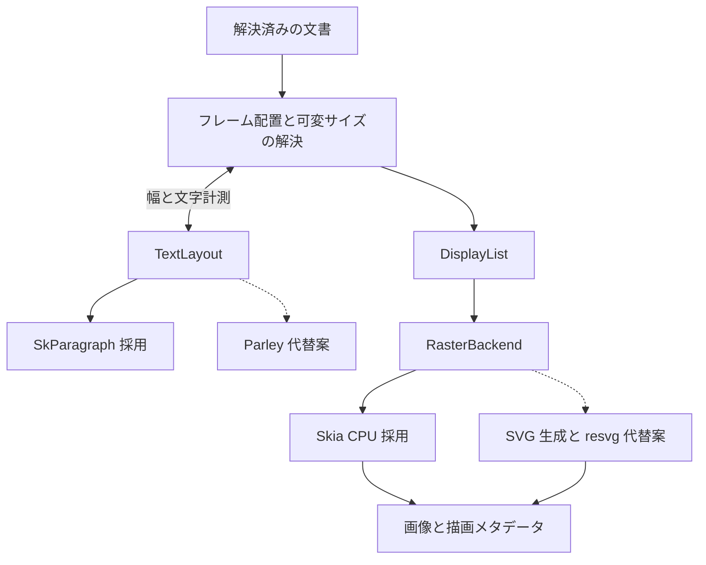

# lazypencil 描画バックエンド比較

確認日: 2026-10-23

状態: Rust と Skia CPU・SkParagraph を採用。JavaScript・Web ページ・GLSL の実行経路を追加。実行速度・メモリ使用量・配布サイズは未計測。

採用する構成は **Rust 本体と、`skia-safe` 経由の Skia CPU・SkParagraph** とする。既存 `.pen` の継続利用と新規作成をともに実現するため、文字・合成・エフェクトを実装する総コストを重視した選択である。**SVG と resvg に段落レイアウトを組み合わせる構成**は代替案として記録する。

初期検証は採用済みの Skia 系に集中し、画像の正確さ、初回描画、再描画、常用メモリ、配布の成立性を確認する。二つ目のバックエンドの実装・比較は必須にせず、採用構成で具体的な問題が判明した場合に再検討する。

JavaScript の生成結果は通常のレイアウトへ渡し、Web ページと GLSL の塗り・エフェクトは必要時に起動するヘッドレス Chromium で画像化して Skia に合成する。3機能とも初期リリースに含め、単一の 2D ライブラリで全実行環境を代替する前提にはしない。[動的コンテンツの実行](dynamic-content.md) に責務と受け入れ条件を定める。

## 比較の前提

### 分離する三つの処理

描画バックエンドを選んでも、`.pen` の文書レイアウト全体が自動で解決されるわけではない。次の責務を分ける。

| 層 | 責務 | 主な候補 |
| --- | --- | --- |
| 文書レイアウト | 参照・変数、親子関係、可変サイズ、配置、クリッピングの解釈 | lazypencil の共通エンジン |
| 文字の組版 | フォント選択、文字からグリフへの変換、行分割、幅・高さ・ベースライン | SkParagraph、Parley、COSMIC Text、Pango、Core Text |
| ラスター描画 | 図形・グリフ・画像・レイヤー・エフェクトからピクセルを生成 | Skia、resvg、tiny-skia、Vello CPU、Cairo、Core Graphics |

SkParagraph のような段落レイアウト機能も、`.pen` のフレーム配置やコンポーネント展開は処理しない。共通エンジンが段落の幅を渡し、計測結果を使って親のサイズを決める。可変サイズの解決には、文字の計測と文書レイアウトの相互作用がある。

### lazypencil で重視する条件

- GUI は必須にしない。通常の図形・文字はブラウザー・GPU なしで PNG を出力し、3機能は必要な実行環境を遅延起動して描画する。
- 日本語と英数字の混在、折り返し、行高、字間、フォントの代替を扱える。
- 複数の塗り、画像、角度グラデーション、影、ぼかし、合成へ拡張できる。
- 大きな文書でも、表示範囲と倍率を指定して描画できる。
- macOS・Windows・Linux で配布でき、同じフォント・設定で比較試験を行える。
- ライブラリ単体の小ささに加え、不足機能を補う実装と依存も含めて評価できる。

`.pen` には通常のぼかしだけでなく背景のぼかし、角度・メッシュのグラデーション、独自のシェーダーもある。これらをすべて一般的な SVG の塗りやフィルターへ単純変換できるとは扱わない。[Pencil の形式仕様](https://docs.pencil.dev/for-developers/the-pen-format)

## 候補の比較

以下の評価は、lazypencil の要件に対する設計上の判断である。「CPU 対応」「機能がある」は、Pencil と同じ画像になることを意味しない。

| 構成 | 文字の組版 | 合成とエフェクト | ビルドと配布 | 今回の位置付け |
| --- | --- | --- | --- | --- |
| Skia CPU と SkParagraph | 段落レイアウトを同じ系統で扱える | 影・ぼかし・ブレンド・角度グラデーションの API を利用可能 | C++ と Rust のビルド管理、またはプリビルドが必要 | 採用 |
| SVG と resvg、別途段落レイアウト | `.pen` の折り返しは別途解決 | SVG フィルターを使えるが、角度グラデーションや背景の扱いは追加処理 | Rust で構成できる | 必要時に再検討する代替案 |
| tiny-skia と COSMIC Text など | 別途組み合わせる | 基本図形・画像・合成は使える。不足する効果を自前で実装 | Rust で構成できる | 最小構成を重視する場合の代案 |
| Vello CPU と Parley | 別途組み合わせる | 現行資料にフィルターグラフとマルチスレッド時の制約がある | Rust で構成できる | 初期採用を見送り、継続評価 |
| Cairo と Pango | Pango を利用 | ぼかしなどの追加処理を含めて構成する必要がある | 複数のネイティブライブラリを管理 | 今回の優先度は低い |
| Core Graphics と Core Text | OS の組版機能を利用 | 必要に応じて追加の画像処理も構成する | Apple の描画環境に依存 | macOS 専用なら候補。共通実装には採用しない |

### Skia の CPU 描画と SkParagraph

Skia には画像メモリへ描く Raster Surface がある。ウィンドウや GPU コンテキストを必要とせず、PNG 用のピクセルを生成する構成にできる。Rust からは `skia-safe` を利用でき、同じバインディングでテキストの組版・段落レイアウトも扱える。[Raster Surface](https://api.skia.org/namespaceSkSurfaces.html)、[rust-skia の対応機能](https://github.com/rust-skia/rust-skia/blob/master/skia-safe/README.md)

Skia にはぼかし・ドロップシャドウなどの画像フィルターと、角度グラデーションに使える Sweep Gradient がある。この API の幅から、SVG に収まらない見た目を段階的に実装しやすいと判断する。[画像フィルター](https://api.skia.org/classSkImageFilters.html)、[グラデーション](https://api.skia.org/classSkGradientShader.html)

ただし、背景ぼかしは背後の描画を適切に取り出して合成する処理が必要であり、API を一つ呼ぶだけで `.pen` と一致するわけではない。内側の影、効果の順序、色空間、境界の広がりも lazypencil 側で定義して検証する。

主な負担はビルドと配布である。rust-skia はプリビルドの取得に対応する一方、利用できない構成では LLVM・Python・Ninja を使うソースビルドになる。Linux 向けプリビルドにもシステムライブラリの条件がある。[ビルドと対象プラットフォーム](https://github.com/rust-skia/rust-skia#platform-support-build-targets-and-prebuilt-binaries)

初期試作では CPU と段落レイアウトに機能を絞り、GPU・PDF・アニメーションなどを含めない。`skia-safe` の既定 feature には PDF なども含まれるため、既定値のまま評価しない。[feature 定義](https://github.com/rust-skia/rust-skia/blob/master/skia-safe/Cargo.toml)

Skia のビルド依存が多いことと、lazypencil 実行時のメモリが大きいことは別々に評価する。静的ライブラリの大きさから、使用時の RSS や起動時間を推定しない。

### SVG と resvg

resvg は静的 SVG を画像にする Rust のライブラリで、SVG の前処理を usvg、ラスター描画を tiny-skia と分けている。ブラウザーを起動せずに描画できる。標準の SVG で表現できる図形・画像・クリップ・効果では、SVG の仕組みを利用できる。[resvg の構成](https://github.com/linebender/resvg)

一方、`.pen` の段落レイアウトは別途必要である。確認時点の resvg の SVG 2 対応表では、`inline-size` や `shape-inside` は未対応とされている。`.pen` の幅と文字列を SVG の `<text>` に置くだけで、必要な折り返しを得られる前提にはしない。[SVG 2 の対応状況](https://github.com/linebender/resvg/blob/main/docs/svg2-changelog.md)

比較構成は、Parley などで段落を計測してから SVG へ出力する。確定したグリフを輪郭へ変換すれば、計測後に usvg が別のフォントや組版結果を選ぶ問題を避けられる。色付き絵文字など、単純な輪郭にできないグリフは別の画像・描画処理が必要になる。[Parley の文字処理](https://github.com/linebender/parley)

resvg はぼかし・影を含む SVG フィルターを実装している。したがって「resvg は影を描けない」という比較にはしない。[フィルター実装](https://github.com/linebender/resvg/blob/main/crates/resvg/src/filter/mod.rs)

追加負担になるのは、SVG への変換とその限界である。角度グラデーションは別途画像化などが必要になる。背景ぼかしは背後を別途描画して渡す処理を想定し、一つの SVG の要素に通常のぼかしを付けるだけで再現できるとはしない。SVG の文字列生成・解析も、描画時間とメモリに含める。

resvg の再現性という利点は、与えるフォント・アセット・変換結果が同じであることを前提に評価する。システムが選んだ別フォントによる差まで解消されるわけではない。

### tiny-skia と文字ライブラリ

tiny-skia は CPU 向けの最小限の 2D 描画ライブラリで、パス、塗り、線、クリップ、画像合成などを扱う。一方、文字描画は組み込まれていない。[tiny-skia の機能と対象外](https://github.com/linebender/tiny-skia)

COSMIC Text は文字の組版・レイアウト・フォールバック・描画を扱い、別の文字処理部分として組み合わせられる。ただし、ライブラリ同士が `.pen` の回転・グラデーション文字・クリッピング・効果を自動的につなぐわけではなく、合成部分を実装する必要がある。[COSMIC Text](https://github.com/pop-os/cosmic-text)

SVG 生成と解析を省けることは利点になる。一方、resvg が提供する効果の実装まで省けるため、ぼかし・内側の影・背景ぼかしなどを補う作業が増える。最小の図形描画だけではなく、必要な機能を補った完成構成のサイズと速度で比較すべきである。

初期対応を単純なワイヤーフレームに絞るなら有力だが、既存のデザインを使い続ける目的では、初期の実装負担が大きいと判断する。

### Vello CPU と Parley

Vello には CPU 版があり、GPU 必須として比較から外すのは不適切である。CPU 版は画像へ描画でき、文字の組版には Parley などを組み合わせられる。[Vello CPU](https://github.com/linebender/vello/tree/main/vello_cpu)

確認時点の資料には、複雑なフィルターグラフが未対応で panic になり、マルチスレッドでは単純なフィルターも未対応との記述がある。今回必要になる影・ぼかし・合成をそのまま全面的に任せられるとは判断しない。これは将来の固定版で改めて確認する制約である。

速度を調べる価値はあるが、必要な効果をすべて含めた構成を用意する前に、基本図形のベンチマークだけで採用を決めない。初期試作は Skia に集中し、Vello CPU は将来の再評価候補とする。

### Cairo と Pango

Cairo の簡易テキスト API は高度な文字処理向けではなく、公式資料も Pango などとの組み合わせを案内している。比較する場合は必ず Pango を含む構成にする。[Cairo の文字 API](https://www.cairographics.org/manual/cairo-text.html)

Pango は国際化された文字のレイアウトを扱うが、GObject・HarfBuzz なども依存として持つ。Cairo の図形描画に Pango の組版と必要な画像処理を加えると、複数のネイティブライブラリの配布管理が必要になる。[Pango の依存](https://docs.gtk.org/Pango/)

Linux のシステムパッケージを利用する構成には適するが、macOS を含む本体の配布を最初から統一する目的では、Skia に対する決定的な利点が少ないと判断する。

### Core Graphics と Core Text

Core Text は文字の組版とフォントを扱い、Core Graphics と組み合わせて描画する Apple の仕組みである。macOS に限定するなら、外部の描画エンジンの同梱を抑える案として比較できる。[Apple の Core Text 概要](https://developer.apple.com/library/archive/documentation/StringsTextFonts/Conceptual/CoreText_Programming/Overview/Overview.html)

ただし Linux では同じバックエンドを使えず、二つ目の描画・文字処理実装が必要になる。OS ごとの文字計測とピクセルの差も検証対象になるため、共通の初期バックエンドには選ばない。

## Skia の採用理由

既存文書を扱うと、段落レイアウトに加え、影・ぼかし・複数の塗り・ブレンドなどを段階的に実装する必要がある。Skia と SkParagraph は、そのための部品を一つの系統でそろえられる。lazypencil 側で補う機能の数を減らせる点を重視する。

一方、lazypencil は直接編集する GUI を提供しないため、初期段階で GPU による継続的な描画を必須にしない。CPU で表示領域を描画し、PNG・端末内プレビュー・MCP の画像返却へ同じピクセルを使う構成とする。

Skia だけで `.pen` の全機能を実行できるとは扱わない。WebGL シェーダーは専用の実行経路で対応し、SkSL へそのまま渡さない。メッシュなども定義と出力を比較して実装する。JavaScript・Web ページ・シェーダーを省略して互換性を満たしたとは判断しない。

SVG と resvg は、純 Rust の配布と SVG への変換を重視する場合の代替案になる。現時点では同梱しない。Skia の配布・実行資源に具体的な問題が判明した場合に、必要な再現性を保つ構成として比較する。

## 推奨する責務境界

`TextLayout` は段落の計測・行情報・ベースラインと、対応する描画用データを返す。フレームを計測したときの組版結果を描画にも使い、計測と描画で異なる文字ライブラリを無条件に組み合わせない。

`DisplayList` は、変換、クリップ、パス、画像、文字、レイヤーと合成・効果の順序を保持する。文字データは特定のバックエンドに結び付いた実装を許容し、すべての候補で同じ内部構造を強制しない。代わりに、幅・高さ・行分割などを共通の比較データとして取り出せるようにする。

`RasterBackend` は、領域・倍率・色空間と解決済みの描画内容から、画像と診断を返す。SVG は文書の正本や唯一の中間形式にはせず、resvg 用の出力経路として扱う。初期リリースに二つの本番バックエンドを常時同梱することは要求しない。

動的コンテンツの実行サービスは、この 2D バックエンドの比較とは別の責務を持つ。画像の取得時刻・入力・実行環境・依存ハッシュを管理し、Skia が生成結果を合成する。GLSL のソフトウェア実行を含む保証環境も検証する。

影や背景ぼかしでは、対象ノードの外側や背後も必要になる。表示領域だけを単純に切り出すと結果が変わるため、効果を計算する余白と背後の依存領域を含めて描く。領域を安全に限定できない場合は親フレーム全体を描き、最後に切り出す。

## 採用構成の検証

### 検証する構成と代替案

| 系統 | 構成 | 計測へ含めるもの |
| --- | --- | --- |
| A 採用構成 | 共通文書レイアウト、SkParagraph、Skia CPU | フォント読み込み、文字計測、全効果、ラスター描画、PNG |
| B 必要時の比較対象 | 共通文書レイアウト、Parley などの組版、SVG、usvg、resvg | 同じ処理に加え、グリフ変換・SVG 生成・解析・追加画像処理 |

描画バックエンド単体の比較では、先に確定した同じ座標・図形を与える。完成構成の比較では、それぞれの文字計測から画像生成までを計測し、文字処理の差を隠さない。同じ入力で作れない効果は未対応として記録し、その効果を省いた結果を「高速」と評価しない。

### フィクスチャ

| 種類 | 主な確認内容 |
| --- | --- |
| 日本語の段落 | 句読点・括弧・禁則、英数字との混在、幅変更、行高、字間 |
| フォントの境界 | 太さ、欠損文字の代替、合成文字、絵文字、利用可能なら可変フォント |
| レイアウト | 入れ子、可変幅・高さ、複数行の文字を含むコンポーネント |
| 合成 | 複数の塗り、半透明グループ、画像の切り出し、回転、角丸とクリップ |
| 効果 | 外側・内側の影、ぼかし、背景ぼかし、角度グラデーション、重なり順 |
| 領域描画 | 画面外から入る影、背景ぼかし、ズーム時の領域境界 |
| 文書規模 | 設計書の 1,000 ノードと、拡張時の傾向を見る 10,000 ノード |
| JavaScript | 生成ノード、入力・寸法・コードの変更、実行時間上限、生成物の扱い |
| Web ページ | ローカルページの JavaScript・フォント、サイズ・ズーム・スクロール、更新と取得失敗 |
| GLSL | 塗りとエフェクト、uniform・画像・背景・時刻、座標・色・アルファ、ソフトウェア実行 |

実際の `.pen` と、その意味を固定した小さな描画フィクスチャを両方使う。前者は製品としての互換性、後者はバックエンドや文字処理による差の切り分けに用いる。

### 測定方法

1. OS・CPU・メモリ・対象アーキテクチャ、ライブラリ版・feature・ビルド設定を固定する。採用試作では依存の版とコミットを記録する。
2. フォントファイル・アセットとそのハッシュ、フォント代替の優先順、色空間、画像寸法を固定する。
3. 1 倍・2 倍の解像度で、初回とキャッシュ利用時を別々に測定する。初回のシステムフォント走査も分離して記録する。
4. 読み込み、文字計測・レイアウト、描画、PNG エンコードを個別に測り、全体時間も記録する。
5. 通常時とピークの RSS、キャッシュ容量、配布バイナリと必要な共有ライブラリ・データの合計を測る。ビルド成果物の容量と配布容量を混同しない。
6. 反復実行の回数、中央値、p95 を記録する。TUI の比較では画像の端末転送時間を別に記録する。
7. 指定フォントで用意した Pencil の基準画像と比較し、行分割・座標・効果の差と、アンチエイリアスなどのピクセル差を分ける。
8. 動的コンテンツでは、ワーカー・Chromium の起動、ページ取得、シェーダーのコンパイルと実行、画像転送、最終合成を分けて測定する。通常文書とは別に追加プロセスを含む合計を記録する。

特定バックエンドのプロジェクトが公開している速度比やバイナリサイズは、そのビルドとテスト条件の値である。lazypencil の見積もり値へ直接転用しない。

### メモリの見方

RGBA の画像バッファは、概ね `width × height × 4` バイトを使う。1920 × 1080 では約 7.9 MiB、縦横を 2 倍にすると約 31.6 MiB になる。画像を複製する影・ぼかし・背景処理では、その複数枚分が追加され得る。この値は寸法からの計算であり、プロセス全体の使用量ではない。

したがって、バックエンドの名称だけで軽さを判断せず、描画領域、効果用バッファ、キャッシュの上限もそろえて比較する。Skia の機能を削っても無制限に大きな画像を描けば軽くならず、resvg でもフィルターの中間画像は必要になる。

### 検証結果の扱い

採用済みの Skia 系について、必要な見た目、設計書の性能目標、配布条件を検証する。性能目標は暫定値のため、緩和する場合は計測結果と変更理由を残す。

Skia の条件を満たせない場合は、まず feature、描画領域とキャッシュ、対象プラットフォーム、プリビルド生成を見直す。代替案への変更が必要になった場合に、代表的な既存文書と新規作成の両方で必要機能を満たすか、追加処理込みで比較する。

ボトルネックを記録し、実行構成と既定の上限を調整する。3機能は正式な対応対象として維持し、ブラウザーへの依存と必要なセットアップを明示する。描画の欠落を黙って許容しない。
