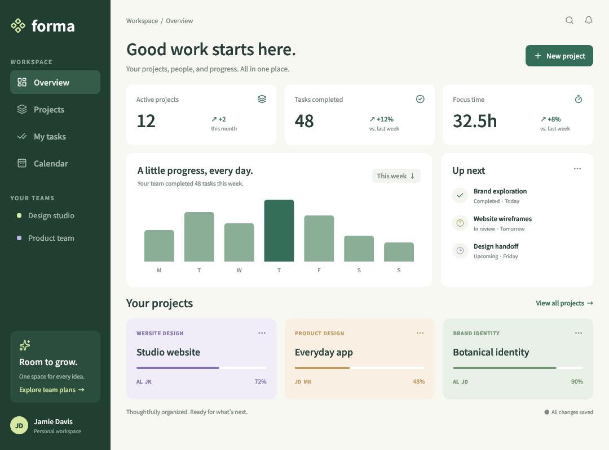
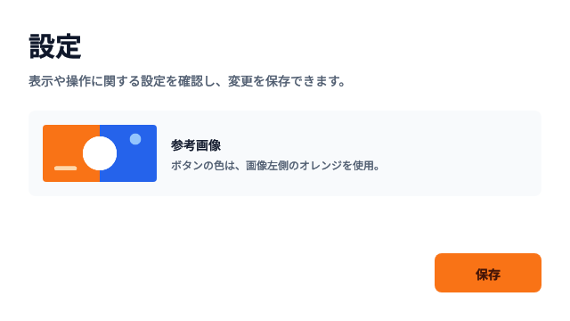
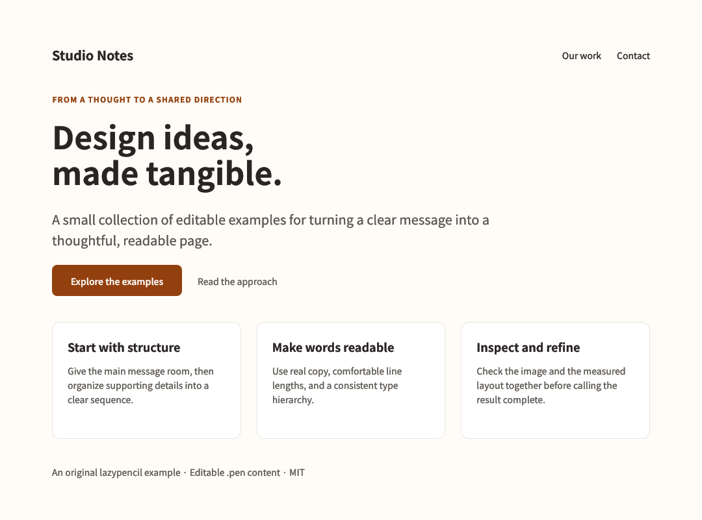

# Example gallery

Start with a finished screen, ask for a small change, then render the result.
These are editable `.pen` designs, not application implementations. The three
examples below render locally with bundled fonts and need no Chromium runtime.
AI editing uses your chosen client's authentication and usage allowance.

[Install and choose a workflow](../README.md#quick-start) ·
[日本語の導入ガイド](../docs/getting-started.ja.md)

## Get a working copy

To try just the dashboard, use `lazypencil demo` from a build that includes it.
For releases without `demo`, including 0.2.5, download the
[raw dashboard file](https://raw.githubusercontent.com/EkeMinusYou/lazypencil/main/examples/project-dashboard.pen)
as `demo.pen`. Neither route needs a repository checkout. Then run:

```sh
lazypencil render demo.pen --output demo.png
open demo.png
```

For all examples, download the repository ZIP using GitHub's **Code → Download
ZIP**, or clone it:

```sh
git clone https://github.com/EkeMinusYou/lazypencil.git
cd lazypencil
```

From the repository root, copy the examples to a new working directory before
editing. Choose an unused destination name so your earlier work stays separate:

```sh
cp -R examples my-examples
```

Keep the copied `assets` directory with the documents: the Japanese settings
screen references `assets/crop-source.png`. The dashboard and content page have
no external asset files.

The commands below run from the repository root against this working copy.
PNG export works without an AI connection or terminal image support. To edit
through MCP, [register your AI client](../README.md#use-lazypencil-from-your-ai-client),
then replace `/absolute/path/` in the prompts with the actual working-copy path.
For TUI chat, [configure an ACP adapter](../README.md#use-the-terminal-workspace).

## Project dashboard



[Editable source](project-dashboard.pen) · 1080 × 800

Use it to explore a small product's overview screen: navigation, summary metrics,
weekly progress, upcoming tasks and project cards. It is also the document bundled
with `demo`.

```sh
lazypencil render my-examples/project-dashboard.pen --output dashboard.png
lazypencil tui my-examples/project-dashboard.pen --agent codex
```

Try this prompt in the TUI:

```text
Change the project cards' accent colors to a blue palette and increase the spacing
between cards. Keep their content. Validate the layout and render the result.
```

Or ask your MCP client:

```text
Open /absolute/path/my-examples/project-dashboard.pen. Change the project cards'
accent colors to a blue palette and increase the spacing between cards. Keep
their content. Validate the layout and render the result.
```

## Japanese settings screen



[Editable source](agent-settings.pen) · [Required image](assets/crop-source.png) · 640 × 360

Use it to try Japanese typography, longer button labels and a local reference
image. Keep `assets/crop-source.png` beside the copied document in its `assets`
directory.

```sh
lazypencil render my-examples/agent-settings.pen --output settings.png
lazypencil tui my-examples/agent-settings.pen --agent codex
```

Try this prompt in the TUI:

```text
保存ボタンの文言を「変更を保存」にし、横幅を広げてください。
参考画像と説明文は維持し、レイアウトを検証して描画結果を確認してください。
```

For MCP, start with `Open /absolute/path/my-examples/agent-settings.pen`, then
append the same request.

## Content page



[Editable source](content-page.pen) · 1080 × 801

Use it to compare heading hierarchy, text spacing and a reusable page palette
before implementing a content or product page.

```sh
lazypencil render my-examples/content-page.pen --output content.png
lazypencil tui my-examples/content-page.pen --agent codex
```

Try this prompt in the TUI:

```text
Increase the contrast in size between the main heading and body text. Give the
feature cards more breathing room while preserving all content. Validate the
layout and render the result.
```

For MCP, start with `Open /absolute/path/my-examples/content-page.pen`, then
append the same request.

## Export and continue

Use `--agent claude` instead of `--agent codex` if you configured Claude. After
editing, repeat the document's `render` command to export its current state as a
PNG. The `.pen` file remains editable; AI-generated code is a separate next step
you can request from your coding agent.

For more technical examples, explore `standard-ui.pen`, `icon-families.pen` and
`graphics-study.pen`. Browser nodes and GLSL examples need the optional
[Chromium runtime](../docs/runtimes.md); see [format limits](../README.md#format-support)
before opening documents from other editors.

## Update these previews

The gallery images are PNG exports of the checked-in documents. After changing
a featured document, regenerate its corresponding image from the repository root:

```sh
lazypencil render examples/project-dashboard.pen --output docs/images/examples/project-dashboard.png
lazypencil render examples/agent-settings.pen --output docs/images/examples/agent-settings.png
lazypencil render examples/content-page.pen --output docs/images/examples/content-page.png
```

The dashboard is also embedded in the executable for `demo`; rebuild lazypencil
after changing it to update the bundled copy.
